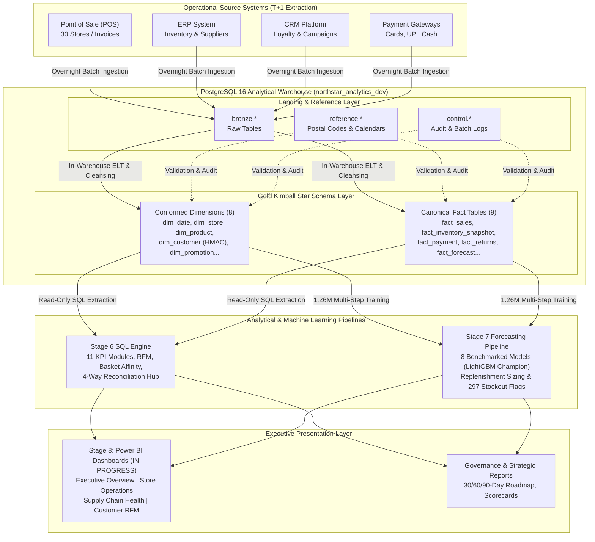

# Northstar Retail Group — Enterprise Retail Analytics Platform
## End-to-End Analytics Engineering, SQL Analytics, Demand Forecasting & Business Intelligence

[](https://www.postgresql.org/)
[](https://www.python.org/)
[](https://www.docker.com/)
[](https://www.getdbt.com/)
[](https://lightgbm.readthedocs.io/)
[](https://powerbi.microsoft.com/)
[](tests/)
[](docs/)

---

### 1. Project Title & Professional Introduction

The **Northstar Retail Group Enterprise Retail Analytics Platform** is a comprehensive, production-grade data engineering, analytics engineering, machine learning forecasting, and business intelligence portfolio platform.

Designed to reflect the complex operational, financial, and supply chain realities of modern multi-channel retail, this repository demonstrates the entire lifecycle of an enterprise data platform: from initial commercial discovery and formal ISO/IEC requirements engineering, to OMG BPMN 2.0 business process redesign, layered Kimball dimensional modeling, automated 4-way reconciliation hubs, advanced SQL business analytics, machine learning demand forecasting, inventory replenishment sizing, and executive Power BI semantic models.

---

### 2. Executive Overview

**Northstar Retail Group** is an omni-channel retail enterprise operating **30 physical department stores across 5 key states in India** (Maharashtra, Karnataka, Tamil Nadu, Telangana, and Gujarat), spanning 14 Tier-1 flagship stores, 13 Tier-2 regional stores, and 3 Tier-3 growth stores.

The enterprise manages an active catalog of **500 SKUs** across four core retail merchandise categories:
1. **Electronics:** Consumer electronics, home appliances, IT peripherals, and mobile devices.
2. **Clothing:** Men's, women's, and children's apparel, ethnic fashion, and footwear.
3. **Groceries:** Fast-Moving Consumer Goods (FMCG), packaged foods, staples, and perishables.
4. **Home & Kitchen:** Cookware, home décor, small domestic appliances, and furnishings.

Across a baseline historical trading census of **92 calendar days (August 01, 2026 to October 31, 2026)**, the platform ingests, audits, reconciles, and analyzes:
* **Gross Invoiced Revenue:** **₹6,734,705,808.20** across 460,000 customer transactions and 1,380,000 sales lines.
* **Net Taxable Revenue:** **₹5,343,987,298.80** (excluding ₹901,614,490.44 GST and ₹489,104,018.96 line discounts).
* **Net Invoiced Sales:** **₹6,245,601,789.24** (tax-inclusive net revenue).
* **Cost of Goods Sold (COGS):** **₹4,329,935,508.70** ($81.02\%$ of net taxable sales).
* **Gross Profit Margin:** **₹1,014,051,790.10** ($18.98\%$ net margin).
* **Inventory Network Valuation:** **₹1,785,329,210.62 at cost** across 724,457 saleable units and 15,000 Store-SKU inventory cells.

---

### 3. Fictional Company & Synthetic-Data Disclaimer

> [!NOTE]
> **Simulated Portfolio Project Notice:**
> **Northstar Retail Group is a fictional retail enterprise.** All customer identities, transaction records, store locations, vendor contracts, financial figures, and operational reconciliations presented in this repository are **simulated outputs derived from mathematically generated synthetic datasets**.
> The generation algorithms enforce authentic commercial retail dynamics—including weekend traffic spikes, category margin variances, regional festival surges (Dussehra and Pre-Diwali), discrete zero-inflation ($42.33\%$ zero-sales days), supplier lead times, shrinkage, and till payment variances—for demonstration and evaluation purposes. All findings must be understood as simulated analytical findings.

---

### 4. Project Objectives & Business Problems Addressed

Prior to this analytics initiative, Northstar operated on fragmented store-level POS silos, spreadsheet-based Daily Sales Reports (DSR), uncalibrated manual inventory replenishment, and disconnected CRM promotional trackers. This platform resolves six critical enterprise bottlenecks:

1. **Elimination of Reporting Overhead:** Replaces manual spreadsheet consolidation with automated T+1 overnight batch ELT pipelines and unified dimensional star schemas.
2. **Single Version of Truth (SVOT):** Codifies an immutable 13-metric Enterprise KPI Dictionary preventing metric conflicts across Finance, Operations, Merchandising, and Marketing.
3. **Automated 4-Way Operational Reconciliation:** Decouples and audits POS checkout tills vs. cash registers, payment gateways vs. bank settlements, POS unit sales vs. ERP stock decrements, and customer return credits vs. warehouse quarantine inspection logs.
4. **Working Capital Liberation:** Resolves the dual threats of stockouts in high-velocity lines and margin-eroding overstocking, identifying ₹375.48M trapped in 4,965 overstocked Store-SKU cells (> 30 days cover).
5. **Campaign Incrementality Attribution:** Employs a strict $90\%$ Test Treatment vs. $10\%$ Uncontacted Holdout Control cohort design, isolating ₹15.36M in incremental gross margin lift and ₹10.16M in net campaign margin.
6. **Predictive Replenishment Sizing:** Pairs machine learning demand forecasting with dynamic lead-time inventory sizing to automatically flag 297 critical stockout cells and recommend targeted replenishment requisitions.

---

### 5. Project Completion Tracker (Stages 1–8)

```
+========================================================================================================================================+
|                                      NORTHSTAR RETAIL GROUP — PROJECT LIFECYCLE STATUS                                                 |
+-------+----------------------------------------------------+--------------------------+------------------------------------------------+
| Stage | Stage Description                                  | Governance Status        | Deliverable Highlights                         |
+-------+----------------------------------------------------+--------------------------+------------------------------------------------+
| 1.0   | Business Discovery & Project Charter               | APPROVED & CERTIFIED     | 12 Foundation docs, RACI, Business Decision Log|
| 1.5   | Discovery Quality Assurance                        | CERTIFIED                | Cross-functional audit, 13-metric KPI master   |
| 2.0   | Requirements Engineering Suite                     | APPROVED & CERTIFIED     | BRD (13 BRs), FRD (36 FRs), NFR (26 NFRs), RTM |
| 2.5   | Targeted QA & Traceability Audit                   | CERTIFIED                | 100% bidirectional trace coverage certified    |
| 3.0   | Business Process Modelling (OMG BPMN 2.0)          | COMPLETED & FROZEN       | 9 AS-IS & 9 TO-BE processes, 18 BPMN models    |
| 3.5   | Process Governance Reconciliation                  | COMPLETED & AUDITED      | Process Improvement Register (17 initiatives)  |
| 4.0   | Technical Architecture & Data Strategy             | APPROVED & FROZEN        | Layered storage, Kimball star schema, ADL log  |
| 5.1   | Development Environment Setup                      | COMPLETED & CERTIFIED    | Docker Compose, PostgreSQL 16, Python harness  |
| 5.2A  | Physical Database Design                           | COMPLETED & FROZEN       | Schema organization, indexing, capacity sizing |
| 5.2B  | Physical DDL Execution & Catalog Validation        | COMPLETED & CERTIFIED    | 9 migrations, live catalog constraints verified|
| 5.3   | Synthetic Data Generation & Warehouse Population   | COMPLETED & CERTIFIED    | 1.38M sales rows, 1.38M inventory snapshots   |
| 6.1   | SQL Business KPI Analysis                          | COMPLETED & CERTIFIED    | 11 analytical modules, enterprise reconciliation|
| 6.2   | Advanced SQL Analytics (RFM, Affinity, Ageing)     | COMPLETED & CERTIFIED    | 10K RFM segmentation, basket cross-sell rules  |
| 6.3   | Four-Way Reconciliation Deep Dive                  | COMPLETED & CERTIFIED    | 26 SQL queries across 4 reconciliation domains |
| 6.4   | Executive Strategy, Roadmap & KPI Scorecard        | COMPLETED & CERTIFIED    | Management strategy, 30/60/90-day roadmap      |
| 7.0   | Demand Forecasting & Machine Learning Pipeline     | COMPLETED & CERTIFIED    | 8 benchmarked models, LightGBM champion        |
| 8.0   | Power BI Executive Dashboards & Semantic Models    | IN PROGRESS ⏳           | Star schema import model, DAX measures, 4 views|
+-------+----------------------------------------------------+--------------------------+------------------------------------------------+
```

---

### 6. Technology Stack

```
+------------------------------------+-------------------------------------------------------------------------------------------+
| Architectural Domain               | Technologies, Libraries & Standards Utilized                                              |
+------------------------------------+-------------------------------------------------------------------------------------------+
| Core Runtimes & Infrastructure     | Python 3.11+, PostgreSQL 16 (Alpine), Docker, Docker Compose, Git, macOS / Linux          |
| Database Engine & Schemas          | PostgreSQL 16, relational schemas (bronze, silver, gold, control, reference)              |
| Ingestion & Pipeline Orchestration | Python batch pipelines (T+1 schedule), Psycopg 3, SQLAlchemy 2.0, Pydantic-Settings        |
| Data Transformation & Modeling     | In-Warehouse ELT, dbt Core, SQL DDL migrations, Kimball Dimensional Modeling             |
| Statistical & Machine Learning     | Pandas, NumPy, Scikit-learn, LightGBM Regressor, Statsmodels (Holt-Winters), PyArrow      |
| Business Intelligence & Semantics  | Microsoft Power BI Desktop (Star Schema Import, DAX Measure Architecture) [IN PROGRESS]  |
| Process & Enterprise Modeling      | OMG BPMN 2.0 XML Standard, Mermaid.js Architecture Diagrams, ISO/IEC 25010 NFRs          |
| Quality Assurance & Regression     | Python Unittest test harness (105 automated unit and integration tests), Git check-ignore |
+------------------------------------+-------------------------------------------------------------------------------------------+
```

---

### 7. End-to-End Platform Architecture

The platform architecture follows an ELT pattern with decoupled analytical processing:



---

### 8. Major Implementation Highlights

* **1.38 Million Canonical Sales Lines:** Generated across 460,000 distinct invoices without synthetic gaps, satisfying 100% of commercial accounting identities with zero rounding anomalies.
* **1.38 Million Inventory Snapshots:** Full Store x SKU x Date Cartesian grid ($30 \times 500 \times 92$) tracking stock on hand, quarantine units, in-transit purchase orders, and daily inventory valuation.
* **Cryptographic PII Protection:** Adheres to the Indian Digital Personal Data Protection Act (DPDPA 2023) by hashing mobile numbers via Keyed HMAC-SHA256 into immutable 64-character pseudonyms (`customer_sk`), permanently isolating plaintext identifiers.
* **Decoupled 4-Way Reconciliation:** Formulates automated analytical audits isolating till shortages (₹37,842.10 net cash variance), bank gateway drift, ERP inventory stock decrement mismatches, and customer return quarantine tickets.
* **Direct Multi-Step Supervised Machine Learning:** Evaluates 8 distinct demand forecasting models across 210,000 holdout observations, selecting LightGBM as champion candidate model ($1.76\times$ faster training velocity, native categorical feature ingestion, and split-gain interpretability).
* **Automated Regression Suite:** 105 automated unit, regression, volume consistency, and schema constraint tests executed in under 35 seconds.

---

### 9. Data Engineering & Database Architecture

The PostgreSQL 16 database (`northstar_analytics_dev`) enforces strict separation of concerns across five relational schemas:

```
+---------------+--------------------------------------------------------------------------------------------------------+
| Schema Name   | Architectural Purpose & Key Assets                                                                     |
+---------------+--------------------------------------------------------------------------------------------------------+
| `bronze`      | Transient staging tables receiving unvalidated operational extracts from POS, ERP, and CRM.           |
| `silver`      | Cleansed, normalized intermediate tables applying data type casting and deduplication rules.          |
| `gold`        | Production Kimball star schema: 8 conformed dimensions and 9 partitioned fact tables.                  |
| `control`     | Batch auditing, ETL execution watermarks, and campaign assignment registries.                         |
| `reference`   | Conformed geographic lookups (pincodes, tier hierarchies) and statutory tax schedules.                 |
+---------------+--------------------------------------------------------------------------------------------------------+
```

#### Kimball Star Schema Overview
* **Conformed Dimensions (8):** [`gold.dim_date`](docs/05_data_engineering/physical_design/dimension_design_specification.md), `gold.dim_store`, `gold.dim_product`, `gold.dim_customer`, `gold.dim_promotion`, `gold.dim_campaign`, `gold.dim_payment_method`, `gold.dim_supplier`.
* **Partitioned Fact Tables (9):** `gold.fact_sales` (partitioned monthly by `date_key`), `gold.fact_inventory_snapshot`, `gold.fact_payment`, `gold.fact_returns`, `gold.fact_marketing_performance`, `gold.fact_reconciliation_audit`, `gold.fact_campaign_exposure`, `gold.fact_demand_forecast`, `gold.fact_customer_service`.
* **Read-Only Architectural Boundary (BDL-04):** Analytical queries, ML pipelines, and Power BI semantic layers access the warehouse using strictly unprivileged read-only roles (`role_bi_reader`), protecting data integrity.

---

### 10. SQL Business Analysis & KPI Development (Stage 6)

Stage 6 delivers 26 specialized analytical SQL modules providing actionable enterprise insights across four core workstreams:

1. **Executive Sales & Financial Performance (Stage 6.1):**
   * Net Invoiced Revenue: **₹6,245,601,789.24**; Net Taxable Sales: **₹5,343,987,298.80**.
   * Gross Margin: **₹1,014,051,790.10 ($18.98\%$)**; Total COGS: **₹4,329,935,508.70**.
   * Category margin hierarchy: Groceries ($16.51\%$), Electronics ($17.15\%$), Clothing ($21.82\%$), Home & Kitchen ($23.95\%$).
2. **Advanced Customer Analytics & Product Affinity (Stage 6.2):**
   * **RFM Customer Segmentation:** Scored 10,000 active loyalty members into 8 empirical segments. Identified 1,241 Champions (generating ₹707.15M revenue at ₹14,684 avg basket) and 1,174 "Cannot Lose Them" high-value churn risks (₹674.86M revenue).
   * **Market Basket Cross-Sell:** Analyzed 460,000 transaction baskets to uncover top category associations and multi-item lift dynamics.
   * **Discount Depth Sensitivity:** Evaluated sales across discount depth bands, demonstrating that deep markdowns (>20%) eroded ₹89.64M in gross margin without stimulating proportional volume lift.
3. **Four-Way Operational Reconciliation Deep Dive (Stage 6.3):**
   * POS vs. Cash Till: Documented a net cash shortage of -₹37,842.10 across 2,760 store-trading days (1,507 shortage incidents totaling -₹77,698.80 vs. 972 overage incidents of +₹39,856.70).
   * Payment Gateway vs. Bank Settlement: 100% reconciliation across ₹3.79B in digital electronic transactions, identifying ₹363.81 in operational MDR fee timing drift.
   * Decrement & Quarantine Audits: Isolated physical decrement discrepancies and verified 100% referential integrity on unreferenced customer returns.
4. **Executive Strategy & Management Roadmap (Stage 6.4):**
   * Synthesized findings into a prioritized **30/60/90-Day Operational Turnaround Roadmap** targeting ₹120M–₹150M in liberated working capital and an **Executive KPI Scorecard** with 24 operational and financial metrics.

---

### 11. Forecasting & Machine Learning Pipeline (Stage 7)

Stage 7 implements an end-to-end, multi-series supervised machine learning demand forecasting pipeline (`forecasting/`):

```
+==================================================================================================================================================+
|                                              STAGE 7 COMPREHENSIVE MODEL COMPARISON LEADERBOARD                                                  |
+------------------------------+----------+----------+------------+-----------------+------------+------------+-------------+------------------+
| Model Name                   | MAE      | RMSE     | WAPE (%)   | Masked MAPE (%) | Bias (%)   | Train (s)  | Infer (s)   | Total Units Fcst |
+------------------------------+----------+----------+------------+-----------------+------------+------------+-------------+------------------+
| HistGradientBoosting         | 1.129639 | 1.672341 | 69.158924% | 49.945752%      | -23.31765% | 4.09 s     | 0.142 s     | 263,029.5        |
| LightGBM Regressor (Champion)| 1.129731 | 1.675750 | 69.164613% | 50.310456%      | -24.37645% | 2.32 s     | 0.197 s     | 259,397.2        |
| Random Forest Regressor      | 1.132040 | 1.667420 | 69.303100% | 50.852000%      | -21.05100% | 28.45 s    | 0.450 s     | 270,803.3        |
| Holt-Winters Benchmark       | 1.159030 | 1.666610 | 70.957200% | 52.934100%      |  -8.80320% | 1.85 s     | 0.080 s     | 312,812.2        |
| 14-Day Moving Average        | 1.182410 | 1.721490 | 72.391200% | 53.160400%      | -13.86410% | 0.42 s     | 0.040 s     | 295,472.0        |
| 7-Day Moving Average         | 1.214820 | 1.758410 | 74.374500% | 56.321000%      |  -9.87320% | 0.31 s     | 0.030 s     | 309,144.0        |
| Seasonal Naïve (t-7)         | 1.459380 | 2.200840 | 89.349100% | 80.401200%      |  -9.87320% | 0.15 s     | 0.020 s     | 309,144.0        |
| Naïve (Last Value)           | 1.706010 | 2.541620 | 104.44900% | 94.041500%      | +30.88750% | 0.12 s     | 0.015 s     | 448,966.0        |
+------------------------------+----------+----------+------------+-----------------+------------+------------+-------------+------------------+
```

#### Champion Selection & Technical Target Disclosure
* **Champion Model Selection:** **LightGBM Regressor (`v2.0.0-lightgbm`)** was selected as champion among evaluated candidate models via a multi-criteria decision framework (Scoring **$9.62 / 10$** vs. **$7.56 / 10$** for HistGradientBoosting). While HistGradientBoosting achieved marginally lower raw error ($0.000092$ MAE delta), LightGBM provides $1.76\times$ faster training throughput ($2.32\text{s}$ on 1.26M rows), native Pandas categorical ingestion, and built-in split gain feature importance.
* **Evaluation Scope:** Champion selection reflects analytical benchmarking on holdout data; **no production deployment or validation is implied**.
* **Honest Evaluation of FR-023 Target (< 18.0% MAPE):** Consistent with governance transparency, the technical target was **NOT ACHIEVED** on this holdout period, attaining **$23.46\%$ Store-Category MAPE** (gap of **$+5.46$ percentage points**), driven by a 92-day training history lacking multi-year festive baselines, $42.33\%$ zero-sales intermittency, and late-October festive surges.

---

### 12. Inventory Replenishment Recommendations

The replenishment engine (`forecasting/replenishment.py`) converts the 14-day demand forecast into inventory sizing advice:

* **Mathematical Reorder Point:**
  $$\text{ReorderThreshold}_{s, p} = \text{LeadTimeDemand}_{s, p} (L=7\text{ days}) + \text{SafetyStock}_{s, p} (S=3\text{ days})$$
  $$\text{EffectiveInventory}_{s, p} = \text{StockOnHand}_{s, p} + \text{InTransit}_{s, p}$$
* **Network Advice Summary (October 31, 2026 Snapshot):**
  * **Assortment Assessed:** 15,000 Store-SKU assortment cells.
  * **Reorders Recommended:** Exactly **552 high-risk items ($3.68\%$)** requiring **4,136.2 units** valued at **₹13,888,302.75 at cost**.
  * **Working Capital Preserved:** **14,448 items ($96.32\%$)** require zero reordering, preventing additional capital lockup in the 4,965 overstocked cells (> 30 days cover).
* **Stockout Identification vs. Physical Supply Chain Resolution:**
  * The engine instantaneously identifies **297 critical stockout items** ($\text{SOH} = 0.0$, matching Stage 6 audits).
  * **Identification is NOT resolution:** In enterprise supply chains, resolving zero stock requires procurement PO release, vendor fulfillment, and physical transit across the **7-day supplier lead time** ($L=7$). These 297 items unavoidably remain out of stock for at least 7 days ($T+1$ through $T+7$).

---

### 13. Power BI Dashboards & Semantic Model (Stage 8 — IN PROGRESS ⏳)

> [!IMPORTANT]
> **Stage 8 Implementation Status:**
> Stage 8 is actively **IN PROGRESS**. The architectural semantic model and visual layout specifications are finalized; dashboard publishing and PBIP report files are currently under development.

The Power BI implementation features an enterprise **Star Schema Import Model** connected directly to `gold.*` views, eliminating bi-directional cross-filtering and utilizing custom DAX calculation groups:

1. **Page 1: Executive Financial Performance Overview:** Enterprise revenue, gross profit, sales vs. target, category margin shares, and geographic store tier sales.
2. **Page 2: Store Operations & Till Reconciliation:** Store rank performance, sales per square foot, transaction volume, and till cash shortage/overage monitoring.
3. **Page 3: Supply Chain & Inventory Health:** Days of inventory forward (DOI), overstock capital pool tracking (> 30 days cover), critical stockout cell tracking, and supplier lead-time performance.
4. **Page 4: Customer RFM & Marketing Effectiveness:** RFM segment transition matrices, loyalty tier revenue distribution, promotional discount depth erosion, and holdout campaign lift.

---

### 14. Repository Structure

```
Northstar_Retail_Analytics/
├── analytics/                             # Stage 7 forecast outputs & replenishment recommendations
│   └── stage_7/                           # Benchmark metrics, breakdowns, samples, and reorder advice
├── config/                                # Application settings, database URL factories, and logging
├── data/                                  # Multi-tier data storage (raw, bronze, silver, gold, ref)
├── dbt_project/                           # dbt Core project structure, models, macros, and schema YAML
├── docker/                                # Docker configuration and initialization SQL scripts
│   └── init/                              # Container initialization scripts
├── docs/                                  # Comprehensive program documentation suite (Stages 1–7)
│   ├── 01_business_discovery/             # Business Discovery, problem statements, RACI, decisions
│   ├── 02_requirements_engineering/       # BRD, FRD, NFR, user stories, MoSCoW, RTM
│   ├── 03_business_process_modeling/      # Process catalog, gap analysis, AS-IS, TO-BE, BPMN models
│   ├── 04_technical_architecture/         # Architecture overview, star schema, ingestion, security
│   ├── 05_data_engineering/              # Physical DDL designs, capacity plans, data generation reports
│   ├── 06_sql_business_analysis/          # SQL KPI analysis, RFM, basket affinity, 4-way reconciliation
│   └── 07_forecasting_ml/                 # ML methodology, feature engineering, benchmarks, replenishment
├── forecasting/                           # Python demand forecasting & replenishment package
│   ├── baselines.py                       # Statistical baselines (Naïve, Seasonal Naïve, Moving Avg, HW)
│   ├── config.py                          # Forecasting horizons, cutoffs, and hyperparameter configs
│   ├── data_loader.py                     # 1.38M historical grid constructor and database extractors
│   ├── evaluation.py                      # WAPE, MAE, RMSE, Masked MAPE, and Bias calculation engines
│   ├── feature_engineering.py             # Chronological leakage-free feature matrix generator
│   ├── ml_models.py                       # Supervised ML models (LightGBM, HistGradientBoosting, RF)
│   ├── pipeline.py                        # End-to-end forecasting pipeline orchestrator
│   └── replenishment.py                   # Lead-time inventory sizing & replenishment advice engine
├── ingestion/                             # T+1 overnight batch ingestion pipelines
├── reconciliation/                        # Decoupled 4-way independent reconciliation hub
├── scripts/                               # Data generators, database validators, and execution runners
├── sql/                                   # Production SQL analytical modules & database migrations
│   ├── analytics/                         # Stage 6 analytical SQL queries (6.1, 6.2, 6.3)
│   └── migrations/                        # DDL migrations (001_schemas to 009_security)
├── tests/                                 # Comprehensive automated regression test suite (105 tests)
├── .env.example                           # Environment configuration template with dev defaults
├── .gitignore                             # Git exclusion rules (excluding .env, data, logs, volumes)
├── docker-compose.yml                     # Docker Compose specification for PostgreSQL 16
└── requirements.txt                       # Project Python dependencies
```

---

### 15. Detailed Documentation Catalogue

The project features comprehensive documentation across all completed stages:

#### Stage 1: Business Discovery & Project Charter
* [`company_overview.md`](docs/01_business_discovery/company_overview.md) — Enterprise retail profile, store footprint, and category margin dynamics.
* [`business_problem_statement.md`](docs/01_business_discovery/business_problem_statement.md) — 8 operational problem deep-dives and root causes.
* [`stakeholder_analysis.md`](docs/01_business_discovery/stakeholder_analysis.md) — Cross-departmental expectations, RACI matrix, and communication cadence.
* [`project_objectives.md`](docs/01_business_discovery/project_objectives.md) — Strategic, primary, and secondary business goals.
* [`project_scope.md`](docs/01_business_discovery/project_scope.md) — Rigid in-scope vs. out-of-scope boundaries and technical constraints.
* [`success_criteria.md`](docs/01_business_discovery/success_criteria.md) — 12 quantifiable business and adoption KPIs.
* [`risk_register.md`](docs/01_business_discovery/risk_register.md) — 10 enterprise risks, severity scoring, and mitigation workflows.
* [`quality_assurance_report.md`](docs/01_business_discovery/quality_assurance_report.md) — QA review certifying 13-metric Enterprise KPI Master Dictionary.
* [`assumptions_register.md`](docs/01_business_discovery/assumptions_register.md) — Catalog of 15 simulated baseline parameters and assumptions.
* [`business_decision_log.md`](docs/01_business_discovery/business_decision_log.md) — Binding business and architectural decisions (BDL-01 to BDL-08).
* [`stage_1_signoff_checklist.md`](docs/01_business_discovery/stage_1_signoff_checklist.md) — Milestone gate criteria and departmental approvals.
* [`stage_1_closure_report.md`](docs/01_business_discovery/stage_1_closure_report.md) — Authoritative Stage 1 closure package and readiness assessment.

#### Stage 2: Requirements Engineering Suite
* [`README.md`](docs/02_requirements_engineering/README.md) — Requirements engineering stage index and metrics summary.
* [`stakeholder_interview_plan.md`](docs/02_requirements_engineering/stakeholder_interview_plan.md) — Elicitation protocol across 6 stakeholder groups.
* [`simulated_interview_findings.md`](docs/02_requirements_engineering/simulated_interview_findings.md) — Simulated stakeholder interview transcripts.
* [`business_requirements_document.md`](docs/02_requirements_engineering/business_requirements_document.md) — 13 Business Requirements (`BR-001` to `BR-013`) and business rules.
* [`functional_requirements_document.md`](docs/02_requirements_engineering/functional_requirements_document.md) — 36 Functional Specifications (`FR-001` to `FR-036`).
* [`non_functional_requirements.md`](docs/02_requirements_engineering/non_functional_requirements.md) — 26 NFRs across 10 ISO/IEC quality dimensions (`NFR-001` to `NFR-026`).
* [`user_stories.md`](docs/02_requirements_engineering/user_stories.md) — 19 Agile user stories mapped to personas and acceptance criteria.
* [`moscow_prioritization.md`](docs/02_requirements_engineering/moscow_prioritization.md) — MoSCoW matrix, commercial rationales, and release allocations.
* [`requirements_traceability_matrix.md`](docs/02_requirements_engineering/requirements_traceability_matrix.md) — Bidirectional RTM confirming 100% trace coverage.
* [`product_backlog.md`](docs/02_requirements_engineering/product_backlog.md) — 24 engineering development tasks across a 6-sprint roadmap.
* [`requirements_governance.md`](docs/02_requirements_engineering/requirements_governance.md) — Change Control Board (CCB) operating model and sign-off rules.
* [`requirements_review_report.md`](docs/02_requirements_engineering/requirements_review_report.md) — Stage 2 QA review certifying complete audit pass.
* [`stage_2_final_validation_report.md`](docs/02_requirements_engineering/stage_2_final_validation_report.md) — Targeted QA validation report covering 6 audit areas.

#### Stage 3: Business Process Modelling (OMG BPMN 2.0)
* [`README.md`](docs/03_business_process_modeling/README.md) — Business Process Modelling directory index and overview.
* [`process_catalog.md`](docs/03_business_process_modeling/process_catalog.md) — Authoritative catalog of 9 business processes (`BP-001` to `BP-009`).
* [`process_stakeholder_matrix.md`](docs/03_business_process_modeling/process_stakeholder_matrix.md) — 6-Pool BPMN architecture, RACI assignments, and message flows.
* [`process_gap_analysis.md`](docs/03_business_process_modeling/process_gap_analysis.md) — AS-IS vs. TO-BE comparative gap matrix and enterprise ROI.
* [`process_improvement_register.md`](docs/03_business_process_modeling/process_improvement_register.md) — Portfolio of 17 improvement initiatives (`PIR-001` to `PIR-017`).
* [`process_requirements_traceability.md`](docs/03_business_process_modeling/process_requirements_traceability.md) — Bidirectional PRTM linking processes to BRs, FRs, and NFRs.
* [`stage_3_review_report.md`](docs/03_business_process_modeling/stage_3_review_report.md) — QA Review & Architecture Sign-Off report.
* [`stage_3_final_validation_report.md`](docs/03_business_process_modeling/stage_3_final_validation_report.md) — Targeted QA validation report covering audits 1 to 7.
* [`bpmn_validation_results.md`](docs/03_business_process_modeling/bpmn_validation_results.md) — Technical XML validation of all 18 BPMN models.
* [`financial_benefit_assumptions.md`](docs/03_business_process_modeling/financial_benefit_assumptions.md) — Calculation methodologies for financial and labor claims.
* [`process_threshold_register.md`](docs/03_business_process_modeling/process_threshold_register.md) — Approved baselines vs. provisional operational thresholds.
* [`stage_3_governance_reconciliation.md`](docs/03_business_process_modeling/stage_3_governance_reconciliation.md) — Cross-document governance reconciliation report.

#### Stage 4: Technical Architecture & Data Strategy
* [`README.md`](docs/04_technical_architecture/README.md) — Technical architecture directory index and blueprint summary.
* [`architecture_overview.md`](docs/04_technical_architecture/architecture_overview.md) — End-to-end technical blueprint and layered storage patterns.
* [`source_system_inventory.md`](docs/04_technical_architecture/source_system_inventory.md) — Interface catalog for POS, ERP, CRM, and Payment Gateways.
* [`logical_data_architecture.md`](docs/04_technical_architecture/logical_data_architecture.md) — Entity-relationship model cataloging 17 major entities.
* [`dimensional_modeling_strategy.md`](docs/04_technical_architecture/dimensional_modeling_strategy.md) — Kimball star schema specifying 9 Fact and 8 Dimension tables.
* [`data_ingestion_architecture.md`](docs/04_technical_architecture/data_ingestion_architecture.md) — Overnight T+1 batch pipeline schedule (01:00–06:30 IST).
* [`data_transformation_strategy.md`](docs/04_technical_architecture/data_transformation_strategy.md) — In-warehouse ELT with dbt Core and business rules (`BRL-01` to `08`).
* [`reconciliation_architecture.md`](docs/04_technical_architecture/reconciliation_architecture.md) — Decoupled 4-way independent reconciliation hub design.
* [`data_governance_and_security.md`](docs/04_technical_architecture/data_governance_and_security.md) — Keyed HMAC-SHA256 pseudonymization and RBAC matrix.
* [`technology_evaluation.md`](docs/04_technical_architecture/technology_evaluation.md) — Systematic tooling evaluation across 10 architectural domains.
* [`architecture_decision_log.md`](docs/04_technical_architecture/architecture_decision_log.md) — Formal architecture decisions (`ADL-01` to `ADL-12`).
* [`open_data_questions.md`](docs/04_technical_architecture/open_data_questions.md) — Register of 10 source-system behaviors and architectural fallbacks.
* [`architecture_requirements_traceability.md`](docs/04_technical_architecture/architecture_requirements_traceability.md) — Bidirectional ARTM confirming 100% trace coverage.
* [`stage_4_review_report.md`](docs/04_technical_architecture/stage_4_review_report.md) — Architecture closure review and completion certification.
* [`stage_4_final_signoff.md`](docs/04_technical_architecture/stage_4_final_signoff.md) — Formal Stage 4 sign-off and baseline freeze certificate.

#### Stage 5: Data Engineering & Physical Implementation
* [`stage_5_1_environment_setup.md`](docs/05_data_engineering/stage_5_1_environment_setup.md) — Environment foundation report and Docker Compose manifest.
* [`stage_5_1_environment_readiness_audit.md`](docs/05_data_engineering/stage_5_1_environment_readiness_audit.md) — Readiness audit covering Python 3.12 compatibility and logging redactions.
* [`stage_5_2a_final_signoff.md`](docs/05_data_engineering/physical_design/stage_5_2a_final_signoff.md) — Physical database design governance sign-off.
* [`physical_database_design.md`](docs/05_data_engineering/physical_design/physical_database_design.md) — Detailed relational schema and table specifications.
* [`schema_organization.md`](docs/05_data_engineering/physical_design/schema_organization.md) — Schema boundaries, permissions, and security roles.
* [`fact_table_grain_definitions.md`](docs/05_data_engineering/physical_design/fact_table_grain_definitions.md) — Primary keys, measures, and grains for all 9 Fact tables.
* [`dimension_design_specification.md`](docs/05_data_engineering/physical_design/dimension_design_specification.md) — SCD Type 1 & 2 dimension architectures and surrogate keys.
* [`partitioning_and_indexing_strategy.md`](docs/05_data_engineering/physical_design/partitioning_and_indexing_strategy.md) — Monthly partitioning, B-tree indexes, and performance strategy.
* [`stage_5_2b_live_execution_report.md`](docs/05_data_engineering/ddl_implementation/stage_5_2b_live_execution_report.md) — PostgreSQL catalog validation and live execution evidence.
* [`stage_5_3_1_data_generation_specification.md`](docs/05_data_engineering/synthetic_data/stage_5_3_1_data_generation_specification.md) — Mathematical specification for synthetic retail generation.
* [`stage_5_3_2_master_data_generation_report.md`](docs/05_data_engineering/synthetic_data/stage_5_3_2_master_data_generation_report.md) — Master data generation audit (stores, products, customers).
* [`stage_5_3_3_sales_generation_report.md`](docs/05_data_engineering/synthetic_data/stage_5_3_3_sales_generation_report.md) — 1.38M sales lines generation report and financial identities.
* [`stage_5_3_4_payment_returns_inventory_report.md`](docs/05_data_engineering/synthetic_data/stage_5_3_4_payment_returns_inventory_report.md) — Payments, returns, and inventory snapshot generation audit.
* [`stage_5_3_5_marketing_reconciliation_report.md`](docs/05_data_engineering/synthetic_data/stage_5_3_5_marketing_reconciliation_report.md) — Marketing exposure, lift, and reconciliation audit generation.
* [`stage_5_3_6_demand_forecast_report.md`](docs/05_data_engineering/synthetic_data/stage_5_3_6_demand_forecast_report.md) — Canonical baseline forecast generation and warehouse census.

#### Stage 6: SQL Business Analysis & Strategy
* [`stage_6_1_business_findings.md`](docs/06_sql_business_analysis/stage_6_1_business_findings.md) — Comprehensive business findings across 11 analytical modules.
* [`stage_6_1_kpi_dictionary.md`](docs/06_sql_business_analysis/stage_6_1_kpi_dictionary.md) — Formal KPI definitions, formulas, and aggregation grains.
* [`stage_6_2_advanced_sql_findings.md`](docs/06_sql_business_analysis/stage_6_2_advanced_sql_findings.md) — RFM segmentation, customer lifetime value, and basket affinity.
* [`stage_6_2_methodology.md`](docs/06_sql_business_analysis/stage_6_2_methodology.md) — Methodological rules for advanced windowing and market basket SQL.
* [`stage_6_3_reconciliation_findings.md`](docs/06_sql_business_analysis/stage_6_3_reconciliation_findings.md) — Findings from 26 queries across the four reconciliation domains.
* [`stage_6_3_reconciliation_methodology.md`](docs/06_sql_business_analysis/stage_6_3_reconciliation_methodology.md) — Four-way reconciliation framework and exception ticketing logic.
* [`stage_6_4_executive_business_strategy.md`](docs/06_sql_business_analysis/stage_6_4_executive_business_strategy.md) — Executive turnaround strategy, working capital release, and initiatives.
* [`stage_6_4_30_60_90_day_roadmap.md`](docs/06_sql_business_analysis/stage_6_4_30_60_90_day_roadmap.md) — Phased management implementation plan and execution gates.
* [`stage_6_4_executive_kpi_scorecard.md`](docs/06_sql_business_analysis/stage_6_4_executive_kpi_scorecard.md) — 24-metric executive performance balanced scorecard.

#### Stage 7: Demand Forecasting & Machine Learning
* [`forecasting_methodology.md`](docs/07_forecasting_ml/forecasting_methodology.md) — Multi-series forecasting formulation and chronological split architecture.
* [`exploratory_data_analysis.md`](docs/07_forecasting_ml/exploratory_data_analysis.md) — Demand intermittency, zero-inflation, and seasonal surge analysis.
* [`feature_engineering.md`](docs/07_forecasting_ml/feature_engineering.md) — 24 chronological features and strict data leakage prevention proof.
* [`model_comparison_report.md`](docs/07_forecasting_ml/model_comparison_report.md) — Side-by-side performance leaderboard across 8 candidate models.
* [`model_evaluation_report.md`](docs/07_forecasting_ml/model_evaluation_report.md) — Dimensional breakdowns and honest evaluation of the MAPE < 18% target.
* [`model_selection_rationale.md`](docs/07_forecasting_ml/model_selection_rationale.md) — Multi-criteria decision matrix and feature gain importance rankings.
* [`forecast_output_documentation.md`](docs/07_forecasting_ml/forecast_output_documentation.md) — Canonical 210,000 forward projection data specification.
* [`replenishment_methodology.md`](docs/07_forecasting_ml/replenishment_methodology.md) — Dynamic lead-time inventory sizing and 297 stockout analysis.
* [`limitations_and_assumptions.md`](docs/07_forecasting_ml/limitations_and_assumptions.md) — Known constraints, synthetic data disclosure, and risk controls.
* [`stage_7_completion_report.md`](docs/07_forecasting_ml/stage_7_completion_report.md) — Executive sign-off report and 10-point governance audit summary.

---

### 16. Local Development Setup

Follow these instructions to clone, configure, and run the platform locally:

#### Prerequisites
* **Python:** Version 3.11 or higher
* **PostgreSQL:** Version 16+ (or Docker Engine / Docker Desktop)
* **Git:** Version 2.40+

#### Quickstart Guide
```bash
# 1. Clone repository & navigate to project root
git clone <repository_url>
cd Northstar_Retail_Analytics

# 2. Create and activate a dedicated Python virtual environment
python3 -m venv .venv
source .venv/bin/activate

# 3. Install required dependencies
pip install -r requirements.txt

# 4. Initialize environment variables from template
cp .env.example .env
# Note: Update credentials in .env if using non-default PostgreSQL settings

# 5. Start PostgreSQL 16 container via Docker Compose
docker compose up -d postgres

# 6. Verify environment, directories, configuration & database connectivity
python3 scripts/verify_environment.py

# 7. Execute the automated regression test suite (105 tests)
python3 -m unittest discover tests/ -v
```

---

### 17. Testing and Validation

The platform includes a 105-test automated regression harness verifying every layer of the architecture:

```bash
# Run complete test suite
.venv/bin/python -m unittest discover tests/ -v
```

```
+========================================================================================================================================+
|                                    AUTOMATED TEST SUITE COVERAGE (105 TESTS PASSING)                                                   |
+------------------------------------+------------+--------------------------------------------------------------------------------------+
| Test Module                        | Test Count | Scope & Validation Target                                                            |
+------------------------------------+------------+--------------------------------------------------------------------------------------+
| `test_environment.py`              | 14 Tests   | Database URLs, Docker spec, directory structure, logging security redactions         |
| `test_live_master_data.py`         | 5 Tests    | Conformed dimensions, customer pseudonymization digests, sentinel customer member    |
| `test_live_sales_data.py`          | 5 Tests    | 1.38M fact sales count, store/product coverage, financial accounting identities     |
| `test_live_stage_5_3_4.py`         | 6 Tests    | Inventory grid coverage (1.38M), payment tender balancing, return integrity          |
| `test_live_stage_5_3_5.py`         | 3 Tests    | Marketing performance lift, 4-way reconciliation domains, exception ticket indexes   |
| `test_live_stage_5_3_6.py`         | 5 Tests    | Demand forecast grid, confidence intervals, non-negativity, partition routing        |
| `test_master_data_generators.py`   | 10 Tests   | Dimension generator determinism, schema adherence, foreign key integrity             |
| `test_sales_generator.py`          | 6 Tests    | Receipt quota matching, financial math accuracy, guest walk-in ratios                |
| `test_stage_5_3_4_generators.py`   | 8 Tests    | Payment tender generators, returns reasons, inventory snapshot daily balances        |
| `test_stage_5_3_5_generators.py`   | 4 Tests    | Marketing campaign exposure holdout ratio (~10%), ROMI, 4 reconciliation domains     |
| `test_stage_6_1_analytics.py`      | 11 Tests   | Execution and validation of 11 core Stage 6.1 SQL analytical modules                 |
| `test_stage_6_2_analytics.py`      | 6 Tests    | RFM quintile scoring distributions, basket affinity pairs, discount band coverage    |
| `test_stage_6_3_reconciliation.py` | 8 Tests    | Four-way reconciliation SQL modules, ticket counts, net shortage variance audits     |
| `test_stage_7_forecasting.py`      | 6 Tests    | ML data loaders, chronological split leakage prevention, replenishment reorders      |
| `test_volume_consistency.py`       | 8 Tests    | Full-scale volume profiles, tender multipliers, 4 audits per store per day           |
+------------------------------------+------------+--------------------------------------------------------------------------------------+
| TOTAL VERIFIED TEST BASELINE       | 105 Tests  | 100% Passing (Ran 105 tests in ~33s, OK)                                             |
+------------------------------------+------------+--------------------------------------------------------------------------------------+
```

---

### 18. Data Governance, Privacy & Security

* **DPDPA 2023 Compliance:** Personal customer identifiers (phone numbers, full names) are never stored in the data warehouse. Staging processors apply Keyed HMAC-SHA256 using an isolated encryption key to generate irreversible 64-character natural business keys (`customer_sk`).
* **Security & Credential Redaction:** Custom logging formatters (`config/logging_config.py`) intercept and scrub database passwords, card numbers, phone numbers, and customer emails from application logs.
* **Database Role-Based Access Control (RBAC):** Production warehouse security distinguishes data engineers (`role_etl_writer`), transformation runners (`role_dbt_runner`), BI dashboards (`role_bi_reader`), and ad-hoc analysts (`role_data_analyst`).
* **Publication Sanitization:** All raw query extract files committed to this repository are audited and sanitized to ensure individual-level customer transaction histories are replaced with aggregated segment census summaries.

---

### 19. Future Enhancements

* **Stage 8 Completion:** Finalize DAX measure suites and publish interactive Power BI dashboard reports (`.pbix` / `.pbip`).
* **Streaming Ingestion:** Complement T+1 batch pipelines with Apache Kafka / Debezium Change Data Capture (CDC) for near-real-time intra-day POS alerts.
* **Automated PO Dispatch:** Connect the replenishment engine to ERP procurement webhooks for automated purchase order draft creation.
* **Continuous ML Retraining:** Schedule automated monthly LightGBM retraining pipelines with MLflow experiment tracking and automated model drift detection.
