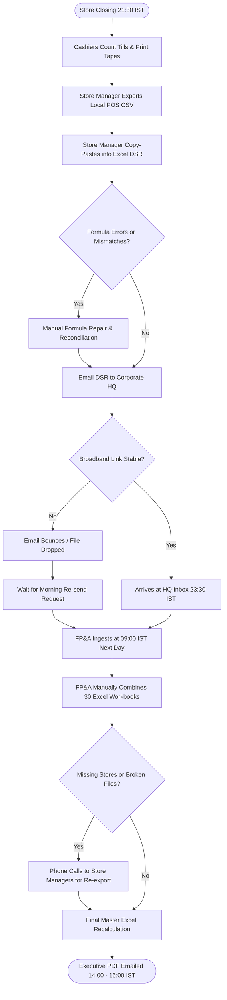

# Northstar Retail Group — Enterprise Retail Analytics Platform
## Business Process AS-IS: BP-001 — Daily Sales Reporting (DSR Compilation)

---

### 1. Process Identification & Business Purpose

* **Process ID:** `BP-001-ASIS`
* **Process Title:** Daily Sales Reporting Compilation & Distribution (Current State)
* **Operational Domain:** Store Operations & Corporate Financial Reporting
* **Business Purpose:** Extract previous-day transactional sales from store registers, manually consolidate 30 individual store spreadsheets, and generate a daily sales summary for executive leadership and regional operations.

---

### 2. Process Governance & Ownership

* **Accountable Process Owner:** VP Retail Operations (K. R. Ramanathan)
* **Operational Performers:** 30 Store Managers, Central FP&A Reporting Analysts (2 FTEs)
* **Participating Stakeholders:**
  * Store Checkout Cashiers (print register till tapes)
  * Store Managers (manual POS CSV export & spreadsheet formatting)
  * Corporate FP&A Analysts (manual copy-paste aggregation, formula cleansing)
  * Regional Directors & C-Suite Executives (report consumers)

---

### 3. Trigger & Preconditions

* **Process Trigger:** Official daily store closing time (21:30 IST in high streets; 22:00 IST in Tier-1 destination malls).
* **Preconditions:**
  * All customer checkout lanes are closed.
  * Cashiers have conducted final cash drawer lockups.
  * Local store POS database server is operational.

---

### 4. Process Inputs & Outputs

```
+----------------------------------------------------------------------------------------------------+
|                                      PROCESS INPUTS & OUTPUTS                                      |
+------------------------------------+---------------------------------------------------------------+
| INPUTS                             | OUTPUTS                                                       |
+------------------------------------+---------------------------------------------------------------+
| - Local POS register sales tables  | - 30 fragmented Store DSR Excel files emailed to HQ           |
| - Cashier till audit tapes         | - Consolidated Corporate Daily Sales Excel workbook           |
| - Cash office manual tally sheets  | - Static PDF Daily Trading Summary distributed by email       |
| - Local store broadband link       | - Daily disputed revenue exception emails                     |
+------------------------------------+---------------------------------------------------------------+
```

---

### 5. Detailed AS-IS Activity Workflow

The current manual process involves five sequential operational phases executing late at night and extending into the following afternoon:

```
21:30 - 22:30 IST        22:30 - 23:30 IST        23:30 - 02:00 IST        09:00 - 13:00 IST        14:00 - 16:00 IST
+---------------------+  +---------------------+  +---------------------+  +---------------------+  +---------------------+
| Cashier Till Lockup |  | Store Manager CSV   |  | Midnight Batch Push |  | Central FP&A Manual |  | Delayed Executive   |
| & Physical Counting |->| Export & Excel Edit |->| & Email Dispatch    |->| Workbook Cleansing  |->| Report Distribution |
| (Store Cash Office) |  | (Backroom Office)   |  | (Broadband Jitter)  |  | (HQ Bengaluru)      |  | (24-36h Rear-view)  |
+---------------------+  +---------------------+  +---------------------+  +---------------------+  +---------------------+
```

1. **Step 1 (Till Drawer Counting):** At 21:30 IST, cashiers carry cash drawers to the back office. The Cash Office Supervisor counts physical currency notes, coins, card EDC swipe slips, and dynamic UPI receipts against printed POS register till tapes.
2. **Step 2 (Local POS CSV Extraction):** The Store Manager logs into the local store back-office POS server and triggers an export of daily sales lines into a raw `.csv` format.
3. **Step 3 (Manual Spreadsheet Compilation):** The Store Manager opens a local Microsoft Excel template (`Store_DSR_Template_2025.xlsx`), manually copy-pastes CSV columns, resolves formula breaks, types in cashier variance explanations, and saves the file. *(Duration: ~90 minutes).*
4. **Step 4 (Email Dispatch & Nightly Batch):** Between 23:00 and 23:30 IST, the Store Manager attaches the spreadsheet to an email addressed to `dsr-consolidation@northstarretail.in`. Concurrently, an unmonitored scheduled task attempts to FTP raw transactional batch files to HQ.
5. **Step 5 (Broadband Transmission Exceptions):** In Tier-2 locations (Warangal, Mangaluru, Surat), broadband dropouts frequently cause email bounces or incomplete FTP transmissions.
6. **Step 6 (Morning FP&A Aggregation):** At 09:00 IST the following morning, two corporate FP&A analysts open all received emails, download attachments into a shared network folder, and copy-paste rows into a `Master_Enterprise_Sales_YTD.xlsx` workbook. *(Duration: 3 to 4 hours).*
7. **Step 7 (Discrepancy Investigation):** If a store report is missing or contains broken `#REF!` or `#VALUE!` Excel formulas, the analyst calls the Store Manager to request a re-export.
8. **Step 8 (Final Distribution):** The consolidated report is converted to PDF and emailed to executive leadership between **14:00 and 16:00 IST** (over 16 hours after store closing).

---

### 6. Supplementary Process Diagram (Mermaid)



*(Note: Formal BPMN 2.0 XML representation is provided in [`bpmn/bp_001_as_is.bpmn`](file:///Users/adibnoushad/Northstar_Retail_Analytics/docs/03_business_process_modeling/bpmn/bp_001_as_is.bpmn)).*

---

### 7. Decision Gateways & Exception Handling Paths

* **Gateway 1 (Local Template Error):** If local register CSV columns do not match the Excel macro (e.g., due to POS software patch variance), the Store Manager must manually adjust cell ranges, leading to transcription errors.
* **Gateway 2 (Broadband Network Dropout):** If the store internet connection drops, the email sits in the store outbox. The store is logged as "Zero Sales" in initial corporate aggregations until a phone follow-up occurs.
* **Gateway 3 (Missing Store Escalation):** If FP&A identifies missing stores at 10:00 IST, an ad-hoc escalation email is sent to the Regional Director, delaying total enterprise revenue sign-off.

---

### 8. Governing Business Rules (AS-IS)

* **Rule ASIS-01:** Every store manager must submit a completed DSR spreadsheet by 23:30 IST on the day of trading.
* **Rule ASIS-02:** Net Sales in the spreadsheet is calculated as Gross Sales minus Returns, but cash discounts are inconsistently subtracted across store templates.
* **Rule ASIS-03:** Corporate FP&A will not publish the daily update until at least 26 of the 30 store spreadsheets are received.

---

### 9. Operational Pain Points & Bottlenecks

1. **Extreme Decision Latency:** C-Suite executives receive yesterday’s performance updates late in the afternoon (14:00–16:00 IST), precluding morning operational tactical interventions.
2. **Massive Administrative Overhead:** 30 Store Managers spend 90 minutes each night on manual data entry, amounting to **45 hours of store management time wasted every day**.
3. **Data Fragility & Human Error:** Copy-pasting across 30 spreadsheets frequently introduces formula breaks, row truncations, and double-counted sales lines.
4. **Conflicting Versions of the Truth:** Disparate spreadsheets circulated via email create conflicting snapshots during weekly leadership meetings.

---

### 10. Root-Cause Analysis (Ishikawa 5-Whys)

* *Why is executive reporting delayed until the afternoon?*  
  Because central FP&A analysts spend 3–4 hours every morning manually consolidating 30 store spreadsheets.
* *Why are they consolidating spreadsheets manually?*  
  Because store POS systems are not connected to an automated central data ingestion pipeline.
* *Why are store managers exporting spreadsheets?*  
  Because local store POS nodes operate as standalone database instances without an enterprise ETL agent.
* *Why has this persisted?*  
  Historical organizational acceptance of spreadsheet-centric reporting during Northstar’s rapid store expansion from 10 to 30 units.
* *Root Cause:* **Absence of a centralized, automated Extract, Transform, Load (ELT) ingestion architecture and single semantic data repository.**

---

### 11. Traceability & Requirements Mapping

* **Aligned Business Problem:** `BP-01: Manual Sales Report Consolidation`
* **Aligned Business Requirement:** `BR-001: Automated Daily Sales Ingestion and Delivery`
* **Aligned Functional Requirements:** `FR-001`, `FR-002`, `FR-004`, `FR-005`, `FR-032`
* **Aligned Agile User Stories:** `US-001`, `US-002`, `US-018`
* **Target Success Criteria:** `SC-01` (DSR delivery by 06:00 IST), `SC-02` (≥85% store manager admin overhead reduction)

