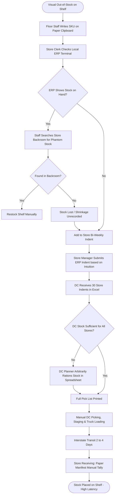

# Northstar Retail Group — Enterprise Retail Analytics Platform
## Business Process AS-IS: BP-002 — Inventory Management & Store Replenishment

---

### 1. Process Identification & Business Purpose

* **Process ID:** `BP-002-ASIS`
* **Process Title:** Manual Inventory Management & Ad-Hoc Store Replenishment (Current State)
* **Operational Domain:** Supply Chain, Central Warehousing & Store Operations
* **Business Purpose:** Monitor store-level stock quantities, identify out-of-stock shelves, raise ad-hoc stock requests from retail stores to the central distribution center (DC), and manually allocate inventory across 30 stores.

---

### 2. Process Governance & Ownership

* **Accountable Process Owner:** VP Supply Chain & Logistics (Sunita Rao)
* **Operational Performers:** 30 Store Inventory Supervisors, Store Managers, Central DC Warehouse Planners (3 FTEs)
* **Participating Stakeholders:**
  * Store Department Floor Staff (manual physical shelf inspection)
  * Store Managers (manual ERP Indent creation & WhatsApp follow-ups)
  * Central DC Inventory Planners (spreadsheet allocation, stock picking)
  * Logistics & Fleet Drivers (transportation & dispatch)

---

### 3. Trigger & Preconditions

* **Process Trigger:** Bi-weekly replenishment cycle (Tuesdays and Fridays) or ad-hoc visual detection of empty shelves by store staff.
* **Preconditions:**
  * Physical stock is present on the retail store sales floor or backroom.
  * Local Store ERP terminal has basic connectivity to central SAP/ERP database.

---

### 4. Process Inputs & Outputs

```
+----------------------------------------------------------------------------------------------------+
|                                      PROCESS INPUTS & OUTPUTS                                      |
+------------------------------------+---------------------------------------------------------------+
| INPUTS                             | OUTPUTS                                                       |
+------------------------------------+---------------------------------------------------------------+
| - Visual shelf stock observation   | - Handwritten Store Indent clipboards                         |
| - Local ERP stock balance screen   | - Manual ERP Material Requisition (Indent) records            |
| - Store Manager intuition/gut-feel | - Central DC Allocation Excel sheet (`DC_Allocations_v4.xlsx`)|
| - Supplier lead-time estimates     | - Physical DC Goods Dispatch Note (GDN) & Manifest            |
| - Ad-hoc customer complaints       | - Emergency interstate transfer emails                        |
+------------------------------------+---------------------------------------------------------------+
```

---

### 5. Detailed AS-IS Activity Workflow

The current replenishment process is heavily manual, reactive, and fragmented across five operational phases:

```
Daily 08:00 - 10:00 IST   Bi-Weekly 11:00 - 14:00   Bi-Weekly 15:00 - 18:00   Next Day 06:00 - 12:00   T+2 to T+4 Days
+---------------------+  +---------------------+  +---------------------+  +---------------------+  +---------------------+
| Physical Floor Walk |  | Manual ERP Stock    |  | DC Planner Manual   |  | Manual Warehouse    |  | Unpredictable Stock |
| & Paper Clipboards  |->| Indent Entry        |->| Spreadsheet Triage  |->| Picking & Loading   |->| Arrival & Shelf Out |
| (Store Staff Eyes)  |  | (Back-Office PC)    |  | (HQ Allocation)     |  | (Paper Pick-Lists)  |  | (Stockouts/Overstock|
+---------------------+  +---------------------+  +---------------------+  +---------------------+  +---------------------+
```

1. **Step 1 (Visual Shelf Audit):** Every morning between 08:00 and 10:00 IST, department staff walk store aisles with paper clipboards to visually spot empty shelf facings and estimate remaining stock without systematic barcode scanning.
2. **Step 2 (Local ERP Inventory Lookup):** Store inventory clerks manually look up selected item codes on the store ERP client. Due to unsynchronized POS sales decrements, ERP on-hand figures often show stock that does not physically exist ("phantom inventory").
3. **Step 3 (Ad-Hoc Indent Generation):** On Tuesdays and Fridays, Store Managers compile requested quantities into an ERP Store Indent based on subjective gut-feel, historical memory, and panic ordering for fast-moving items.
4. **Step 4 (DC Allocation Triage):** Central DC planners in Bengaluru receive indents from all 30 stores. Because total requested quantities frequently exceed available DC stock, planners manually copy indent quantities into a master Excel allocation workbook (`DC_Allocations_v4.xlsx`) and arbitrarily ration stock across stores.
5. **Step 5 (Store Manager Lobbying):** Store Managers routinely call or WhatsApp DC warehouse managers to lobby for priority shipment of high-demand items, creating favoritism and erratic distribution.
6. **Step 6 (Warehouse Picking & Dispatch):** DC pickers print paper picking slips and assemble pallet loads. Stock is loaded onto multi-stop delivery trucks covering interstate transit routes (e.g., Bengaluru to Hyderabad/Vijayawada).
7. **Step 7 (Delayed Store Delivery & Staged Receiving):** Shipments arrive between 2 and 4 days later. Store staff manually tick off paper manifests against delivered cartons. Discrepancies and damages are logged on paper and often take weeks to reconcile.

---

### 6. Supplementary Process Diagram (Mermaid)



*(Note: Formal BPMN 2.0 XML representation is provided in [`bpmn/bp_002_as_is.bpmn`](file:///Users/adibnoushad/Northstar_Retail_Analytics/docs/03_business_process_modeling/bpmn/bp_002_as_is.bpmn)).*

---

### 7. Decision Gateways & Exception Handling Paths

* **Gateway 1 (Phantom Stock Branch):** When ERP displays positive inventory but shelves are empty, store staff spend up to 2 hours searching storerooms for misplaced goods before confirming an unrecorded stock loss.
* **Gateway 2 (DC Stock Shortage Rationing):** When central warehouse stock cannot fulfill 30 store requests, the DC planner manually cuts store orders by an arbitrary flat percentage (e.g., 40% across all stores), regardless of individual store sales velocity.
* **Gateway 3 (Emergency Inter-Store Stock Transfer):** When a Tier-1 flagship store runs out of high-margin electronics, regional management arranges emergency stock transfers via local courier from an adjacent store, incurring exorbitant freight costs without formal inventory tracking.

---

### 8. Governing Business Rules (AS-IS)

* **Rule ASIS-04:** Store indents must be finalized and keyed into the ERP terminal by 14:00 IST on designated indent days.
* **Rule ASIS-05:** Static reorder levels are configured once per year in the ERP and do not dynamically adjust for seasonal spikes or promotional lifts.
* **Rule ASIS-06:** No automated alerts exist for slow-moving or aging inventory until stock reaches terminal obsolescence.

---

### 9. Operational Pain Points & Bottlenecks

1. **Chronic Stockouts of Class-A Velocity Items:** Top 20% revenue-generating items suffer frequent stockouts (estimated 12–15% lost sales), particularly during weekends and festival promotions.
2. **Working Capital Locked in Aging Overstock:** Over 18% of store inventory remains stagnant for $>90$ days because stores reorder blindly and lack visibility into local stock aging.
3. **Distorted Demand Signals (Bullwhip Effect):** Store managers inflate order quantities to ensure they receive a fraction of their order during rationing, amplifying supply chain volatility at the central DC.
4. **Labor-Intensive Allocation:** Central DC planners spend over 15 hours each week manually massaging Excel allocation spreadsheets.

---

### 10. Root-Cause Analysis (Ishikawa 5-Whys)

* *Why are stores regularly running out of fast-moving products while backrooms overflow with slow-movers?*  
  Because replenishment orders are created through subjective human intuition rather than data-driven sales velocity.
* *Why are orders created through intuition?*  
  Because store managers do not have visibility into item-level Days of Inventory (DOI), sell-through rates, or real-time sales trends.
* *Why is real-time inventory visibility absent?*  
  Because POS sales decrements drift from ERP stock records, creating persistent phantom inventory.
* *Why is central allocation arbitrary?*  
  Because the central DC lacks an automated algorithmic allocation engine that considers store-level sales velocity and lead-time demand.
* *Root Cause:* **Absence of automated, velocity-based replenishment logic, static reorder points, and disconnected POS-ERP inventory monitoring.**

---

### 11. Traceability & Requirements Mapping

* **Aligned Business Problem:** `BP-05: Inventory Overstocking and Stockouts`
* **Aligned Business Requirement:** `BR-003: Inventory Health and Stockout Prevention`
* **Aligned Functional Requirements:** `FR-007`, `FR-008`, `FR-009`, `FR-035`
* **Aligned Agile User Stories:** `US-004`, `US-005`, `US-006`
* **Target Success Criteria:** `SC-05` (Reduce stockout rates on Class-A SKUs to $<4\%$)
