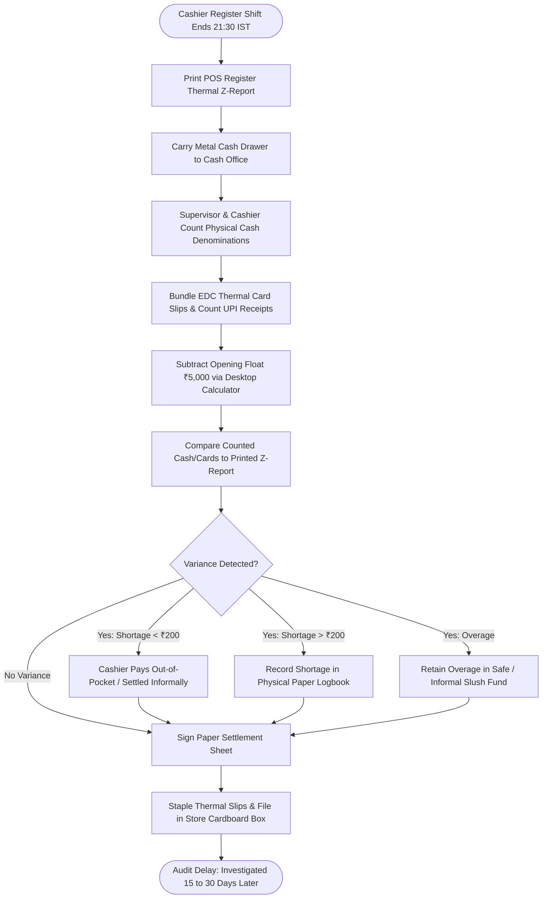

# Northstar Retail Group — Enterprise Retail Analytics Platform
## Business Process AS-IS: BP-003 — POS-Till Reconciliation

---

### 1. Process Identification & Business Purpose

* **Process ID:** `BP-003-ASIS`
* **Process Title:** Manual POS-Till Reconciliation & Cashier Settlement (Current State)
* **Operational Domain:** Store Cash Office, Retail Operations & Internal Audit
* **Business Purpose:** Reconcile individual cashier register transactions against physical cash, printed EDC credit/debit card swipe slips, dynamic UPI merchant slips, and POS till summary audit tapes (Z-reports) at daily store closing.

---

### 2. Process Governance & Ownership

* **Accountable Process Owner:** Head of Internal Audit (Deepak Sharma) & VP Retail Operations
* **Operational Performers:** 30 Store Cash Office Supervisors, Store Cashiers, Regional Internal Auditors
* **Participating Stakeholders:**
  * Store Cashiers (drawer hand-over and counting declaration)
  * Cash Office Supervisor (manual denomination tally and envelope sealing)
  * Store Manager (variance sign-off and paper ledger entry)
  * Central Finance & Internal Audit (monthly manual audit review)

---

### 3. Trigger & Preconditions

* **Process Trigger:** Cashier shift changeover or end-of-day register closure (21:30–22:00 IST).
* **Preconditions:**
  * The cashier has processed all queued customers and printed the POS register X/Z-report.
  * Cash drawer containing physical currency notes, coins, EDC charge slips, and voucher coupons is physically present in the back cash office.

---

### 4. Process Inputs & Outputs

```
+----------------------------------------------------------------------------------------------------+
|                                      PROCESS INPUTS & OUTPUTS                                      |
+------------------------------------+---------------------------------------------------------------+
| INPUTS                             | OUTPUTS                                                       |
+------------------------------------+---------------------------------------------------------------+
| - Physical currency notes & coins  | - Handwritten Cashier Settlement Sheets                       |
| - Printed POS register Z-report    | - Physical cash deposit tamper-evident bank bags              |
| - EDC thermal credit/debit slips   | - Physical binder of stapled thermal paper receipts           |
| - Paper credit notes & gift coupons| - Monthly manual cashier discrepancy spreadsheet              |
| - Cash drawer opening float record | - Delayed shortage deduction notices issued to cashiers       |
+------------------------------------+---------------------------------------------------------------+
```

---

### 5. Detailed AS-IS Activity Workflow

The current till reconciliation process is entirely manual, paper-intensive, and prone to record manipulation:

```
21:30 - 22:00 IST        22:00 - 22:45 IST        22:45 - 23:15 IST        T+7 to T+15 Days         Monthly Close
+---------------------+  +---------------------+  +---------------------+  +---------------------+  +---------------------+
| Cashier Shift Close |  | Physical Currency & |  | Manual Variance Log |  | Central Cash Audit  |  | Salary Deduction &  |
| & Till Tape Print   |->| EDC Slip Tally      |->| & Binder Filing     |->| Envelope Sampling   |->| Shortage Recovery   |
| (Register Lane)     |  | (Back Cash Office)  |  | (Store Paper Diary) |  | (HQ Audit Team)     |  | (Internal Audit)    |
+---------------------+  +---------------------+  +---------------------+  +---------------------+  +---------------------+
```

1. **Step 1 (Till Closure & Tape Printing):** At closing time, each cashier prints a thermal Z-report summary from their checkout terminal, showing declared gross sales, tender breakdowns, and line voids.
2. **Step 2 (Physical Drawer Hand-over):** The cashier carries the metal cash drawer to the secure cash office accompanied by store security.
3. **Step 3 (Manual Physical Counting):** The Cash Office Supervisor and cashier manually count cash note denominations (₹500, ₹200, ₹100, ₹50, ₹20, ₹10), calculate the total cash value on a desktop calculator, subtract the starting cash float (typically ₹5,000), and bundle thermal EDC merchant swipe slips by credit card acquiring terminal.
4. **Step 4 (Paper Settlement Sheet Entry):** The supervisor writes the physical totals on a paper *Daily Cashier Settlement Sheet*, compares them against the printed Z-report totals, and identifies differences (overages or shortages).
5. **Step 5 (Store Variance Adjustment):** If a cash shortage is under ₹200, the cashier frequently covers the shortfall out-of-pocket on the spot to avoid formal investigation. If the shortage exceeds ₹200, an incident note is written in a physical spiral ledger.
6. **Step 6 (Vouchers & Slip Archival):** EDC slips, UPI payment confirmations, and printed Z-reports are stapled together and stuffed into paper envelopes stored in cardboard filing boxes inside the store backroom.
7. **Step 7 (Delayed HQ Audit & Escalation):** Central Internal Audit only samples store paper files weeks later during periodic store visits or when physical bank cash collection reports reveal banking deficits. Suspicious cashier void patterns (e.g., cash sales cancelled after customer departure) go completely undetected until annual inventory audits.

---

### 6. Supplementary Process Diagram (Mermaid)



*(Note: Formal BPMN 2.0 XML representation is provided in [`bpmn/bp_003_as_is.bpmn`](file:///Users/adibnoushad/Northstar_Retail_Analytics/docs/03_business_process_modeling/bpmn/bp_003_as_is.bpmn)).*

---

### 7. Decision Gateways & Exception Handling Paths

* **Gateway 1 (Informal Shortage Settlement):** Small cash shortages are routinely resolved off-the-record by store cashiers to avoid HR disciplinary points, masking systematic checkout skimming or register counting vulnerabilities.
* **Gateway 2 (Cash Overage Retention):** When physical cash exceeds the register tape, excess funds are often retained in a local safe "slush fund" to offset future cash shortages, compromising internal financial controls.
* **Gateway 3 (Thermal Slip Degradation):** Thermal EDC slips stored in paper boxes fade rapidly due to heat and humidity across coastal and humid store locations (Surat, Mangaluru, Chennai), making retrospective manual audits impossible after 60 days.

---

### 8. Governing Business Rules (AS-IS)

* **Rule ASIS-07:** Each register drawer must maintain an opening cash float of exactly ₹5,000 at the start of each morning shift.
* **Rule ASIS-08:** Discrepancies greater than ₹500 must be reported to the Store Manager within 24 hours. (In practice, rarely adhered to due to informal cashier settlements).
* **Rule ASIS-09:** Thermal till audit rolls must be physically archived in store backrooms for 12 months.

---

### 9. Operational Pain Points & Bottlenecks

1. **Unmonitored Cashier Voids & Collusion:** Dishonest cashiers can void cash transactions after customers leave with merchandise, pocketing the cash while keeping the drawer balanced against the doctored register tape.
2. **Substantial Cash Office Administrative Burden:** Cash office supervisors spend 2 to 3 hours each night manually counting notes and sorting thousands of thermal slips across 10 to 18 checkout lanes.
3. **Audit Latency (15–30 Days):** Internal audit learns of cash shortages weeks after the incident, by which time seasonal or contract cashiers have frequently left the company.
4. **Zero Chain-Wide Discrepancy Visibility:** Executive management has no visibility into cumulative chain-wide till shrinkage, which quietly drains tens of lakhs annually.

---

### 10. Root-Cause Analysis (Ishikawa 5-Whys)

* *Why are till shortages discovered weeks or months after they occur?*  
  Because till reconciliation relies on paper settlement sheets and physical thermal tapes archived in decentralized store boxes.
* *Why are paper tapes used instead of digital records?*  
  Because store POS transaction logs are not digitally ingested and matched against cashier closing declarations in an automated system.
* *Why are cashier voids not detected in real time?*  
  Because store POS software does not run automated statistical anomaly checks on cashier void and cancellation frequencies.
* *Why has paper reconciliation persisted?*  
  Because store operations prioritize fast register closeouts over digital auditability.
* *Root Cause:* **Lack of automated, digital POS line-to-till reconciliation, absence of centralized cashier anomaly surveillance, and reliance on physical paper logs.**

---

### 11. Traceability & Requirements Mapping

* **Aligned Business Problem:** `BP-03: POS and ERP Discrepancies`, `BP-02: Fragmented KPI Definitions`
* **Aligned Business Requirement:** `BR-004: Automated Financial and Transactional Reconciliation`
* **Aligned Functional Requirements:** `FR-010`, `FR-014`, `FR-015`, `FR-035`
* **Aligned Agile User Stories:** `US-007`, `US-008`
* **Target Success Criteria:** `SC-03` (Automated 4-way reconciliation completed by 05:30 IST daily)
