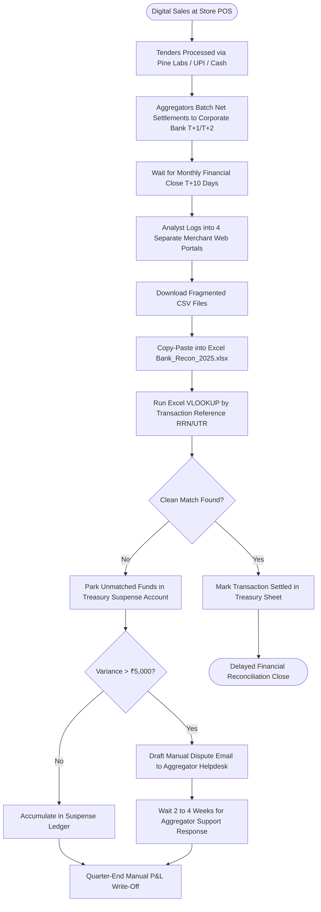

# Northstar Retail Group — Enterprise Retail Analytics Platform
## Business Process AS-IS: BP-004 — Payment Settlement Reconciliation

---

### 1. Process Identification & Business Purpose

* **Process ID:** `BP-004-ASIS`
* **Process Title:** Manual Payment Settlement & Gateway Reconciliation (Current State)
* **Operational Domain:** Corporate Treasury, Finance & Revenue Accounting
* **Business Purpose:** Verify that customer digital payments collected at store checkout lanes (Credit/Debit Cards, dynamic UPI, digital wallets) are accurately settled by payment aggregators (Pine Labs, Paytm, Razorpay) and deposited into Northstar Retail Group’s corporate bank accounts.

---

### 2. Process Governance & Ownership

* **Accountable Process Owner:** Chief Financial Officer (Rajesh Khandelwal) & Treasury Controller
* **Operational Performers:** Central Treasury Accounting Team (2 FTEs), Bank Cash Collection Agents
* **Participating Stakeholders:**
  * Store Cashiers (initiating EDC swipe / UPI dynamic QR transactions)
  * Payment Gateway Aggregators (Pine Labs, Paytm, Razorpay merchant portals)
  * Corporate Acquiring Banks (HDFC Bank, ICICI Bank, State Bank of India)
  * Central Accounts Payable & Receivable Analysts (manual spreadsheet reconciliation)

---

### 3. Trigger & Preconditions

* **Process Trigger:** Monthly financial book close cycle or receipt of monthly consolidated bank statements (typically T+10 to T+15 days post month-end).
* **Preconditions:**
  * Payment gateways have closed their monthly settlement cycles.
  * Corporate banks have issued monthly PDF/CSV bank account statements.

---

### 4. Process Inputs & Outputs

```
+----------------------------------------------------------------------------------------------------+
|                                      PROCESS INPUTS & OUTPUTS                                      |
+------------------------------------+---------------------------------------------------------------+
| INPUTS                             | OUTPUTS                                                       |
+------------------------------------+---------------------------------------------------------------+
| - Store POS daily tender CSVs      | - Monthly Treasury Suspense Account Ledger                    |
| - Pine Labs / Paytm portal CSVs    | - Manual Settlement Variance Workbook (`Bank_Recon_2025.xlsx`)|
| - Corporate bank account CSV feeds | - Ad-hoc email dispute queries to payment aggregators         |
| - Cash-in-transit (CIT) deposit slips| - Unreconciled merchant discount fee (MDR) expense entries   |
| - Customer chargeback debit notices| - Retroactive journal adjustments at financial quarter-end   |
+------------------------------------+---------------------------------------------------------------+
```

---

### 5. Detailed AS-IS Activity Workflow

The current settlement reconciliation process is heavily delayed, manual, and reactive:

```
T+1 to T+3 Days          T+10 to T+15 Days        T+15 to T+20 Days        T+20 to T+25 Days        Quarter-End
+---------------------+  +---------------------+  +---------------------+  +---------------------+  +---------------------+
| Store Cash Banking  |  | Portal CSV Downloads|  | Excel VLOOKUP Match |  | Dispute Emails to   |  | Huge Suspense Bal-  |
| & Gateway Settlement|->| & Manual Filtering  |->| & Unmatched Balance |->| Payment Gateways    |->| ances Written Off   |
| (CIT Van / Aggregat)|  | (HQ Treasury Desk)  |  | (Formula Breaks)    |  | (Chargeback Inquiri)|  | (P&L Leakage)       |
+---------------------+  +---------------------+  +---------------------+  +---------------------+  +---------------------+
```

1. **Step 1 (Fragmented Tender Collection):** At store checkouts, transactions are tendered via cash, Pine Labs EDC card terminals, or UPI QR codes. Cash is collected daily by armored Cash-in-Transit (CIT) services, while digital payments are batched by aggregators on T+1 or T+2 rolling settlement schedules.
2. **Step 2 (Monthly Portal Data Extraction):** Between the 10th and 15th of the following month, a treasury analyst manually logs into multiple distinct merchant web portals (Pine Labs Plutus, Paytm Merchant Dashboard, Razorpay Dashboard, HDFC Corporate NetBanking).
3. **Step 3 (Manual File Ingestion & Formatting):** The analyst downloads dozens of raw CSV files containing hundreds of thousands of transaction records, cleans conflicting date formats, and pastes them into a massive master reconciliation workbook (`Bank_Recon_2025.xlsx`).
4. **Step 4 (Spreadsheet Matching & VLOOKUP Errors):** Analysts attempt to match POS transaction IDs (RRN / UTR numbers) against bank credit lines using Microsoft Excel `VLOOKUP` or `INDEX/MATCH`. Because POS terminals truncate or format reference numbers differently from bank credit lines, over 15% of records fail to match automatically.
5. **Step 5 (Suspense Account Parking):** Unmatched settlement differences are parked into a general ledger "Treasury Suspense Account", which routinely holds balances between ₹15 Lakhs and ₹40 Lakhs across financial quarters.
6. **Step 6 (MDR Fee Omission):** Merchant Discount Rate (MDR) fees deducted by banks and aggregators (typically 0.9% to 1.8% per transaction) are accepted as reported by the bank without systematic audit against negotiated corporate fee schedules.
7. **Step 7 (Chargeback Latency):** Customer chargebacks and failed UPI reversals often arrive 30 to 45 days after the transaction. Without automated cross-referencing, store cashiers cannot verify if disputed merchandise was returned or retained by customers.

---

### 6. Supplementary Process Diagram (Mermaid)



*(Note: Formal BPMN 2.0 XML representation is provided in [`bpmn/bp_004_as_is.bpmn`](file:///Users/adibnoushad/Northstar_Retail_Analytics/docs/03_business_process_modeling/bpmn/bp_004_as_is.bpmn)).*

---

### 7. Decision Gateways & Exception Handling Paths

* **Gateway 1 (Unmatched Reference Number Exception):** When reference numbers differ between POS logs and bank statements (e.g., Pine Labs invoice ID vs. Bank UTR), the analyst must manually search transaction amounts and timestamps, consuming hours per store.
* **Gateway 2 (Aggregator Deduction Discrepancy):** When the net settlement received is lower than expected due to unannounced fee revisions or chargeback holdbacks, treasury creates a manual dispute ticket with the aggregator, which takes weeks to resolve.
* **Gateway 3 (CIT Cash Deposit Variance):** Physical cash deposited by CIT armored vans occasionally differs from cashier settlement sheets due to transit loss or counterfeit note rejections, taking up to 20 days to detect.

---

### 8. Governing Business Rules (AS-IS)

* **Rule ASIS-10:** Bank reconciliation must be completed within 20 days of the calendar month close.
* **Rule ASIS-11:** Unreconciled balances under ₹500 may be written off to the bank charges expense ledger at the discretion of the senior treasury accountant.
* **Rule ASIS-12:** Bank chargeback notices received by mail or email must be manually forwarded to store managers for customer receipt validation.

---

### 9. Operational Pain Points & Bottlenecks

1. **Substantial Cash Drag in Suspense Accounts:** Tens of lakhs of rupees remain locked in unverified suspense accounts, obscuring real cash liquidity and working capital.
2. **Undetected Gateway Over-Deductions:** Aggregators occasionally apply incorrect MDR tiers on international or premium credit cards, resulting in unrecovered overcharges estimated at ₹12–18 Lakhs annually.
3. **Severe Audit Vulnerability:** Statutory auditors flag Northstar’s delayed payment reconciliation and unverified suspense balances during annual financial audits.
4. **Labor-Intensive Spreadsheet Processing:** 2 treasury analysts spend over 50% of their working hours each month cleaning CSV tables and executing manual VLOOKUP formulas.

---

### 10. Root-Cause Analysis (Ishikawa 5-Whys)

* *Why does payment settlement reconciliation take 20 days post month-end?*  
  Because treasury relies on manual spreadsheet matching of multi-source CSV downloads.
* *Why are multi-source CSV files downloaded manually?*  
  Because payment aggregator APIs and bank statement SFTP feeds are not integrated into an automated central reconciliation engine.
* *Why do reference numbers fail to match?*  
  Because POS software, payment terminals, and bank acquiring switches generate distinct identifier formats without an automated canonical mapping table.
* *Why are merchant fee overcharges not caught?*  
  Because fee calculations are not programmatically validated against contract rate master tables on a transaction-by-transaction basis.
* *Root Cause:* **Absence of an automated, daily three-way payment reconciliation engine connecting POS tenders, gateway transaction logs, and bank statement feeds.**

---

### 11. Traceability & Requirements Mapping

* **Aligned Business Problem:** `BP-03: POS and ERP Discrepancies`, `BP-02: Fragmented KPI Definitions`
* **Aligned Business Requirement:** `BR-004: Automated Financial and Transactional Reconciliation`
* **Aligned Functional Requirements:** `FR-011`, `FR-014`, `FR-015`, `FR-035`
* **Aligned Agile User Stories:** `US-007`, `US-008`
* **Target Success Criteria:** `SC-03` (Automated 4-way reconciliation completed by 05:30 IST daily)
