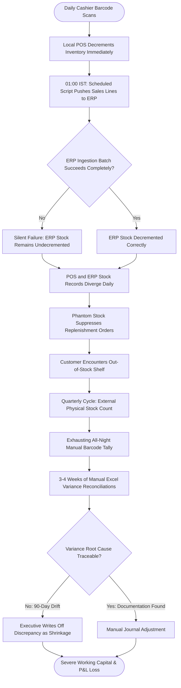

# Northstar Retail Group — Enterprise Retail Analytics Platform
## Business Process AS-IS: BP-005 — POS-ERP Inventory Reconciliation

---

### 1. Process Identification & Business Purpose

* **Process ID:** `BP-005-ASIS`
* **Process Title:** Manual POS-ERP Inventory Reconciliation & Quarterly Stock Audit (Current State)
* **Operational Domain:** Supply Chain, Store Inventory Control & Internal Audit
* **Business Purpose:** Compare unit sales scanned at retail POS registers against stock decrement movements recorded in the central Enterprise Resource Planning (ERP) database to identify inventory record drift, phantom stock, and retail shrinkage.

---

### 2. Process Governance & Ownership

* **Accountable Process Owner:** VP Supply Chain & Logistics (Sunita Rao) & Head of Internal Audit
* **Operational Performers:** Store Inventory Controllers, Central ERP Systems Administrators, External Stock Audit Agency
* **Participating Stakeholders:**
  * Store Cashiers (scanning item barcodes at checkout)
  * Store Inventory Supervisors (receiving stock and logging damaged goods)
  * IT Systems Administrators (monitoring brittle unverified nightly batch scripts)
  * Internal & External Stock Auditors (conducting quarterly physical counts)

---

### 3. Trigger & Preconditions

* **Process Trigger:** Quarterly physical stock count cycle (March, June, September, December) or severe operational stockout crises on the sales floor.
* **Preconditions:**
  * Retail stores must freeze operations or conduct counting during overnight store closures.
  * Local POS transaction databases and central ERP stock tables are accessible.

---

### 4. Process Inputs & Outputs

```
+----------------------------------------------------------------------------------------------------+
|                                      PROCESS INPUTS & OUTPUTS                                      |
+------------------------------------+---------------------------------------------------------------+
| INPUTS                             | OUTPUTS                                                       |
+------------------------------------+---------------------------------------------------------------+
| - POS scanned transaction logs     | - Quarterly Stock Variance Spreadsheet (`Stock_Audit_Q3.xlsx`)|
| - Central ERP inventory ledger     | - Unexplained Retail Shrinkage Adjustment Journal Entries     |
| - Physical counting tally sheets   | - Massive quarterly inventory write-offs across P&L accounts  |
| - Unmonitored batch sync error logs| - Ad-hoc finger-pointing between Store Operations and IT      |
| - Damaged / returned item scrap log| - Lingering phantom inventory records in ERP system           |
+------------------------------------+---------------------------------------------------------------+
```

---

### 5. Detailed AS-IS Activity Workflow

The current reconciliation process is discontinuous, highly delayed, and reliant on manual quarterly physical counts:

```
Daily Trading Cycle      Nightly 01:00 IST        Daily Sales Drift        Quarter-End Weekend      T+30 Days Post Count
+---------------------+  +---------------------+  +---------------------+  +---------------------+  +---------------------+
| Cashiers Scan Goods |  | Brittle Unmonitored |  | "Phantom Stock"     |  | Exhausting Physical |  | Huge Quarterly P&L  |
| at POS Checkouts    |->| Batch Decrements ERP|->| Accumulates Daily   |->| Wall-to-Wall Count  |->| Shrinkage Write-Off |
| (POS Units Decreased|  | (Frequent Failures) |  | (POS != ERP Stock)  |  | (Stores Closed/Tire)|  | (₹80L+ Written Off) |
+---------------------+  +---------------------+  +---------------------+  +---------------------+  +---------------------+
```

1. **Step 1 (POS Scan & Local Decrement):** During the day, cashier barcode scans decrement local store POS inventory balances in real time.
2. **Step 2 (Brittle Nightly ERP Decrement Batch):** At 01:00 IST, an unmonitored legacy scheduled script attempts to upload raw daily sales lines to the central SAP/ERP system to post inventory movement documents (Movement Type 251: Sales Issue).
3. **Step 3 (Silent Batch Sync Failures):** Due to temporary broadband drops, barcode formatting mismatches, or locked ERP database tables, batches frequently drop lines or fail completely without alerting administrators.
4. **Step 4 (Cumulative Inventory Drift & Phantom Stock):** Over weeks, the divergence between POS sales and ERP stock records widens. The ERP displays available stock that does not physically exist in the store ("phantom inventory"), causing central supply chain systems to suppress replenishment.
5. **Step 5 (Quarterly Physical Stock Count):** Every 90 days, an external auditing agency and store employees conduct an exhaustive physical count of every SKU in the store over a weekend night (12–14 hours per store).
6. **Step 6 (Discrepancy Consolidation & Blame Game):** Audit teams spend 3 to 4 weeks manually matching physical count sheets against ERP stock ledgers in massive Excel files (`Stock_Audit_Q3.xlsx`). Store managers blame "IT batch failures", while IT blames "store theft and shrinkage".
7. **Step 7 (Massive P&L Write-Offs):** Because root causes cannot be traced back across 90 days of transactions, management writes off hundreds of lakhs of rupees as unexplained retail shrinkage, damaging company profitability.

---

### 6. Supplementary Process Diagram (Mermaid)



*(Note: Formal BPMN 2.0 XML representation is provided in [`bpmn/bp_005_as_is.bpmn`](file:///Users/adibnoushad/Northstar_Retail_Analytics/docs/03_business_process_modeling/bpmn/bp_005_as_is.bpmn)).*

---

### 7. Decision Gateways & Exception Handling Paths

* **Gateway 1 (Silent Batch Sync Exception):** When a batch failure occurs, error records are logged to unmonitored text files. No automated alert is dispatched to data engineering or store inventory teams, allowing errors to compound for months.
* **Gateway 2 (Barcode Mismatch Rejection):** If a store introduces a new local barcode that has not been mapped in the central ERP Material Master, the ERP silently rejects the entire transaction line, resulting in persistent stock divergence.
* **Gateway 3 (Untraceable Shrinkage Attribution):** When physical counts reveal missing inventory, auditors cannot distinguish between actual physical pilferage, cashier scanning errors, or unposted ERP batch drops.

---

### 8. Governing Business Rules (AS-IS)

* **Rule ASIS-13:** Physical wall-to-wall stock counting must be conducted once every quarter across all 30 retail stores.
* **Rule ASIS-14:** Cumulative quarterly inventory variances exceeding 1.0% of store sales must be formally investigated by the Internal Audit department.
* **Rule ASIS-15:** Store managers are financially penalized for stock shrinkage exceeding 0.75% of net store turnover, leading to widespread under-reporting of inventory write-downs.

---

### 9. Operational Pain Points & Bottlenecks

1. **Persistent Phantom Stock:** Store shelves sit empty while central supply chain systems believe products are in stock, causing lost sales across fast-moving categories.
2. **Exorbitant Annual Shrinkage Write-Offs:** Northstar writes off an estimated ₹1.2–1.5 Crore annually in unexplained stock discrepancies.
3. **Severe Operational Disruption:** Quarterly physical counts exhaust store staff, require temporary store closures, and cost substantial third-party audit fees.
4. **Total Absence of Daily Auditability:** Because discrepancies are evaluated only every 90 days, investigating individual root causes is virtually impossible.

---

### 10. Root-Cause Analysis (Ishikawa 5-Whys)

* *Why do POS and ERP inventory records diverge continuously?*  
  Because nightly ERP inventory decrement batch jobs fail silently and are never reconciled daily.
* *Why are they not reconciled daily?*  
  Because the organization lacks an automated data pipeline that compares POS sales line units against ERP stock ledger movements on a T+1 schedule.
* *Why are failures silent?*  
  Because legacy batch scripts have no monitoring, error alerting, or quarantine mechanisms.
* *Why is shrinkage discovered only quarterly?*  
  Because physical counting is the sole operational mechanism currently used to identify inventory variances.
* *Root Cause:* **Lack of automated, daily line-item POS-ERP inventory reconciliation and reliance on delayed quarterly manual physical audits.**

---

### 11. Traceability & Requirements Mapping

* **Aligned Business Problem:** `BP-03: POS and ERP Discrepancies`, `BP-05: Inventory Overstocking and Stockouts`
* **Aligned Business Requirement:** `BR-005: POS and ERP Synchronization and Reconciliation`
* **Aligned Functional Requirements:** `FR-012`, `FR-014`, `FR-015`, `FR-035`
* **Aligned Agile User Stories:** `US-007`
* **Target Success Criteria:** `SC-04` (Automated daily POS-ERP inventory reconciliation completed by 05:30 IST)
