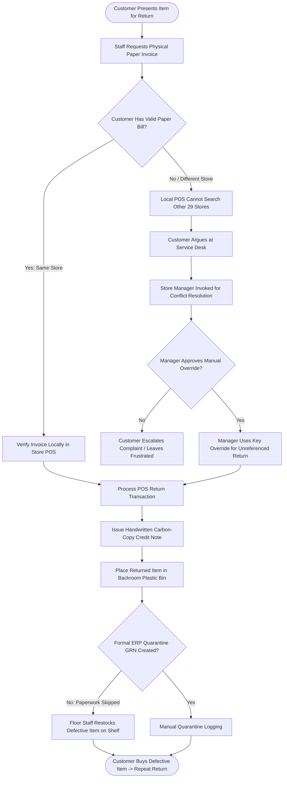

# Northstar Retail Group — Enterprise Retail Analytics Platform
## Business Process AS-IS: BP-006 — Customer Returns Management

---

### 1. Process Identification & Business Purpose

* **Process ID:** `BP-006-ASIS`
* **Process Title:** Manual Customer Returns & Credit Note Handling (Current State)
* **Operational Domain:** Store Customer Service, Retail Operations & Inventory Control
* **Business Purpose:** Process customer product returns at store customer service desks, validate original purchase proofs, issue store credit notes or cash refunds, and return merchandise to store sales floors or quarantine staging areas.

---

### 2. Process Governance & Ownership

* **Accountable Process Owner:** VP Retail Operations (K. R. Ramanathan) & Customer Experience Lead
* **Operational Performers:** Store Customer Service Desk Staff, Store Cashiers, Store Managers
* **Participating Stakeholders:**
  * Retail Customers (presenting merchandise for return or exchange)
  * Customer Service Desk Cashiers (manual bill verification and physical inspection)
  * Store Managers (manual override authorization for unreferenced returns)
  * Central Customer Support & Finance (reconciling disputed credit notes)

---

### 3. Trigger & Preconditions

* **Process Trigger:** Customer arrives at store customer service counter requesting a refund, exchange, or credit note for purchased goods.
* **Preconditions:**
  * Customer presents merchandise, optionally accompanied by a physical paper invoice.
  * Store POS customer service terminal is operational.

---

### 4. Process Inputs & Outputs

```
+----------------------------------------------------------------------------------------------------+
|                                      PROCESS INPUTS & OUTPUTS                                      |
+------------------------------------+---------------------------------------------------------------+
| INPUTS                             | OUTPUTS                                                       |
+------------------------------------+---------------------------------------------------------------+
| - Physical returned merchandise    | - Carbon-copy handwritten Paper Credit Notes                  |
| - Original paper invoice (if held) | - Cash refund vouchers signed by Store Manager                |
| - Customer verbal return claim     | - Defective / Damaged goods staging in store backroom corner  |
| - Store Manager supervisor key     | - Unrecorded returns restocked directly onto store shelves    |
| - Cash register refund drawer      | - Disputed credit note logbook entries                        |
+------------------------------------+---------------------------------------------------------------+
```

---

### 5. Detailed AS-IS Activity Workflow

The current returns management process is decentralized, vulnerable to return fraud, and lacks cross-store integration:

```
Customer Counter Walk-In  Manual Paper Inspection  Manager Key Override    Paper Credit Note Issued Returned Goods Put Away
+---------------------+  +---------------------+  +---------------------+  +---------------------+  +---------------------+
| Customer Demands    |  | Staff Inspects Item |  | Store Manager Keys  |  | Handwritten Paper   |  | Defective Product   |
| Return at Desk      |->| & Searches Paper Bill|->| Manual Override     |->| Credit Note Issued  |->| Placed on Shelf     |
| (No Invoice / Lost) |  | (Cannot Check Other)|  | (No Fraud Checks)   |  | (Prone to Forgery)  |  | (Customer Complaints|
+---------------------+  +---------------------+  +---------------------+  +---------------------+  +---------------------+
```

1. **Step 1 (Customer Return Request):** A customer presents an item at the store customer service counter. Over 30% of customers lack a physical paper invoice or purchased the item at a different Northstar store.
2. **Step 2 (Local Invoice Search Failure):** Because store POS systems operate as standalone database instances without central network access, desk staff cannot search or validate invoices issued by other stores.
3. **Step 3 (Manager Key Override):** To appease frustrated customers and avoid floor conflict, the Store Manager routinely swipes a supervisor override key or enters a master PIN to approve returns without an invoice.
4. **Step 4 (Paper Credit Note Issuance):** Staff issue a carbon-copy handwritten paper credit note or disburse physical cash from the register drawer. Cashiers manually type a generic return reason (often defaulting to "Customer Unhappy" or "Size Issue") into the POS terminal.
5. **Step 5 (Bypass of Quarantine & ERP GRN):** Returned items are placed in an unmonitored plastic bin behind the desk. Staff frequently skip creating an ERP Quarantine Goods Receipt Note (GRN) to avoid tedious paperwork.
6. **Step 6 (Defective Goods Restocked on Floor):** At shift end, store floor staff sort returned items. Without clear quarantine tagging or technical testing, defective electronic gadgets or damaged apparel are frequently placed back on retail shelves, causing repeat customer returns.
7. **Step 7 (Delayed Return Fraud Discovery):** Rings of return fraudsters exploiting paper credit note duplicates or returning shoplifted goods across multiple stores are discovered only months later during corporate financial audits.

---

### 6. Supplementary Process Diagram (Mermaid)



*(Note: Formal BPMN 2.0 XML representation is provided in [`bpmn/bp_006_as_is.bpmn`](file:///Users/adibnoushad/Northstar_Retail_Analytics/docs/03_business_process_modeling/bpmn/bp_006_as_is.bpmn)).*

---

### 7. Decision Gateways & Exception Handling Paths

* **Gateway 1 (Cross-Store Return Exception):** When an item purchased at the Indiranagar store is presented for return at the Whitefield store, staff cannot verify the purchase price, promotional discounts applied, or warranty eligibility, resulting in arbitrary refund valuations.
* **Gateway 2 (Unreferenced Return Manager Override):** Store Managers approve thousands of unreferenced returns annually without formal verification, creating an open loophole for internal cashier theft and external shoplifting syndicates.
* **Gateway 3 (Quarantine Bypass):** Defective items bypass quarantine inspection, contaminating active floor inventory with broken stock.

---

### 8. Governing Business Rules (AS-IS)

* **Rule ASIS-16:** Customer returns must be initiated within 14 days of purchase. (In practice, store managers override this rule ad-hoc).
* **Rule ASIS-17:** Cash refunds are prohibited for transactions over ₹2,000; paper store credit notes must be issued.
* **Rule ASIS-18:** Unreferenced returns over ₹500 require Store Manager signature on the paper credit note slip.

---

### 9. Operational Pain Points & Bottlenecks

1. **Return Fraud & Shoplifting Exploitation:** Unreferenced returns and duplicate paper credit notes cause an estimated ₹35–50 Lakhs in annual retail shrinkage.
2. **Defective Stock Resale:** Failure to enforce quarantine controls damages brand reputation when customers purchase previously returned, broken merchandise.
3. **Severe Customer Friction:** Legitimate customers face long delays, confrontational desk staff, and rigid paper invoice requirements when shopping across multiple branches.
4. **Zero Return Root-Cause Analytics:** Merchandising teams have no data on why specific apparel brands or electronics SKUs suffer high return rates, preventing supplier defect claims.

---

### 10. Root-Cause Analysis (Ishikawa 5-Whys)

* *Why do stores accept unreferenced returns and suffer return fraud?*  
  Because store cashiers cannot search or validate customer invoices issued by other stores or verify purchase history.
* *Why can they not search invoices across stores?*  
  Because local store POS instances are disconnected from a centralized, enterprise transaction index.
* *Why do defective goods end up back on sales shelves?*  
  Because POS return processing is disconnected from ERP quarantine warehouse staging and Goods Receipt Notes (GRN).
* *Why are return reason codes uninformative?*  
  Because cashiers are not required to select standardized, category-specific defect codes during return processing.
* *Root Cause:* **Absence of a centralized cross-store transaction repository, disconnected POS-to-ERP quarantine workflows, and lack of return fraud anomaly tracking.**

---

### 11. Traceability & Requirements Mapping

* **Aligned Business Problem:** `BP-03: POS and ERP Discrepancies`, `BP-08: Executive Reporting Gaps`
* **Aligned Business Requirement:** `BR-006: Customer Returns and Credit Note Management`
* **Aligned Functional Requirements:** `FR-013`, `FR-014`, `FR-015`, `FR-035`
* **Aligned Agile User Stories:** `US-009`
* **Target Success Criteria:** `SC-06` (100% of customer returns verified against original invoice and reconciled with ERP quarantine GRN)
