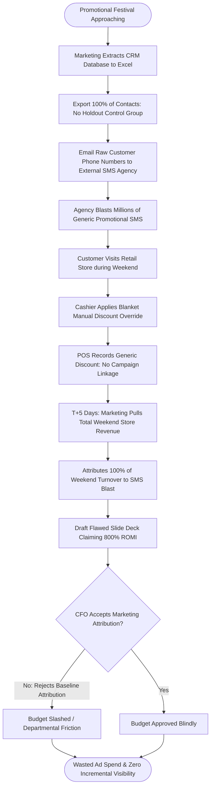

# Northstar Retail Group — Enterprise Retail Analytics Platform
## Business Process AS-IS: BP-007 — Marketing Campaign Effectiveness Measurement

---

### 1. Process Identification & Business Purpose

* **Process ID:** `BP-007-ASIS`
* **Process Title:** Blast Marketing Campaigns & Manual Last-Touch Attribution (Current State)
* **Operational Domain:** Corporate Marketing, CRM & Brand Communications
* **Business Purpose:** Plan promotional marketing campaigns, dispatch mass unsegmented SMS blasts to customer phone databases, and evaluate campaign effectiveness using unscientific last-touch or gross period sales comparisons.

---

### 2. Process Governance & Ownership

* **Accountable Process Owner:** Chief Marketing Officer (Pooja Sharma) & CRM Lead
* **Operational Performers:** Central Marketing Campaign Executives (2 FTEs), Third-Party SMS Aggregator Agency
* **Participating Stakeholders:**
  * CRM Database Administrator (manual extraction of phone numbers into Excel)
  * Bulk SMS Gateway Agency (dispatching unsegmented bulk text messages)
  * Store Cashiers (applying blanket promotional discount overrides at checkout)
  * Executive Committee (consuming inflated campaign ROI claims)

---

### 3. Trigger & Preconditions

* **Process Trigger:** Upcoming festive calendar events (Diwali, Pongal, Eid, Independence Day) or monthly weekend clearance pushes.
* **Preconditions:**
  * Raw customer phone numbers exist in the CRM database.
  * Marketing promotional budget is allocated.

---

### 4. Process Inputs & Outputs

```
+----------------------------------------------------------------------------------------------------+
|                                      PROCESS INPUTS & OUTPUTS                                      |
+------------------------------------+---------------------------------------------------------------+
| INPUTS                             | OUTPUTS                                                       |
+------------------------------------+---------------------------------------------------------------+
| - Unencrypted CRM customer CSVs    | - Mass unsegmented promotional SMS / WhatsApp broadcasts     |
| - Generic store discount codes     | - Unencrypted customer phone spreadsheets emailed to agencies |
| - Vendor bulk messaging rate cards | - Flawed Campaign ROI Slide Decks (`Diwali_ROI_Final_v2.pptx`)|
| - Gross store revenue summaries    | - Inflated marketing attribution claims (100% gross sales)    |
| - Marketing budget expenditure logs| - Discontented customers unsubscribing due to SMS spam fatigue|
+------------------------------------+---------------------------------------------------------------+
```

---

### 5. Detailed AS-IS Activity Workflow

The current marketing process is unscientific, lacks control groups, compromises customer data privacy, and relies on flawed attribution:

```
T-7 Days Planning        T-2 Days Agency Blast    Campaign Weekend         T+5 Days Aggregation     T+10 Days Presentation
+---------------------+  +---------------------+  +---------------------+  +---------------------+  +---------------------+
| Unsegmented CRM CSV |  | Cleartext Customer  |  | Cashiers Apply Flat |  | Central Marketing   |  | Marketing Presents  |
| Extracted to Excel  |->| Phone Numbers Sent  |->| Discount Override   |->| Claims 100% of Store|->| Inflated 800% ROI   |
| (No Holdout Group)  |  | to Bulk SMS Vendor  |  | (No Code Tracking)  |  | Weekend Sales in PPT|  | Deck to Skeptical CFO|
+---------------------+  +---------------------+  +---------------------+  +---------------------+  +---------------------+
```

1. **Step 1 (Ad-Hoc Planning & Audience Extraction):** One week prior to a promotional event, a marketing executive extracts raw customer contact lists from the CRM database into an unencrypted Excel spreadsheet. No control holdout group is created (100% of customers are targeted).
2. **Step 2 (Insecure Agency Data Transmission):** The spreadsheet containing hundreds of thousands of raw customer phone numbers, full names, and shopping histories is emailed to an external bulk messaging agency over unsecured public email, exposing customer PII to substantial leak risks.
3. **Step 3 (Mass Blast Dispatch):** The vendor broadcasts generic SMS messages (e.g., *"Flat 20% Off this Weekend at Northstar Stores! Show this SMS at billing"*).
4. **Step 4 (Checkout Friction & Generic Overrides):** Over the weekend, customers show the SMS at checkout. Because store POS registers lack dynamic barcode scanning or API integration with the CRM, cashiers simply press a generic POS discount override button ("Manager 20% Discount") without recording customer mobile numbers or coupon IDs.
5. **Step 5 (Flawed Gross Attribution):** Following the campaign, marketing calculates campaign revenue by taking **100% of total sales generated across all stores over the campaign weekend**.
6. **Step 6 (Fictitious ROI Reporting):** Marketing calculates Return on Marketing Investment: $\text{ROMI} = \frac{\text{Total Weekend Gross Sales} - \text{Campaign Cost}}{\text{Campaign Cost}}$, claiming astronomical returns of 600% to 1,000%.
7. **Step 7 (Executive Skepticism & Conflict):** The CFO and CEO routinely reject marketing's claims, arguing that regular baseline shoppers would have purchased anyway without the SMS blast. Because marketing cannot prove *incremental sales lift*, marketing budgets are routinely cut.

---

### 6. Supplementary Process Diagram (Mermaid)



*(Note: Formal BPMN 2.0 XML representation is provided in [`bpmn/bp_007_as_is.bpmn`](file:///Users/adibnoushad/Northstar_Retail_Analytics/docs/03_business_process_modeling/bpmn/bp_007_as_is.bpmn)).*

---

### 7. Decision Gateways & Exception Handling Paths

* **Gateway 1 (Agency Delivery Failure):** When SMS delivery drops due to carrier throttling, marketing has no real-time delivery confirmation logs, discovering delivery failures only after the promotional weekend has passed.
* **Gateway 2 (Cashier Override Abuse):** Store cashiers use the generic promotional discount key for personal acquaintances or customers who never received the marketing message, artificially eroding gross margins.
* **Gateway 3 (PII Privacy Vulnerability):** Insecure dissemination of raw phone numbers exposes Northstar to severe reputational damage and regulatory penalties.

---

### 8. Governing Business Rules (AS-IS)

* **Rule ASIS-19:** Promotional SMS broadcasts must be scheduled at least 48 hours prior to the sales event.
* **Rule ASIS-20:** Blanket store discount overrides are capped at 25% without Store Manager physical authorization.
* **Rule ASIS-21:** Campaign performance reporting must be submitted to executive management within 10 days of campaign completion.

---

### 9. Operational Pain Points & Bottlenecks

1. **Zero Visibility into Incremental Lift:** Inability to measure true incremental revenue leads to wasted marketing expenditures on customers who would have bought anyway.
2. **Gross Margin Cannibalization:** Unrestricted discount overrides cannibalize full-price margin without driving new footfall or basket size expansion.
3. **Severe Customer Data Privacy Exposure:** Sharing unencrypted PII across external vendors violates modern enterprise privacy standards.
4. **Executive Distrust:** Ongoing friction between the CMO and CFO undermines strategic marketing investment.

---

### 10. Root-Cause Analysis (Ishikawa 5-Whys)

* *Why cannot management measure true marketing campaign effectiveness?*  
  Because campaigns lack scientific holdout control groups and closed-loop transactional attribution.
* *Why are control groups not maintained?*  
  Because campaign planning is executed manually in spreadsheets without an automated experimentation engine.
* *Why can transactions not be linked to campaigns?*  
  Because store POS systems apply generic discount keys rather than tracking individual customer coupons or pseudonymized identities.
* *Why are customer phone numbers shared insecurely?*  
  Because marketing lacks an automated, privacy-preserving cryptographic pseudonymization pipeline.
* *Root Cause:* **Absence of automated closed-loop attribution, lack of 10% holdout control group governance, and unencrypted customer data handling.**

---

### 11. Traceability & Requirements Mapping

* **Aligned Business Problem:** `BP-06: Difficult Marketing Campaign Measurement`, `BP-02: Fragmented KPI Definitions`
* **Aligned Business Requirement:** `BR-007: Marketing Campaign Effectiveness and Customer Analytics`
* **Aligned Functional Requirements:** `FR-017`, `FR-018`, `FR-020`, `FR-021`, `FR-035`
* **Aligned Agile User Stories:** `US-010`, `US-011`
* **Target Success Criteria:** `SC-07` (Closed-loop attribution with 10% holdout), `SC-08` (100% PII pseudonymization via Keyed HMAC-SHA256)
