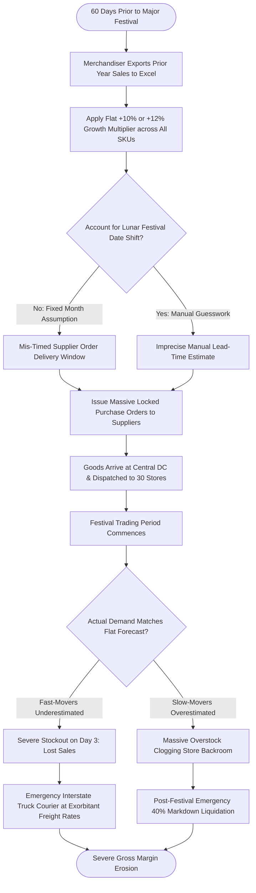

# Northstar Retail Group — Enterprise Retail Analytics Platform
## Business Process AS-IS: BP-008 — Demand Forecasting & Procurement Planning

---

### 1. Process Identification & Business Purpose

* **Process ID:** `BP-008-ASIS`
* **Process Title:** Intuition-Based Demand Forecasting & Flat-Growth Procurement (Current State)
* **Operational Domain:** Central Merchandising, Demand Planning & Procurement
* **Business Purpose:** Forecast future store product demand, establish procurement purchase quantities, and schedule supplier production orders across Northstar’s four retail categories (Electronics, Clothing, Groceries, Home & Kitchen).

---

### 2. Process Governance & Ownership

* **Accountable Process Owner:** VP Supply Chain & Logistics (Sunita Rao) & Merchandising Director
* **Operational Performers:** Central Category Merchandisers (4 FTEs), Procurement Officers
* **Participating Stakeholders:**
  * Category Merchandisers (manual spreadsheet demand modeling)
  * Supplier Account Representatives (negotiating volume minimums and lead times)
  * Store Managers (submitting informal wish-lists for seasonal merchandise)
  * CFO & Finance Committee (approving multi-crore seasonal inventory procurement budgets)

---

### 3. Trigger & Preconditions

* **Process Trigger:** Monthly procurement planning cycle (20th of every month) or seasonal festival planning window (60–90 days prior to major Indian festivals).
* **Preconditions:**
  * Prior year sales figures exported from SAP/ERP system.
  * Category procurement capital budget allocated by corporate finance.

---

### 4. Process Inputs & Outputs

```
+----------------------------------------------------------------------------------------------------+
|                                      PROCESS INPUTS & OUTPUTS                                      |
+------------------------------------+---------------------------------------------------------------+
| INPUTS                             | OUTPUTS                                                       |
+------------------------------------+---------------------------------------------------------------+
| - Prior year gross sales summaries | - Category Procurement Excel Workbooks (`Diwali_Plan_v5.xlsx`)|
| - Merchandiser subjective intuition| - Flat-growth supplier Purchase Orders (PO)                   |
| - Supplier volume discount sheets  | - Emergency freight orders to rebalance stock                 |
| - Informal Store Manager feedback  | - Massive post-festival clearance markdown worklists          |
| - Gregorian calendar dates         | - Severe stockouts of fast-moving festival items              |
+------------------------------------+---------------------------------------------------------------+
```

---

### 5. Detailed AS-IS Activity Workflow

The current forecasting and planning workflow is manual, spreadsheet-bound, and insensitive to regional festive calendar dynamics:

```
T-60 Days Planning       T-45 Days Flat Sizing    T-30 Days PO Release     Festival Active Period   Post-Festival Analysis
+---------------------+  +---------------------+  +---------------------+  +---------------------+  +---------------------+
| Merchandisers Open  |  | Apply Arbitrary +10%|  | Large Advance POs   |  | Severe Stockouts on |  | Massive Clearance   |
| Last Year Excel CSV |->| Flat Growth Target  |->| Placed with Vendors |->| Class-A / Overstock |->| Markdowns & Margin  |
| (Ignore Lunar Shift)|  | (No Elasticity Model|  | (Locked Budgets)    |  | on Slow Goods       |  | Destruction (>35%)  |
+---------------------+  +---------------------+  +---------------------+  +---------------------+  +---------------------+
```

1. **Step 1 (Historical Data Dump):** Merchandisers export historical monthly category sales from the ERP into local Microsoft Excel spreadsheets.
2. **Step 2 (Flat Growth Application):** In the absence of statistical forecasting tools, merchandisers apply a blanket flat growth multiplier (e.g., "Last Year's Diwali Sales $+12\%$") uniformly across all SKUs, regardless of individual product lifecycle, cannibalization, or store footprint expansion.
3. **Step 3 (Lunar Festival Timing Mismatch):** Major Indian festivals follow lunar and lunisolar calendars (Diwali, Eid, Pongal, Ganesh Chaturthi, Durga Puja), shifting their Gregorian dates by 10 to 25 days each year. Merchandisers frequently fail to adjust for these calendar shifts, ordering goods according to last year's calendar months, leading to late product arrivals or premature inventory buildup.
4. **Step 4 (Supplier PO Commitments):** Merchandisers issue large, inflexible Purchase Orders (POs) to domestic and overseas suppliers 30 to 60 days in advance to capture vendor volume discounts.
5. **Step 5 (Severe In-Season Distortion):** When trading begins, popular high-demand items (e.g., specific LED TV models, festive ethnic wear) stock out within days, while slow-moving styles sit untouched. Store managers resort to frantic phone calls requesting emergency courier transfers.
6. **Step 6 (Bullwhip Supply Chain Amplification):** Panic reorders from stores flood the central DC, causing chaotic emergency purchase orders to suppliers at premium rush rates.
7. **Step 7 (Post-Season Margin Liquidation):** Following the festival, stores are left with overstocked inventory. Management is forced to liquidate inventory at steep markdowns (30% to 50% off), eroding seasonal gross margin profitability.

---

### 6. Supplementary Process Diagram (Mermaid)



*(Note: Formal BPMN 2.0 XML representation is provided in [`bpmn/bp_008_as_is.bpmn`](file:///Users/adibnoushad/Northstar_Retail_Analytics/docs/03_business_process_modeling/bpmn/bp_008_as_is.bpmn)).*

---

### 7. Decision Gateways & Exception Handling Paths

* **Gateway 1 (Supplier Minimum Order Quantity Constraint):** When supplier MOQs exceed calculated store demand, merchandisers round up order quantities blindly, disproportionately stocking low-velocity items in store backrooms.
* **Gateway 2 (Emergency Procurement Branch):** Mid-season stockouts trigger manual emergency purchase orders at premium wholesale prices with expedited air/express freight costs.
* **Gateway 3 (Inter-Store Rebalancing Exception):** Stores with excess stock refuse to release inventory to stockout stores, hoarding stock to protect their own local monthly sales quotas.

---

### 8. Governing Business Rules (AS-IS)

* **Rule ASIS-22:** Seasonal procurement purchase orders must be finalized at least 45 days prior to the start of festive trading.
* **Rule ASIS-23:** Category purchase commitments exceeding ₹50 Lakhs require CFO and CEO committee sign-off.
* **Rule ASIS-24:** Clearance markdowns cannot exceed 25% without written authorization from the Merchandising Director.

---

### 9. Operational Pain Points & Bottlenecks

1. **High Forecast Error Rates (MAPE $>35\%$):** Unscientific forecasting causes error rates exceeding 35%, generating concurrent stockouts and overstocks.
2. **Massive Working Capital Blockage:** ₹15+ Crores of corporate capital is trapped in slow-moving inventory following poorly planned seasonal campaigns.
3. **Emergency Expedited Freight Costs:** Frantic mid-season stock rebalancing incurs ₹40–60 Lakhs in avoidable express logistics costs annually.
4. **Substantial Margin Erosion:** Over 22% of total seasonal merchandise is eventually sold at clearance discounts below gross margin targets.

---

### 10. Root-Cause Analysis (Ishikawa 5-Whys)

* *Why do stores experience simultaneous stockouts and overstocking during festival seasons?*  
  Because demand forecasting relies on flat percentage growth spreadsheets rather than statistical time-series models.
* *Why are flat percentage spreadsheets used?*  
  Because merchandisers lack an enterprise analytics forecasting engine with automated feature engineering.
* *Why are festival dates mis-timed?*  
  Because standard spreadsheets do not incorporate automated regional lunisolar festival calendars.
* *Why are lead times and reorder quantities inaccurate?*  
  Because supplier delivery lead-time variability and store-specific sales velocity are not factored into demand algorithms.
* *Root Cause:* **Absence of statistical baseline time-series forecasting, lack of calendar-aware festival modeling, and reliance on manual spreadsheet guesswork.**

---

### 11. Traceability & Requirements Mapping

* **Aligned Business Problem:** `BP-07: Unreliable Sales Forecasting`, `BP-05: Inventory Overstocking and Stockouts`
* **Aligned Business Requirement:** `BR-008: Baseline Statistical Demand Forecasting`
* **Aligned Functional Requirements:** `FR-023`, `FR-024`, `FR-035`
* **Aligned Agile User Stories:** `US-012`, `US-013`
* **Target Success Criteria:** `SC-09` (Forecast MAPE $<18\%$ on Class-A SKUs over 14/30-day horizons)
