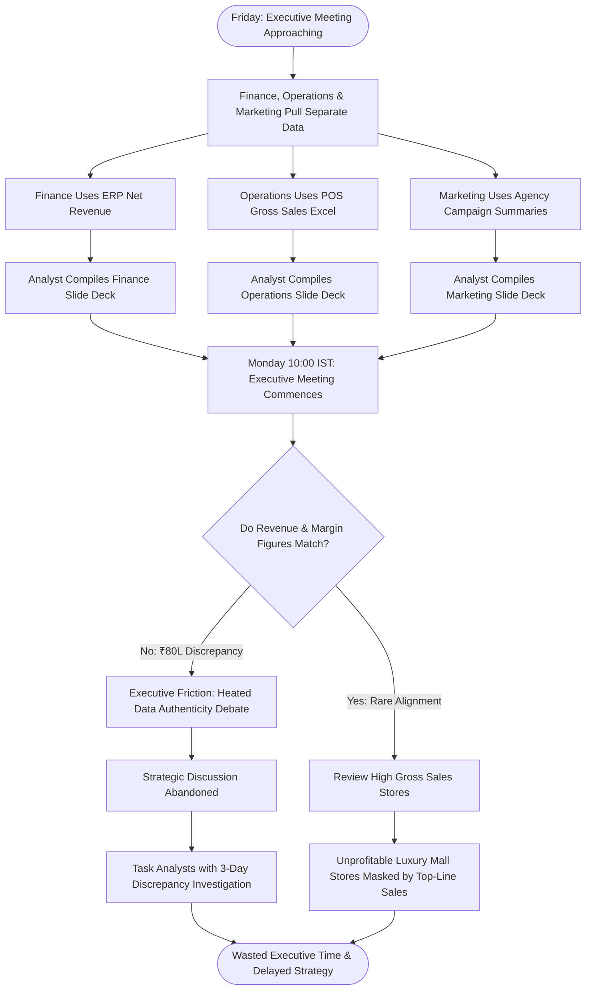

# Northstar Retail Group — Enterprise Retail Analytics Platform
## Business Process AS-IS: BP-009 — Executive Performance Reporting & Leadership Reviews

---

### 1. Process Identification & Business Purpose

* **Process ID:** `BP-009-ASIS`
* **Process Title:** Fragmented Departmental Reporting & Monthly Executive Reviews (Current State)
* **Operational Domain:** C-Suite Executive Leadership, Corporate Strategy & FP&A
* **Business Purpose:** Consolidate enterprise financial, operational, and commercial performance metrics across 30 retail stores and four product categories into leadership presentations for weekly executive committee meetings and monthly board reviews.

---

### 2. Process Governance & Ownership

* **Accountable Process Owner:** Chief Executive Officer (Vikram Singhania) & VP Retail Operations
* **Operational Performers:** Executive Assistants, Departmental Financial Analysts (3 FTEs)
* **Participating Stakeholders:**
  * Executive Committee (CEO, COO, CFO, CMO, VP Supply Chain, VP Operations)
  * Corporate FP&A Lead (compiling financial decks)
  * Retail Operations Regional Directors (presenting operational store performance)
  * Marketing Analytics Lead (presenting campaign metrics)

---

### 3. Trigger & Preconditions

* **Process Trigger:** Weekly Monday morning Executive Committee meeting (10:00 IST) or Monthly Board Review (last Thursday of each month).
* **Preconditions:**
  * Departmental analysts have compiled their respective functional spreadsheets.
  * PowerPoint slide templates are assembled.

---

### 4. Process Inputs & Outputs

```
+----------------------------------------------------------------------------------------------------+
|                                      PROCESS INPUTS & OUTPUTS                                      |
+------------------------------------+---------------------------------------------------------------+
| INPUTS                             | OUTPUTS                                                       |
+------------------------------------+---------------------------------------------------------------+
| - FP&A monthly Excel model         | - Conflicting departmental PowerPoint decks                   |
| - Retail Operations store tracker  | - Disputed revenue totals in Monday morning executive meetings|
| - Marketing agency campaign slides | - Ad-hoc spreadsheet revisions requested during leadership    |
| - ERP accounting trial balances    | - Unprofitable mall stores hidden behind gross sales figures  |
| - Fragmented departmental emails   | - Delayed strategic capital allocation decisions              |
+------------------------------------+---------------------------------------------------------------+
```

---

### 5. Detailed AS-IS Activity Workflow

The current executive reporting process is characterized by conflicting data silos, intense manual preparation, and unproductive leadership disputes:

```
Friday 15:00 - 20:00 IST  Sunday 18:00 - 23:00 IST  Monday 08:30 - 09:45 IST Monday 10:00 - 12:30 IST Tuesday Post-Mortem
+---------------------+  +---------------------+  +---------------------+  +---------------------+  +---------------------+
| Departmental Silos  |  | Analysts Scramble   |  | Competing PPT Decks |  | Heated Disputes in  |  | Analysts Tasked with|
| Export Conflicting  |->| to Patch Formula    |->| Emailed to C-Suite  |->| Executive Meeting   |->| Investigating Why   |
| Spreadsheets (CSV)  |  | Discrepancies       |  | (Differing Figures) |  | (Numbers Challenged)|  | Numbers Don't Match |
+---------------------+  +---------------------+  +---------------------+  +---------------------+  +---------------------+
```

1. **Step 1 (Siloed Data Extractions):** On Friday afternoons, analysts across Finance, Operations, Marketing, and Supply Chain independently extract transactional data from their respective source systems (Finance queries ERP general ledger; Operations opens compiled DSR spreadsheets; Marketing pulls agency reports).
2. **Step 2 (Divergent KPI Calculations):** Each department applies conflicting definitions and formulas:
   * *Operations* defines Revenue as Gross Register Sales before GST and discount deductions.
   * *Finance* defines Revenue as Net Billed Revenue exclusive of GST and customer returns.
   * *Marketing* defines Revenue as total campaign store turnover including unredeemed discount commitments.
3. **Step 3 (Sunday Night Slide Deck Scramble):** Analysts spend weekend hours formatting PowerPoint slides (`Executive_Deck_v8_Final_FINAL.pptx`), copy-pasting tables, and manually drafting explanatory notes.
4. **Step 4 (Competing Numbers at Monday 10:00 IST Meeting):** During the Monday executive review, the CEO and CFO discover that Operations reports weekly store sales of ₹8.4 Crores, while Finance reports ₹7.6 Crores (an ₹80 Lakh discrepancy).
5. **Step 5 (Meeting Derailment):** The executive meeting devolves into argumentative debates over whose numbers are correct, which spreadsheet formula had errors, and why return deductions were timed differently.
6. **Step 6 (Hidden Store Unprofitability):** Because presentations display only gross sales rankings, high-revenue flagship stores in luxury Tier-1 shopping malls (e.g., Brigade Road Bengaluru, South City Mall Kolkata) appear highly successful, completely masking that exorbitant mall rentals and common area maintenance (CAM) charges make them net P&L negative.
7. **Step 7 (Post-Meeting Investigation Action Items):** The meeting concludes without strategic decisions. Analysts are assigned multi-day action items to investigate discrepancies, perpetuating administrative exhaustion.

---

### 6. Supplementary Process Diagram (Mermaid)



*(Note: Formal BPMN 2.0 XML representation is provided in [`bpmn/bp_009_as_is.bpmn`](file:///Users/adibnoushad/Northstar_Retail_Analytics/docs/03_business_process_modeling/bpmn/bp_009_as_is.bpmn)).*

---

### 7. Decision Gateways & Exception Handling Paths

* **Gateway 1 (Metric Definition Conflict):** When discrepancies are identified during executive presentations, the meeting pauses while analysts check cell references on personal laptops.
* **Gateway 2 (Store Closure Evaluation Inability):** When considering underperforming store turnarounds or lease renewals, the executive committee lacks store-level four-wall P&L contribution metrics, relying on crude gross turnover rankings.
* **Gateway 3 (Weekly Strategy Deferral):** Crucial pricing or inventory clearance decisions are routinely postponed to subsequent weeks due to lack of verified performance data.

---

### 8. Governing Business Rules (AS-IS)

* **Rule ASIS-25:** Executive presentation decks must be distributed by Sunday at 20:00 IST prior to Monday leadership meetings.
* **Rule ASIS-26:** Department heads must verbally defend significant metric variances during the review.
* **Rule ASIS-27:** Store rankings are sorted strictly by gross top-line revenue without factoring in rent, utilities, or localized markdown losses.

---

### 9. Operational Pain Points & Bottlenecks

1. **Complete Absence of a Unified Truth:** Executive committee meetings spend up to 45% of allocated time arguing over data validity rather than executing strategic decisions.
2. **Masked Store Unprofitability:** High-turnover destination mall stores operate at substantial net operating losses without executive awareness, draining company cash flow.
3. **Extreme Latency:** Leadership lacks real-time performance visibility, learning about negative trading trends weeks after they occur.
4. **Massive Analyst Administrative Waste:** Over 35 hours of high-value analytical capacity is wasted every week manually formatting PowerPoint slides and debugging Excel formula breaks.

---

### 10. Root-Cause Analysis (Ishikawa 5-Whys)

* *Why does executive leadership spend meetings debating data authenticity?*  
  Because different departments present conflicting revenue and margin numbers for identical trading periods.
* *Why are numbers conflicting?*  
  Because each department extracts data independently and calculates metrics using unstandardized formulas.
* *Why are formulas unstandardized?*  
  Because the organization lacks an enterprise-governed semantic data layer and single source of truth.
* *Why is store profitability invisible?*  
  Because store-level operational costs (rent, staffing, shrinkage) are stored in separate accounting ledgers and never mapped to daily store revenue.
* *Root Cause:* **Absence of a centralized semantic metric engine, lack of automated executive dashboards, and reliance on fragmented departmental PowerPoint presentations.**

---

### 11. Traceability & Requirements Mapping

* **Aligned Business Problem:** `BP-08: Lack of Unified Executive Reporting`, `BP-02: Fragmented KPI Definitions`, `BP-04: Cannot Identify Underperforming Stores`
* **Aligned Business Requirement:** `BR-009: Store Performance Benchmarking and Quadrant Analysis`, `BR-010: Executive Reporting and Performance Dashboards`
* **Aligned Functional Requirements:** `FR-026`, `FR-027`, `FR-029`, `FR-030`, `FR-035`
* **Aligned Agile User Stories:** `US-014`, `US-015`, `US-016`, `US-017`
* **Target Success Criteria:** `SC-10` (Live Executive Cockpit by 06:30 IST), `SC-11` (100% KPI governance certification), `SC-12` (Store quadrant profitability analysis)
