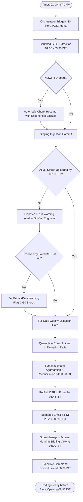

# Northstar Retail Group — Enterprise Retail Analytics Platform
## Business Process TO-BE: BP-001 — Automated Daily Sales Reporting & Distribution

---

### 1. Process Identification & Business Purpose

* **Process ID:** `BP-001-TOBE`
* **Process Title:** Automated Daily Sales Reporting & Executive Publishing (Target State)
* **Operational Domain:** Store Operations, Corporate FP&A & Executive Governance
* **Business Purpose:** Automatically extract, validate, reconcile, and publish verified Daily Sales Reports (DSR) and operational morning briefing dashboards across all 30 retail stores by **06:00 IST daily**, completely eliminating manual spreadsheet compilation.

---

### 2. Process Governance & Ownership

* **Accountable Process Owner:** VP Retail Operations (K. R. Ramanathan)
* **Operational Performers:** Automated Analytics Ingestion Engine, Cloud Orchestrator, Semantic Model Publisher
* **Participating Stakeholders:**
  * Store Managers (consumer of morning briefing views by 06:00 IST)
  * Corporate FP&A Analysts (consumer of automated reconciliation and sales data marts)
  * Regional Operations Directors (consumer of territorial cluster digests)
  * Executive Committee (CEO, COO, CFO — consumer of executive dashboard by 06:30 IST)

---

### 3. Trigger & Preconditions

* **Process Trigger:** Scheduled cron event at **01:00 IST** every calendar day (initiating the off-peak batch ingestion window per Decision `BDL-01`).
* **Preconditions:**
  * Store POS registers have completed automated local end-of-day closure.
  * Ingestion service accounts have read-only access to local store POS database replicas.
  * Analytical cloud data platform staging resources are online.

---

### 4. Process Inputs & Outputs

```
+----------------------------------------------------------------------------------------------------+
|                                      PROCESS INPUTS & OUTPUTS                                      |
+------------------------------------+---------------------------------------------------------------+
| INPUTS                             | OUTPUTS                                                       |
+------------------------------------+---------------------------------------------------------------+
| - POS transactional tables         | - Automated Master DSR (PDF/Email) published by 06:00 IST     |
|   (`sales_header`, `sales_lines`,  | - Store Operations Morning Briefing Dashboard (Live at 06:00) |
|    `tender_lines`, `returns`)      | - Executive Command Cockpit Data Mart (Live at 06:30 IST)     |
| - Store Master metadata            | - Quarantined transactional exception log (`<0.2%` rate)     |
| - Calendar & Festive index table   | - Automated Missing-Store Alert Digest (if applicable)        |
+------------------------------------+---------------------------------------------------------------+
```

---

### 5. Detailed TO-BE Activity Workflow

The automated TO-BE process executes across four synchronized, hands-off phases:

```
01:00 - 04:00 IST        04:00 - 04:30 IST        04:30 - 05:30 IST        05:30 - 06:00 IST        06:30 IST
+---------------------+  +---------------------+  +---------------------+  +---------------------+  +---------------------+
| Off-Peak Ingestion  |  | Data Quality &      |  | Aggregation & DSR   |  | Automated Email/PDF |  | Executive Cockpit   |
| (30 Store Agents,   |->| Four-Way Recon Gate |->| Semantic Compilation|->| Push & Store Mobile |->| Refresh (iPad & Web)|
| 5 MB GZIP Chunks)   |  | (Quarantine Filter) |  | (Single Truth Mart) |  | (Floor Briefing)    |  | (C-Suite Cockpit)   |
+---------------------+  +---------------------+  +---------------------+  +---------------------+  +---------------------+
```

1. **Phase 1: Scheduled Off-Peak Batch Extraction (01:00–04:00 IST):**
   * At 01:00 IST, the central orchestrator triggers lightweight ingestion agents on local store servers across all 30 retail stores.
   * Agents extract previous-day sales lines, GZIP compress data, and stream payload in sequential 5 MB chunks over TLS 1.3 to cloud staging (`FR-001`, `FR-002`, `NFR-001`).
   * If network drops occur, the agent pauses and automatically resumes from the last acknowledged byte offset with exponential backoff (`NFR-026`).
2. **Phase 2: Missing-Store Surveillance & Data Quality Gate (03:30–04:30 IST):**
   * *03:30 IST Checkpoint:* If any store has not uploaded, an automated warning dispatches to On-Call Data Engineering.
   * *04:00 IST Critical Gate:* Escalation dispatches to IT Operations Lead and Regional Director.
   * *04:00–04:30 IST DQ Gate:* Ingestion validation rules inspect incoming lines for null receipt IDs, negative stock, and unmapped barcodes (`FR-035`). Corrupt lines are routed to `quarantine_exceptions` without aborting valid processing.
   * *04:30 IST Partial-Data Cut-off:* If a store remains offline, processing continues with available stores, appending a prominent `WARNING: PARTIAL DATA (X/30 Stores)` banner.
3. **Phase 3: Semantic Aggregation & Four-Way Reconciliation (04:30–05:30 IST):**
   * The transformation engine calculates Net Sales (Rule `BRL-01`), FIFO Cost of Goods Sold (Rule `BRL-02`), and Gross Margin % through the governed semantic layer (`FR-026`).
   * Concurrently, automated four-way reconciliation runs, matching POS sales to till tapes, payment tenders to bank logs, and scanned units to ERP stock decrements (`FR-010`–`FR-013`).
4. **Phase 4: Automated Publishing & Executive Delivery (05:30–06:30 IST):**
   * *05:45 IST:* Standardized DSR data marts are committed and validated.
   * *06:00 IST:* Automated email dispatch pushes formatted summary tables and attached PDF reports to leadership inboxes (`FR-032`). Concurrently, the Store Operations Morning Briefing Workbench goes live on store managers' mobile tablets (`FR-005`).
   * *06:30 IST:* The Executive Command Dashboard refreshes with verified C-Suite visualizations (`FR-029`).

---

### 6. Supplementary Process Diagram (Mermaid)



*(Note: Formal BPMN 2.0 XML representation is provided in [`bpmn/bp_001_to_be.bpmn`](file:///Users/adibnoushad/Northstar_Retail_Analytics/docs/03_business_process_modeling/bpmn/bp_001_to_be.bpmn)).*

---

### 7. Decision Gateways & Automated Exception Paths

* **Exclusive Gateway (XOR) — Network Interruption:** Handled autonomously by the store edge client; retries up to 5 times over 15 minutes before triggering an operational alert.
* **Exclusive Gateway (XOR) — Missing-Store Processing:** If broadband fails completely in a store, the pipeline does **not halt**. It enforces the 04:30 IST cut-off, generates partial enterprise reports with explicit missing store notices, and executes an automated delta re-run once the delayed store connects.
* **Exclusive Gateway (XOR) — Data Quality Gate:** If corrupt lines $<2\%$, process clean lines and quarantine bad lines; if $>2\%$, alert data engineering lead while processing valid data.

---

### 8. Governing Business Rules (TO-BE)

* **Rule BRL-01 (Net Sales):** $\text{Net Sales} = \text{Gross Sales} - \text{Customer Returns} - \text{Line Discounts (Inclusive of GST)}$.
* **Rule BRL-08 (Off-Peak Extraction):** POS extraction must execute strictly between 01:00 and 04:00 IST; daytime production queries are prohibited.
* **Rule TOBE-01 (Reporting SLA):** DSR reports must be published and distributed no later than 06:00 IST on $\ge 99.0\%$ of operating trading days.
* **Rule TOBE-02 (Audit Immutability):** Daily published DSR snapshots are archived immutably; retroactive changes require automated delta journal entries.

---

### 9. Automation Opportunities & Process Enhancements

1. **Complete Elimination of Manual Data Entry:** Relieves 30 Store Managers of 90 minutes of nightly administrative copy-pasting (**1,350 hours saved monthly across the chain**).
2. **Zero Central Data Cleansing:** Frees 2 central FP&A analysts from 20 hours/week of manual spreadsheet repairs, reallocating capacity to strategic financial analysis.
3. **10-Hour Latency Compression:** Executive performance visibility advances from 16:00 IST the next afternoon to **06:00 IST before morning store opening**.
4. **Standardized Single Version of Truth:** All 30 stores and corporate leadership consume metrics derived from an identical, code-governed semantic layer.

---

### 10. Traceability & Requirements Mapping

* **Aligned Business Requirement:** `BR-001: Automated Daily Sales Ingestion and Delivery`, `BR-010: Executive Dashboards`
* **Aligned Functional Requirements:** `FR-001`, `FR-002`, `FR-004`, `FR-005`, `FR-029`, `FR-032`, `FR-035`
* **Aligned Non-Functional Requirements:** `NFR-001` (3.5hr Batch SLA), `NFR-002` (3s UI load), `NFR-018` (Store Completeness SLA), `NFR-025`, `NFR-026`
* **Aligned Agile User Stories:** `US-001`, `US-002`, `US-003`, `US-018`, `US-019`
* **Aligned Success Metrics:** `SC-01` ($\ge 99.0\%$ DSR delivered by 06:00 IST), `SC-02` ($\ge 85\%$ store manager administrative time reduction)

---

### 11. Process Acceptance Criteria

1. On 100% of standard trading days, the master DSR is generated and available in the analytical portal by 05:45 IST without human intervention.
2. DSR email dispatches complete before 06:00 IST with zero formula errors or broken formatting.
3. Net sales totals in the automated DSR match verified register closing audit totals within $\pm ₹0.00$.
4. In simulated Tier-2 broadband disconnect tests, ingestion resumes idempotently without duplicating sales lines.

