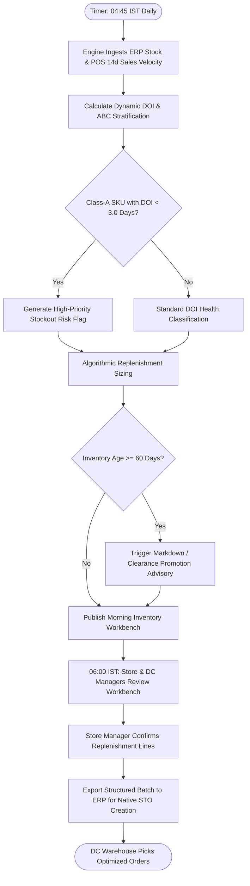

# Northstar Retail Group — Enterprise Retail Analytics Platform
## Business Process TO-BE: BP-002 — Automated Inventory Health & Dynamic Replenishment Advisory

---

### 1. Process Identification & Business Purpose

* **Process ID:** `BP-002-TOBE`
* **Process Title:** Automated Inventory Health Monitoring & Dynamic Replenishment Advisory (Target State)
* **Operational Domain:** Supply Chain, Central Warehousing & Store Operations
* **Business Purpose:** Automatically calculate store-level stock health, monitor dynamic Days of Inventory (DOI), trigger proactive alerts for high-velocity Class-A stockout risks ($<3$ days DOI), and generate prioritized replenishment and aging markdown advisories by **06:00 IST daily**, while preserving a read-only architectural boundary with operational ERP systems.

---

### 2. Process Governance & Ownership

* **Accountable Process Owner:** VP Supply Chain & Logistics (Sunita Rao)
* **Operational Performers:** Automated Analytics Replenishment Engine, Central DC Allocation Planners, Store Inventory Leads
* **Participating Stakeholders:**
  * Store Inventory Supervisors & Store Managers (review automated daily reorder worklists)
  * Central DC Inventory Planners (review algorithmic allocation recommendations)
  * Merchandising Category Managers (review aging markdown advisories at 60/90/120 days)
  * Procurement Buyers (utilize consolidated DC stock requirement forecasts)

---

### 3. Trigger & Preconditions

* **Process Trigger:** Scheduled execution at **04:45 IST daily** (following completion of POS sales ingestion and ERP stock sync).
* **Preconditions:**
  * Previous-day transactional sales data successfully ingested and validated (`FR-001`).
  * Midnight ERP on-hand inventory snapshot successfully extracted (`FR-007`).
  * SKU Master data with ABC/XYZ velocity classifications and lead-time parameters is updated.

---

### 4. Process Inputs & Outputs

```
+----------------------------------------------------------------------------------------------------+
|                                      PROCESS INPUTS & OUTPUTS                                      |
+------------------------------------+---------------------------------------------------------------+
| INPUTS                             | OUTPUTS                                                       |
+------------------------------------+---------------------------------------------------------------+
| - Clean POS daily sales history    | - Store-level Dynamic DOI calculations for all active SKUs    |
| - Midnight ERP stock balance feed  | - Class-A Stockout Warning Alert Digest (DOI < 3.0 days)      |
| - DC on-hand and in-transit orders | - Algorithmic DC-to-Store Replenishment Recommendation Feed   |
| - SKU ABC/XYZ classification flags | - Stock Aging & Clearance Markdown Advisory (60/90/120 days)  |
| - Store-DC replenishment lead-time | - Phantom Inventory Discrepancy Worklist (`FR-012`)           |
+------------------------------------+---------------------------------------------------------------+
```

---

### 5. Detailed TO-BE Activity Workflow

The automated TO-BE process executes across four analytical and operational phases every morning:

```
04:45 - 05:15 IST        05:15 - 05:45 IST        06:00 IST                08:30 - 10:30 IST
+---------------------+  +---------------------+  +---------------------+  +---------------------+
| Dynamic DOI & ABC   |  | Exception Triage &  |  | Morning Advisory    |  | One-Click Indent    |
| Velocity Analytics  |->| Allocation Scoring  |->| Publishing to Store |->| Review & DC Order   |
| (Cloud Engine)      |  | (Class-A & Aging)   |  | & DC Workbenches    |  | Release (ERP PO/TO) |
+---------------------+  +---------------------+  +---------------------+  +---------------------+
```

1. **Phase 1: Dynamic Days of Inventory (DOI) Computation (04:45–05:15 IST):**
   * The analytics engine joins ERP store on-hand stock with trailing 14-day and 30-day average daily sales velocity (`FR-007`).
   * Dynamic DOI is calculated per SKU per store: $\text{DOI} = \frac{\text{Current On-Hand Stock}}{\text{Average Daily Unit Sales (Trailing 14 Days)}}$.
   * Items are stratified dynamically into ABC classifications based on rolling gross margin and sales revenue contributions.
2. **Phase 2: Risk Flagging & Markdown Aging Analysis (05:15–05:45 IST):**
   * **Class-A Stockout Gate:** Any Class-A SKU with $\text{DOI} < 3.0 \text{ days}$ (or stock $\le$ supplier lead-time demand) is flagged with an immediate Critical Stockout Warning (`FR-008`).
   * **Aging Inventory Gate:** Inventory residing in stores for $\ge 60 \text{ days}$ (Slow), $\ge 90 \text{ days}$ (Stagnant), or $\ge 120 \text{ days}$ (Obsolete) is tagged for promotional clearance or markdown optimization (`FR-009`).
3. **Phase 3: Algorithmic Replenishment Recommendation Generation (05:45–06:00 IST):**
   * The platform calculates optimal replenishment quantities using economic reorder logic: $\text{Reorder Qty} = (\text{Daily Velocity} \times (\text{Lead Time} + \text{Review Period})) + \text{Safety Stock} - \text{On-Hand} - \text{In-Transit}$.
   * Constrained DC allocation logic apportions scarce stock based on store sales velocity and historical margin yield, replacing arbitrary manual rationing.
4. **Phase 4: Operational Action & ERP PO Execution (08:30–10:30 IST):**
   * At 06:00 IST, Store Managers access their *Morning Replenishment Workbench* (`FR-005`), reviewing auto-generated reorder suggestions.
   * Store Managers review and approve recommended quantities with a single review workflow. Per Decision `BDL-04` (Read-Only Architecture), approved order payloads are exported as structured ERP import batches, where native ERP controls execute Stock Transfer Orders (STO) without unmonitored analytical write-backs.

---

### 6. Supplementary Process Diagram (Mermaid)



*(Note: Formal BPMN 2.0 XML representation is provided in [`bpmn/bp_002_to_be.bpmn`](file:///Users/adibnoushad/Northstar_Retail_Analytics/docs/03_business_process_modeling/bpmn/bp_002_to_be.bpmn)).*

---

### 7. Decision Gateways & Automated Exception Paths

* **Exclusive Gateway (XOR) — Stockout Severity Assessment:** If a Class-A SKU has $\text{DOI} < 1.0 \text{ day}$, the engine triggers an Emergency Inter-Store Transfer Advisory, recommending the nearest store with excess stock ($>25 \text{ days DOI}$) to rebalance stock.
* **Exclusive Gateway (XOR) — Central DC Scarcity Apportionment:** If total store demand exceeds DC stock, available units are algorithmically rationed proportionally to each store's 14-day sales velocity rather than arbitrary flat cuts.
* **Exclusive Gateway (XOR) — Markdown Action Threshold:** Aging inventory reaching 90 days triggers an automated recommendation for an end-cap display shift or a 15% promotional discount in regional marketing campaigns.

---

### 8. Governing Business Rules (TO-BE)

* **Rule BRL-04 (Class-A Stockout SLA):** Any Class-A inventory item with $<3$ days of forward coverage must appear in the top-priority morning triage dashboard for regional supply chain managers.
* **Rule BRL-05 (Aging Markdown Hierarchy):** Stock aging buckets are strictly defined as: Normal ($<60 \text{ days}$), Slow Moving ($60\text{--}89 \text{ days}$), Stagnant ($90\text{--}119 \text{ days}$), and Obsolete ($\ge 120 \text{ days}$).
* **Rule BDL-04 (Read-Only Safety Guardrail):** The analytics platform provides advisory recommendations and structured batch export files; direct programmatic write-backs or automated order insertion into operational ERP database tables are strictly forbidden.

---

### 9. Automation Opportunities & Process Enhancements

1. **Elimination of Floor Audits:** Eliminates 60 minutes of daily clipboard inspections per store, saving **900 hours of store labor monthly across 30 stores**.
2. **Velocity-Driven Stock Allocation:** Replaces subjective Store Manager lobbying with mathematical replenishment sizing based on actual local demand.
3. **Drastic Stockout Reduction:** Early warning indicators allow DC planners to schedule replenishments before shelves stock out, driving Class-A stockout rates from $\sim 14\%$ down to $<4\%$ (`SC-06`).
4. **Proactive Working Capital Recovery:** Automated aging markdown advisories accelerate the liquidation of stale stock, reducing holding costs by an estimated ₹1.8 Crore annually (`SC-07`, `SC-08`).

---

### 10. Traceability & Requirements Mapping

* **Aligned Business Requirement:** `BR-003: Inventory Health and Stockout Prevention`
* **Aligned Functional Requirements:** `FR-007`, `FR-008`, `FR-009`, `FR-012`, `FR-035`
* **Aligned Non-Functional Requirements:** `NFR-001` (Off-peak batch SLA), `NFR-002` (Workbench latency $<3\text{s}$), `NFR-008` (Auditability)
* **Aligned Agile User Stories:** `US-004`, `US-005`, `US-006`
* **Aligned Success Metrics:** `SC-06` (High-velocity stockout frequency reduction $\ge 25\%$; Class-A stockout rate $<4\%$), `SC-07` (Inventory holding efficiency DOI 10–15% improvement), `SC-08` (Markdown margin recovery 100–150 bps), `SC-02` (Store administrative efficiency)

---

### 11. Process Acceptance Criteria

1. Dynamic DOI is calculated accurately for 100% of active SKUs across all 30 retail stores by 05:15 IST daily.
2. 100% of Class-A SKUs with $\text{DOI} < 3.0 \text{ days}$ trigger an automated triage entry in the Morning Replenishment Workbench.
3. Algorithmic replenishment recommendations match verified economic order quantity formulas within $\pm 1$ unit.
4. All markdown recommendations strictly adhere to the 60/90/120-day age thresholds without false positive aging flags.
