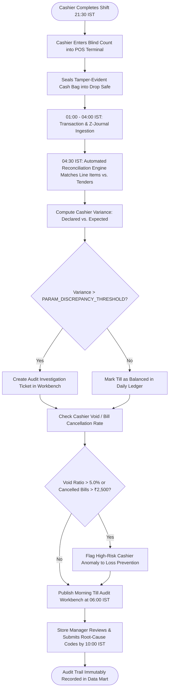

# Northstar Retail Group — Enterprise Retail Analytics Platform
## Business Process TO-BE: BP-003 — Automated POS-Till Reconciliation & Cashier Audit

---

### 1. Process Identification & Business Purpose

* **Process ID:** `BP-003-TOBE`
* **Process Title:** Automated POS-Till Reconciliation & Cashier Anomaly Surveillance (Target State)
* **Operational Domain:** Store Cash Operations, Internal Audit & Corporate Loss Prevention
* **Business Purpose:** Automatically ingest digital till closing journals, reconcile POS line-item transactions against declared drawer tenders, detect cashier-level overages/shortages, flag abnormal void/cancellation ratios ($>5.0\%$), and automatically generate investigation tickets for variances exceeding the configurable threshold (`PARAM_DISCREPANCY_THRESHOLD`, default ₹500) by **05:15 IST daily**.

---

### 2. Process Governance & Ownership

* **Accountable Process Owner:** Head of Internal Audit (Deepak Sharma) & VP Retail Operations
* **Operational Performers:** Automated Reconciliation Pipeline, Cash Office Supervisors, Store Internal Auditors
* **Participating Stakeholders:**
  * Store Cashiers (digital end-of-shift drawer declaration on POS terminal)
  * Cash Office Supervisors (digital count entry and secure bank pouch scan)
  * Store Managers (morning review of flagged cashier variances)
  * Regional Internal Auditors & Loss Prevention Leads (automated discrepancy investigation)

---

### 3. Trigger & Preconditions

* **Process Trigger:** Scheduled execution at **04:30 IST daily** (following completion of POS raw transaction and till journal extraction).
* **Preconditions:**
  * Cashiers have entered closing count declarations directly into POS software at shift end.
  * Ingestion agents have extracted POS sales headers, line items, tender records, and register closing journals (`FR-001`, `FR-010`).
  * Ingestion validation gate has verified data integrity without pipeline truncation.

---

### 4. Process Inputs & Outputs

```
+----------------------------------------------------------------------------------------------------+
|                                      PROCESS INPUTS & OUTPUTS                                      |
+------------------------------------+---------------------------------------------------------------+
| INPUTS                             | OUTPUTS                                                       |
+------------------------------------+---------------------------------------------------------------+
| - POS transactional line items     | - Daily Cashier Till Reconciliation Ledger                    |
| - Cashier digital tender counts    | - Automated Cashier Overage / Shortage Scorecard              |
| - Register closing journals (Z-log)| - Cashier High-Void / Anomaly Exception Alerts (>5% rate)     |
| - Cashier shift master records     | - Automated Investigation Tickets (Variance > threshold)      |
| - `PARAM_DISCREPANCY_THRESHOLD`    | - Store Morning Till Audit Workbench View (`FR-010`, `FR-016`)|
+------------------------------------+---------------------------------------------------------------+
```

---

### 5. Detailed TO-BE Activity Workflow

The automated TO-BE process executes across four synchronized phases:

```
21:30 - 22:00 IST        04:30 - 05:00 IST        05:00 - 05:15 IST        06:00 IST
+---------------------+  +---------------------+  +---------------------+  +---------------------+
| Blind Digital Count |  | Ingestion & Digital |  | Cashier Void Anomaly|  | Morning Audit       |
| Declaration on POS  |->| Till Matching Engine|->| & Shortage Ticket   |->| Workbench & Store   |
| (No Paper Forms)    |  | (Cloud Recon Hub)   |  | Generation (>₹500)  |  | Manager Sign-Off    |
+---------------------+  +---------------------+  +---------------------+  +---------------------+
```

1. **Phase 1: Digital Blind Count Declaration (21:30–22:00 IST):**
   * At shift end, the cashier inputs physical cash count by denomination into the POS terminal screen. The system enforces a *blind count* (the POS terminal does not display the system-expected cash total, preventing cashier adjustment).
   * Cash is placed in a barcode-sealed, tamper-evident security bag and transferred to the store drop-safe.
2. **Phase 2: Automated Line-Item to Till Journal Matching (04:30–05:00 IST):**
   * The cloud reconciliation engine extracts all line-item transactions for the shift: $\sum (\text{Tender Received}) - \sum (\text{Tender Refunded}) = \text{System Expected Total}$.
   * Expected totals are compared against cashier declared counts for each individual till lane and cashier ID (`FR-010`).
   * Net Cash Variance is computed: $\Delta_{\text{Till}} = \text{Declared Tender} - \text{Expected Tender}$.
3. **Phase 3: Cashier Anomaly Detection & Ticket Dispatch (05:00–05:15 IST):**
   * **Discrepancy Threshold Gate:** If $|\Delta_{\text{Till}}| > \text{PARAM\_DISCREPANCY\_THRESHOLD}$ (provisional default ₹500 per Decision `BDL-06`), the platform automatically logs an audit ticket assigned to the Store Manager and Regional Loss Prevention (`FR-010`, `FR-016`).
   * **Void Anomaly Gate:** The engine scans cashier line voids and post-total bill cancellations (`FR-021`). If a cashier's void transaction rate exceeds **5.0% of total scanned lines** (or $>₹2,500$ daily void value), a High-Risk Cashier Anomaly flag is raised.
4. **Phase 4: Store Morning Sign-Off & Audit Portal Access (06:00 IST):**
   * At 06:00 IST, the Store Manager opens the *Store Till Audit Workbench* (`FR-010`, `FR-016`) on their tablet, reviews flagged cashier variances from the night before, and must enter a mandatory explanatory reason code for all open tickets before 10:00 IST.

---

### 6. Supplementary Process Diagram (Mermaid)



*(Note: Formal BPMN 2.0 XML representation is provided in [`bpmn/bp_003_to_be.bpmn`](file:///Users/adibnoushad/Northstar_Retail_Analytics/docs/03_business_process_modeling/bpmn/bp_003_to_be.bpmn)).*

---

### 7. Decision Gateways & Automated Exception Paths

* **Exclusive Gateway (XOR) — Configurable Variance Severity:**
  * $|\Delta| \le ₹50$: Cleared automatically as acceptable cashier round-off tolerance.
  * $₹50 < |\Delta| \le \text{PARAM\_DISCREPANCY\_THRESHOLD}$: Flagged on Store Manager morning report; no formal ticket created.
  * $|\Delta| > \text{PARAM\_DISCREPANCY\_THRESHOLD}$ (₹500): Immediate audit ticket dispatched; requires Store Manager and Cashier co-signature within 24 hours.
* **Exclusive Gateway (XOR) — Void Anomaly Surveillance:** Cashiers with consecutive 3-day void ratios $>5\%$ are automatically flagged for physical register surveillance camera audit by Regional Loss Prevention.

---

### 8. Governing Business Rules (TO-BE)

* **Rule BRL-06 (Threshold Configurability):** Till discrepancy ticketing must be driven by `PARAM_DISCREPANCY_THRESHOLD`, provisionally set to ₹500 and configurable per store tier pending CFO sign-off (`BDL-06`).
* **Rule TOBE-03 (Blind Balancing):** POS registers must never display expected drawer cash to the cashier during end-of-shift declaration.
* **Rule TOBE-04 (Mandatory Justification):** Store Managers cannot close out a daily till discrepancy ticket without selecting a validated audit reason code (e.g., Shortage Paid, Keying Error, Coin Shortage, Fraud Investigation).

---

### 9. Automation Opportunities & Process Enhancements

1. **Elimination of Paper Auditing:** Completely eliminates paper settlement sheets, saving 2 hours of Cash Office Supervisor labor per store per night (**1,800 hours saved monthly chain-wide**).
2. **Immediate Anomaly Detection:** Compresses cashier theft and skimming detection latency from 30 days down to **less than 8 hours**.
3. **Configurable Financial Governance:** Enables corporate finance to tune investigation thresholds centrally without touching local store registers.
4. **Loss Prevention Precision:** Automated void anomaly monitoring isolates suspect register behavior before substantial shrinkage accumulates.

---

### 10. Traceability & Requirements Mapping

* **Aligned Business Requirement:** `BR-004: Automated Financial and Transactional Reconciliation`
* **Aligned Functional Requirements:** `FR-010`, `FR-021`, `FR-016`, `FR-035`
* **Aligned Non-Functional Requirements:** `NFR-001` (Batch SLA), `NFR-008` (Audit immutability), `NFR-017` (Discrepancy threshold flexibility)
* **Aligned Agile User Stories:** `US-007`, `US-008`
* **Aligned Success Metrics:** `SC-04` (POS vs. ERP Financial Reconciliation Variance reduction $\ge 80\%$)

---

### 11. Process Acceptance Criteria

1. 100% of store register shifts are digitally reconciled against ingested POS line items by 05:00 IST daily.
2. An automated audit ticket is created for 100% of cashier variances exceeding `PARAM_DISCREPANCY_THRESHOLD`.
3. Cashiers with void rates $>5.0\%$ or cancelled sales $>₹2,500$ are flagged on the Morning Till Audit Workbench with zero false negative omissions.
4. Discrepancy threshold parameters can be adjusted via central configuration tables without modifying pipeline code.
