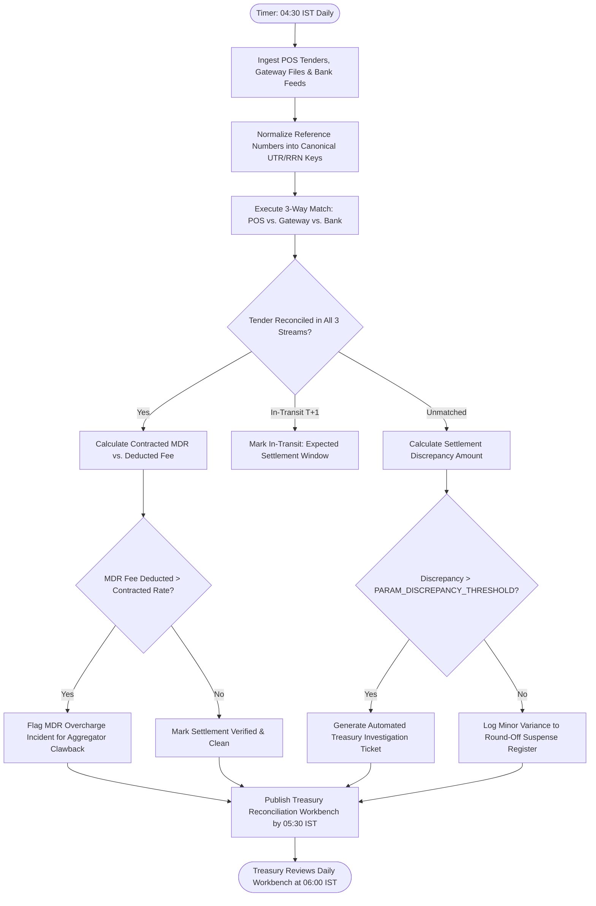

# Northstar Retail Group — Enterprise Retail Analytics Platform
## Business Process TO-BE: BP-004 — Automated Three-Way Payment Settlement Reconciliation

---

### 1. Process Identification & Business Purpose

* **Process ID:** `BP-004-TOBE`
* **Process Title:** Automated Three-Way Payment Settlement & Gateway Fee Audit (Target State)
* **Operational Domain:** Corporate Treasury, Finance Operations & Revenue Assurance
* **Business Purpose:** Automatically execute daily three-way matching between store POS payment tender logs, payment aggregator batch files (Pine Labs, Paytm, Razorpay), and corporate bank acquiring statement feeds; detect fee leakages against contracted Merchant Discount Rates (MDR); and automatically trigger investigation tickets for settlement variances exceeding `PARAM_DISCREPANCY_THRESHOLD` (provisional default ₹500) by **05:30 IST daily**.

---

### 2. Process Governance & Ownership

* **Accountable Process Owner:** Chief Financial Officer (Rajesh Khandelwal) & Treasury Controller
* **Operational Performers:** Automated Financial Reconciliation Pipeline, Corporate Treasury Analysts
* **Participating Stakeholders:**
  * Store Cashiers (capturing EDC reference numbers and UPI IDs at checkout)
  * Payment Aggregators (Pine Labs, Razorpay, Paytm automated SFTP/API feeds)
  * Corporate Acquiring Banks (daily automated BAI2 / MT940 bank statement feeds)
  * Treasury & Financial Controllers (morning review of automated settlement workbench)

---

### 3. Trigger & Preconditions

* **Process Trigger:** Scheduled execution at **04:30 IST daily** (following completion of POS sales ingestion and bank/gateway feed staging).
* **Preconditions:**
  * Previous-day POS tender line records extracted and staged (`FR-001`, `FR-011`).
  * Aggregator batch settlement logs and bank account statements received via secure file feeds (`FR-011`).
  * Contracted MDR rate master table is maintained with negotiated fee percentages.

---

### 4. Process Inputs & Outputs

```
+----------------------------------------------------------------------------------------------------+
|                                      PROCESS INPUTS & OUTPUTS                                      |
+------------------------------------+---------------------------------------------------------------+
| INPUTS                             | OUTPUTS                                                       |
+------------------------------------+---------------------------------------------------------------+
| - POS payment tender line items    | - Daily Three-Way Payment Settlement Reconciliation Ledger    |
| - Aggregator settlement batch feeds| - Automated MDR Fee Discrepancy & Overcharge Audit Report     |
| - Corporate bank statement feeds   | - Unmapped / In-Transit Payment Aging Dashboard               |
| - Contracted MDR rate fee table    | - Automated Treasury Investigation Tickets (>₹500 variance)   |
| - `PARAM_DISCREPANCY_THRESHOLD`    | - Treasury Settlement Reconciliation Workbench View (`FR-011`, `FR-016`)|
+------------------------------------+---------------------------------------------------------------+
```

---

### 5. Detailed TO-BE Activity Workflow

The automated TO-BE process executes across four analytical phases every morning:

```
04:30 - 05:00 IST        05:00 - 05:15 IST        05:15 - 05:30 IST        06:00 IST
+---------------------+  +---------------------+  +---------------------+  +---------------------+
| Ingestion of Bank,  |  | Algorithmic 3-Way   |  | MDR Contract Audit  |  | Treasury Morning    |
| Gateway & POS Feeds |->| Canonical Matching  |->| & Variance Ticket   |->| Settlement Work-    |
| (Cloud Staging)     |  | (POS-Gateway-Bank)  |  | Generation (>₹500)  |  | bench Live (Web)    |
+---------------------+  +---------------------+  +---------------------+  +---------------------+
```

1. **Phase 1: Multi-Source Feed Ingestion & Canonical Normalization (04:30–05:00 IST):**
   * The pipeline ingests POS tender tables, Pine Labs batch settlement files, UPI settlement reports, and corporate bank statement feeds (`FR-011`).
   * Transaction identifiers (Retrieval Reference Numbers / RRN, Universal Transaction References / UTR, and Bank Transaction IDs) are parsed and normalized into a unified canonical key format.
2. **Phase 2: Algorithmic Three-Way Reconciliation Matching (05:00–05:15 IST):**
   * **Match 1 (POS to Gateway):** POS tenders are matched against aggregator capture logs by RRN and exact transaction amount.
   * **Match 2 (Gateway to Bank):** Aggregator payout batches are matched against credit entries in corporate bank accounts.
   * Transactions are classified into standard audit states: *Reconciled*, *In-Transit (T+1/T+2 Window)*, *Unmatched POS Tender*, or *Unmatched Bank Credit*.
3. **Phase 3: MDR Fee Audit & Discrepancy Ticketing (05:15–05:30 IST):**
   * For reconciled digital transactions, the engine computes contracted fees: $\text{Expected Fee} = \text{Gross Amount} \times \text{Contracted MDR \%}$.
   * The engine compares expected fees against actual deducted gateway fees. If actual deductions exceed contracted rates by $\ge ₹100$, an *MDR Overcharge Alert* is logged.
   * **Threshold Ticket Dispatch:** For any unexplained net settlement variance exceeding `PARAM_DISCREPANCY_THRESHOLD` (provisional default ₹500 per `BDL-06`), an automated discrepancy ticket is logged in the Treasury Workbench (`FR-011`, `FR-016`).
4. **Phase 4: Treasury Workbench Publishing & Exception Resolution (06:00 IST):**
   * At 06:00 IST, the *Treasury Settlement Workbench* goes live for corporate finance teams.
   * Analysts review auto-reconciled ledgers, track aging suspense items with zero manual data entry, and export pre-formatted dispute packages to send directly to payment aggregators.

---

### 6. Supplementary Process Diagram (Mermaid)



*(Note: Formal BPMN 2.0 XML representation is provided in [`bpmn/bp_004_to_be.bpmn`](file:///Users/adibnoushad/Northstar_Retail_Analytics/docs/03_business_process_modeling/bpmn/bp_004_to_be.bpmn)).*

---

### 7. Decision Gateways & Automated Exception Paths

* **Exclusive Gateway (XOR) — Settlement Maturity Window:** Unmatched transactions within the standard T+2 settlement window are automatically tagged as *In-Transit* rather than flagged as errors. If they remain unsettled on T+3, they escalate to *Overdue Settlement*.
* **Exclusive Gateway (XOR) — Configurable Variance Threshold:** Settled transactions with net variance exceeding `PARAM_DISCREPANCY_THRESHOLD` (₹500 default per `BDL-06`) trigger high-severity audit tickets requiring financial analyst investigation within 48 hours.
* **Exclusive Gateway (XOR) — Systematic MDR Overcharge Detection:** Repeated MDR overcharges from a specific aggregator trigger an automated contract compliance alert to the CFO and Head of Treasury.

---

### 8. Governing Business Rules (TO-BE)

* **Rule BRL-06 (Threshold Enforcement):** Payment settlement discrepancy ticketing is dynamically governed by `PARAM_DISCREPANCY_THRESHOLD` (provisional default ₹500, configurable by tender type).
* **Rule TOBE-05 (Three-Way Immutability):** A transaction is certified as reconciled only when all three legs (POS tender record, aggregator capture log, and bank deposit credit) agree within the configured tolerance.
* **Rule TOBE-06 (Contracted MDR Governance):** MDR fee calculations must be derived strictly from the active corporate fee schedule master table without manual fee overrides.

---

### 9. Automation Opportunities & Process Enhancements

1. **Daily Settlement Close vs. 20-Day Lag:** Replaces monthly 20-day delayed reconciliation with automated **daily T+1 settlement verification completed before 05:30 IST**.
2. **Elimination of Suspense Balances:** Compresses unverified suspense account balances from ₹35+ Lakhs down to near zero by identifying unmapped transactions immediately.
3. **Automated MDR Fee Recovery:** Automatically catches aggregator fee overcharges, capturing an estimated ₹12–15 Lakhs in annual revenue recovery.
4. **Labor Productivity Reallocation:** Eliminates over 25 hours per week of tedious spreadsheet matching across 2 treasury FTEs, freeing them for strategic cash flow management.

---

### 10. Traceability & Requirements Mapping

* **Aligned Business Requirement:** `BR-004: Automated Financial and Transactional Reconciliation`
* **Aligned Functional Requirements:** `FR-011`, `FR-016`, `FR-035`
* **Aligned Non-Functional Requirements:** `NFR-001` (Daily batch SLA), `NFR-008` (Audit trail), `NFR-017` (Threshold flexibility)
* **Aligned Agile User Stories:** `US-007`, `US-008`
* **Aligned Success Metrics:** `SC-04` (POS vs. ERP Financial Reconciliation Variance reduction $\ge 80\%$), `SC-05` (Month-End Book Closing duration compressed to $\le 3$ business days)

---

### 11. Process Acceptance Criteria

1. Daily three-way matching between POS tenders, gateway batches, and bank statements executes across 100% of transactions by 05:30 IST.
2. Automated audit tickets are created for 100% of settlement variances exceeding `PARAM_DISCREPANCY_THRESHOLD`.
3. MDR rate discrepancies are programmatically identified against contracted schedules with 100% mathematical accuracy.
4. Daily treasury settlement dashboards load in $<3.0 \text{ seconds}$ per `NFR-002`.
