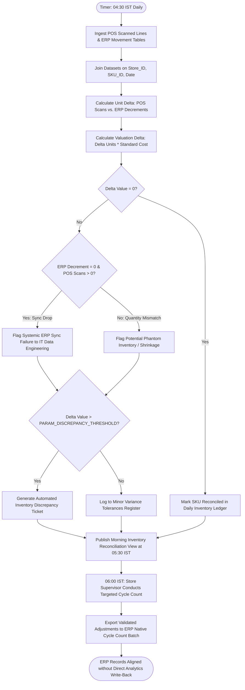

# Northstar Retail Group — Enterprise Retail Analytics Platform
## Business Process TO-BE: BP-005 — Automated POS-ERP Inventory Reconciliation & Phantom Stock Surveillance

---

### 1. Process Identification & Business Purpose

* **Process ID:** `BP-005-TOBE`
* **Process Title:** Automated Daily POS-ERP Inventory Reconciliation & Phantom Stock Detection (Target State)
* **Operational Domain:** Supply Chain, Store Inventory Operations & Loss Prevention
* **Business Purpose:** Automatically compare previous-day POS scanned unit sales against ERP stock decrement ledger movements across all 30 retail stores, identify phantom inventory and unposted movement sync failures, and automatically generate investigation tickets for variances exceeding `PARAM_DISCREPANCY_THRESHOLD` (provisional default ₹500) by **05:30 IST daily**, while preserving a read-only architecture with operational ERP databases (`BDL-04`).

---

### 2. Process Governance & Ownership

* **Accountable Process Owner:** VP Supply Chain & Logistics (Sunita Rao) & Head of Internal Audit
* **Operational Performers:** Automated Inventory Reconciliation Engine, Store Inventory Controllers, Central Supply Chain Planners
* **Participating Stakeholders:**
  * Store Inventory Supervisors (investigate flagged daily SKU discrepancies)
  * Store Managers (sign off on daily inventory reconciliation worklist)
  * Central ERP Basis & Data Engineering Teams (resolve sync drop alerts)
  * Internal Audit & Loss Prevention (track chain-wide cumulative shrinkage trends)

---

### 3. Trigger & Preconditions

* **Process Trigger:** Scheduled execution at **04:30 IST daily** (following completion of POS transactional ingestion and ERP stock ledger extraction).
* **Preconditions:**
  * Clean previous-day POS sales lines ingested and validated (`FR-001`).
  * Midnight ERP Material Document movement tables (Movement Type 251 / 252) extracted (`FR-012`).
  * Unified SKU Master cross-reference table is active and mapped.

---

### 4. Process Inputs & Outputs

```
+----------------------------------------------------------------------------------------------------+
|                                      PROCESS INPUTS & OUTPUTS                                      |
+------------------------------------+---------------------------------------------------------------+
| INPUTS                             | OUTPUTS                                                       |
+------------------------------------+---------------------------------------------------------------+
| - POS sales transaction line units | - Daily POS-ERP SKU Inventory Reconciliation Ledger           |
| - ERP Material Document decrements | - Automated Phantom Inventory Warning Digest (`FR-012`)       |
| - Store inventory receiving logs   | - Unposted ERP Sync Drop Exception Worklist                   |
| - SKU standard cost price master   | - Automated Discrepancy Investigation Tickets (>₹500 variance)|
| - `PARAM_DISCREPANCY_THRESHOLD`    | - Store Morning Inventory Reconciliation View (`FR-012`, `FR-016`)|
+------------------------------------+---------------------------------------------------------------+
```

---

### 5. Detailed TO-BE Activity Workflow

The automated TO-BE process executes across four analytical phases every morning:

```
04:30 - 05:00 IST        05:00 - 05:20 IST        05:20 - 05:30 IST        06:00 IST
+---------------------+  +---------------------+  +---------------------+  +---------------------+
| Ingestion & Daily   |  | Automated SKU-Level |  | Discrepancy Sizing  |  | Morning Inventory   |
| Normalization of    |->| Variance Engine     |->| & Audit Ticket      |->| Workbench Live on   |
| POS & ERP Movements |  | (Unit & Value Delta)|  | Generation (>₹500)  |  | Store Tablet (06:00)|
+---------------------+  +---------------------+  +---------------------+  +---------------------+
```

1. **Phase 1: Ingestion & Stock Movement Alignment (04:30–05:00 IST):**
   * The pipeline extracts POS scanned sales lines: $\Delta Q_{\text{POS}} = \sum (\text{Quantity Sold}) - \sum (\text{Quantity Returned})$.
   * The pipeline extracts ERP stock movement ledger: $\Delta Q_{\text{ERP}} = \sum (\text{Quantity Decremented (Mvt 251)}) - \sum (\text{Quantity Reversal (Mvt 252)})$.
   * Data is aligned at the granular `[Store_ID, SKU_ID, Date]` key level (`FR-012`).
2. **Phase 2: Algorithmic Variance Computation & Drift Classification (05:00–05:20 IST):**
   * The engine computes unit and valuation variance for every active SKU:
     $$\Delta \text{Units} = \Delta Q_{\text{POS}} - \Delta Q_{\text{ERP}}$$
     $$\Delta \text{Value} = \Delta \text{Units} \times \text{Standard Cost Price}$$
   * Discrepancies are categorized into distinct operational root causes:
     * *Unposted Batch Drop:* POS sold $>0$, ERP decremented $=0$ (Sync Pipeline Failure).
     * *Phantom Inventory Risk:* ERP shows positive balance, but POS records show units exhausted and no recent scans.
     * *Shrinkage Drift:* Physical/POS stock lower than ERP ledger across successive trading days.
3. **Phase 3: Automated Discrepancy Sizing & Ticket Generation (05:20–05:30 IST):**
   * **Threshold Ticketing Gate:** If $|\Delta \text{Value}| > \text{PARAM\_DISCREPANCY\_THRESHOLD}$ (provisional default ₹500 per `BDL-06`), the platform automatically logs an inventory investigation ticket in the Store Inventory Workbench (`FR-012`, `FR-016`).
   * **High-Shrinkage Alert Gate:** If cumulative unposted inventory in a store exceeds ₹10,000 across a 7-day rolling window, an urgent operational escalation is dispatched to the VP Supply Chain and Head of Internal Audit.
4. **Phase 4: Store Morning Action & ERP Adjustment Workflow (06:00 IST):**
   * At 06:00 IST, Store Inventory Supervisors open their *Morning Inventory Reconciliation View* on mobile tablets.
   * Supervisors perform targeted physical cycle counts for the specific flagged SKUs (typically 5 to 10 items instead of thousands).
   * Per Decision `BDL-04` (Read-Only Architecture), supervisors approve verified stock corrections, which generate structured adjustment files imported into native ERP inventory adjustment transactions (Movement Type 701/702) under strict dual-authorization controls.

---

### 6. Supplementary Process Diagram (Mermaid)



*(Note: Formal BPMN 2.0 XML representation is provided in [`bpmn/bp_005_to_be.bpmn`](file:///Users/adibnoushad/Northstar_Retail_Analytics/docs/03_business_process_modeling/bpmn/bp_005_to_be.bpmn)).*

---

### 7. Decision Gateways & Automated Exception Paths

* **Exclusive Gateway (XOR) — Sync Drop vs. Operational Shrinkage:** The engine differentiates technical batch failures (all SKUs in a store missing from ERP) from localized stock discrepancies (single SKU variance), automatically alerting IT engineering for the former and store supervisors for the latter.
* **Exclusive Gateway (XOR) — Configurable Variance Severity:** Discrepancies exceeding ₹500 trigger automated ticketing; discrepancies under ₹500 are tracked in rolling cumulative registers to detect slow-leakage skimming.
* **Exclusive Gateway (XOR) — Read-Only Boundary Protection:** No inventory correction can directly write to SAP/ERP tables; all adjustments flow through validated batch files subject to ERP role-based authorization (`BDL-04`).

---

### 8. Governing Business Rules (TO-BE)

* **Rule BRL-06 (Threshold Application):** POS-ERP inventory discrepancy ticketing is dynamically governed by `PARAM_DISCREPANCY_THRESHOLD` (provisional default ₹500).
* **Rule BDL-04 (Read-Only Guardrail):** The analytics platform is strictly read-only; inventory adjustments must be executed via native ERP transactions with verified store manager and auditor approval.
* **Rule TOBE-07 (Targeted Cycle Counting):** Stores must complete targeted physical cycle counts for all flagged discrepancy tickets within 24 hours of ticket generation.

---

### 9. Automation Opportunities & Process Enhancements

1. **Daily Drift Detection vs. 90-Day Delay:** Eliminates 90 days of undetected inventory drift by detecting stock mismatches **within 8 hours of occurrence**.
2. **Eradication of Phantom Stock:** Ensures replenishment algorithms have accurate stock visibility, preventing phantom stock from suppressing replenishment orders.
3. **Drastic Shrinkage Reduction:** Pinpoints exact dates, registers, and SKUs where losses occur, driving annual retail shrinkage down by an estimated ₹60–80 Lakhs.
4. **Transition to Targeted Cycle Counts:** Replaces exhausting quarterly store-wide counting shutdowns with continuous, 15-minute daily targeted counts.

---

### 10. Traceability & Requirements Mapping

* **Aligned Business Requirement:** `BR-005: POS and ERP Synchronization and Reconciliation`
* **Aligned Functional Requirements:** `FR-012`, `FR-016`, `FR-035`
* **Aligned Non-Functional Requirements:** `NFR-001` (Daily batch SLA), `NFR-008` (Auditability), `NFR-017` (Threshold configurability)
* **Aligned Agile User Stories:** `US-007`
* **Target Success Criteria:** `SC-04` (Automated daily POS-ERP inventory reconciliation completed by 05:30 IST; unexplained variance reduction $\ge 80\%$), `SC-05` (Month-End Book Closing duration compressed to $\le 3$ business days)

---

### 11. Process Acceptance Criteria

1. Daily comparison between POS sales units and ERP stock movements executes across 100% of SKUs across all 30 retail stores by 05:30 IST.
2. Automated audit tickets are created for 100% of SKU inventory variances exceeding `PARAM_DISCREPANCY_THRESHOLD`.
3. Systemic ERP sync drops are identified and alerted to IT engineering within 15 minutes of reconciliation pipeline execution.
4. All reconciliation data marts are strictly read-only, with zero direct update queries against production ERP databases.
