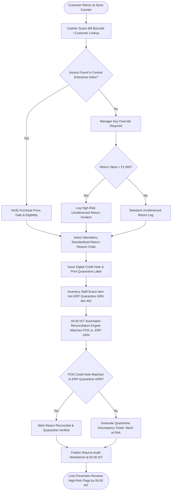

# Northstar Retail Group — Enterprise Retail Analytics Platform
## Business Process TO-BE: BP-006 — Automated Customer Returns Reconciliation & Fraud Surveillance

---

### 1. Process Identification & Business Purpose

* **Process ID:** `BP-006-TOBE`
* **Process Title:** Automated Customer Returns Reconciliation & Return Fraud Surveillance (Target State)
* **Operational Domain:** Customer Service, Store Operations, Inventory Quarantine & Loss Prevention
* **Business Purpose:** Automatically validate customer returns against original transaction invoices across all 30 retail stores, reconcile POS credit note issues against ERP quarantine Goods Receipt Notes (GRN), analyze return root-cause defect patterns, and flag fraudulent or unreferenced returns exceeding ₹1,000 by **05:30 IST daily**, while preserving a read-only architecture (`BDL-04`).

---

### 2. Process Governance & Ownership

* **Accountable Process Owner:** VP Retail Operations (K. R. Ramanathan) & Customer Experience Lead
* **Operational Performers:** Automated Returns Reconciliation Engine, Store Customer Service Leads, Regional Loss Prevention
* **Participating Stakeholders:**
  * Retail Customers (presenting invoice QR or phone lookup for seamless return)
  * Store Customer Service Cashiers (verifying items against original enterprise invoice)
  * Store Inventory Supervisors (receiving physical items into designated ERP quarantine)
  * Quality Assurance & Merchandising Teams (analyzing SKU-level defect trends)

---

### 3. Trigger & Preconditions

* **Process Trigger:** Scheduled execution at **04:30 IST daily** (following completion of POS returns transaction ingestion and ERP quarantine GRN feed staging).
* **Preconditions:**
  * Clean previous-day POS return line items and credit note records ingested (`FR-001`, `FR-013`).
  * Midnight ERP quarantine Goods Receipt Note (GRN) records extracted (`FR-013`).
  * Enterprise Transaction Repository contains searchable historical invoice master data.

---

### 4. Process Inputs & Outputs

```
+----------------------------------------------------------------------------------------------------+
|                                      PROCESS INPUTS & OUTPUTS                                      |
+------------------------------------+---------------------------------------------------------------+
| INPUTS                             | OUTPUTS                                                       |
+------------------------------------+---------------------------------------------------------------+
| - POS return transaction headers   | - Daily Customer Returns & Credit Note Reconciliation Ledger  |
| - Original sale reference invoice  | - Automated POS Credit Note to ERP Quarantine Match Report    |
| - Standardized return reason codes | - Return Fraud & Unreferenced Return Anomaly Digest (>₹1,000)  |
| - ERP Quarantine GRN movement logs | - SKU Defect & Quality Assurance Escalation Worklist          |
| - Cashier supervisor override logs | - Store Morning Returns & Credit Note Audit Workbench View    |
+------------------------------------+---------------------------------------------------------------+
```

---

### 5. Detailed TO-BE Activity Workflow

The automated TO-BE process executes across four operational and analytical phases:

```
Customer Desk Lookup     Daytime Store Receiving  04:30 - 05:30 IST        06:00 IST
+---------------------+  +---------------------+  +---------------------+  +---------------------+
| Central Enterprise  |  | Physical Item Put   |  | Automated POS Credit|  | Morning Returns     |
| Invoice Verification|->| to Quarantine Staging|->| Note to ERP GRN     |->| Audit Workbench &   |
| (Cross-Store Return)|  | (Barcode Scanned)   |  | Reconciliation Gate |  | Quality Action Feed |
+---------------------+  +---------------------+  +---------------------+  +---------------------+
```

1. **Phase 1: Enterprise Cross-Store Invoice Validation (Daytime Operation):**
   * Customer presents merchandise at any Northstar store.
   * Desk staff scans the invoice barcode or performs a customer lookup via encrypted mobile token. The terminal queries the central enterprise invoice index, validating the purchase store, purchase date, net price paid, and return eligibility window (`FR-013`).
   * Cashier enters a mandatory standardized return reason code (Defective/Damaged, Sizing Mismatch, Buyer Remorse, Expired Shelf-Life).
2. **Phase 2: Barcode Quarantine Staging & ERP GRN Creation (Daytime Store Operation):**
   * The POS terminal issues a digital credit note (SMS/Email) and prints a quarantine barcode label.
   * Staff adheres the label to the item and deposits it into the secure Store Quarantine Staging Zone.
   * Store inventory staff scans the barcode to create an official ERP Quarantine Goods Receipt Note (Movement Type 451: Return to Blocked Stock).
3. **Phase 3: Automated Two-Way Returns Reconciliation (04:30–05:30 IST):**
   * The reconciliation engine compares POS credit notes issued against ERP quarantine GRN records (`FR-013`):
     * *Leg 1 (Invoice Linkage):* Validates that every return transaction maps to a verified original sale invoice ID.
     * *Leg 2 (Stock Containment):* Validates that every credit note has a corresponding ERP quarantine GRN to ensure returned goods were not restocked on retail shelves without quality inspection.
4. **Phase 4: Return Fraud Surveillance & Anomaly Ticketing (05:30–06:00 IST):**
   * **Unreferenced Return Gate:** Any manual manager override return lacking an original invoice where value $>₹1,000$ automatically generates a High-Risk Fraud Alert (`FR-013` Acceptance Criterion 2).
   * **Cashier Anomaly Gate:** Cashiers with return transaction frequencies $>3.0\times$ the store average are flagged for loss prevention audit.
   * **Merchandising Quality Gate:** SKUs exhibiting a return rate $>8.0\%$ across a 14-day rolling window trigger an automated quality assurance ticket to the Merchandising Category Manager.

---

### 6. Supplementary Process Diagram (Mermaid)



*(Note: Formal BPMN 2.0 XML representation is provided in [`bpmn/bp_006_to_be.bpmn`](file:///Users/adibnoushad/Northstar_Retail_Analytics/docs/03_business_process_modeling/bpmn/bp_006_to_be.bpmn)).*

---

### 7. Decision Gateways & Automated Exception Paths

* **Exclusive Gateway (XOR) — Cross-Store Invoice Match:** Centralized lookup prevents fraudulent returns of items stolen from competitors or bought under deep unauthorized discounts.
* **Exclusive Gateway (XOR) — Unreferenced Return Threshold:** Unreferenced returns $\le ₹1,000$ require manager PIN; unreferenced returns $>₹1,000$ trigger automatic audit tickets in the Loss Prevention Workbench.
* **Exclusive Gateway (XOR) — Quarantine Stock Mismatch:** Returns where a POS credit note was issued but no ERP quarantine GRN was created within 24 hours trigger an immediate investigation ticket to prevent defective items from leaking onto sales shelves.

---

### 8. Governing Business Rules (TO-BE)

* **Rule TOBE-08 (Mandatory Invoice Linkage):** 100% of customer return transactions must attempt lookup against the central enterprise invoice repository before permitting manager override.
* **Rule TOBE-09 (Quarantine Enforcement):** No returned item may be returned to active inventory without physical inspection and an explicit ERP Stock Release movement document (Movement Type 453: Blocked to Unrestricted).
* **Rule TOBE-10 (Return Fraud Escalation):** Any store where unreferenced returns exceed 2.0% of total return value triggers an automatic operational audit review.

---

### 9. Automation Opportunities & Process Enhancements

1. **Seamless Cross-Store Returns:** Enables customers to return products seamlessly at any of the 30 retail stores, improving customer satisfaction scores.
2. **Eradication of Paper Credit Note Forgery:** Transitions to tamper-proof digital SMS/Email credit notes with one-time verification tokens.
3. **Drastic Return Fraud Reduction:** Compresses return fraud and fake refund skimming, saving an estimated ₹35–45 Lakhs annually.
4. **Merchandising Quality Feedback:** Provides category managers with real-time return reason analytics, enabling defect vendor chargebacks and assortment improvements.

---

### 10. Traceability & Requirements Mapping

* **Aligned Business Requirement:** `BR-006: Customer Returns and Credit Note Management`
* **Aligned Functional Requirements:** `FR-013`, `FR-016`, `FR-035`
* **Aligned Non-Functional Requirements:** `NFR-001` (Daily batch SLA), `NFR-008` (Auditability), `NFR-017` (Threshold configurability)
* **Aligned Agile User Stories:** `US-009`
* **Target Success Criteria:** `SC-04` (Financial reconciliation variance reduction $\ge 80\%$; 100% of returns verified against invoice and reconciled with ERP quarantine GRN)

---

### 11. Process Acceptance Criteria

1. 100% of daily POS credit notes are programmatically compared against ERP quarantine GRN movements by 05:30 IST.
2. 100% of unreferenced manager-override returns $>₹1,000$ generate an automated audit investigation ticket.
3. Standardized return reason codes are captured for 100% of return lines without null or default fallbacks.
4. SKUs with $>8.0\%$ return rates trigger automated alerts to merchandising teams with verified category defect analytics.
