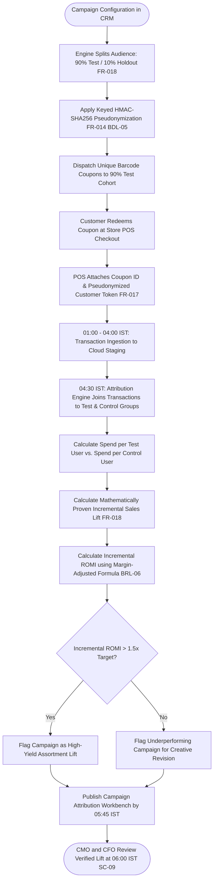

# Northstar Retail Group — Enterprise Retail Analytics Platform
## Business Process TO-BE: BP-007 — Automated Closed-Loop Marketing Campaign Measurement & Privacy-Preserving Customer Analytics

---

### 1. Process Identification & Business Purpose

* **Process ID:** `BP-007-TOBE`
* **Process Title:** Automated Closed-Loop Marketing Campaign Attribution & Incremental Lift Measurement (Target State)
* **Operational Domain:** Corporate Marketing, CRM, Data Privacy & Revenue Analytics
* **Business Purpose:** Enforce scientific campaign design with mandatory 10% uncontacted holdout control groups (`FR-018`, `BR-007`, `BRL-06`), safeguard customer data privacy using provisional Keyed HMAC-SHA256 pseudonymization (`FR-014`, `BDL-05`, `ASM-13`), execute closed-loop transactional attribution (`FR-017`), and automatically calculate incremental sales lift and true Return on Marketing Investment (ROMI) by **06:00 IST daily**.

---

### 2. Process Governance & Ownership

* **Accountable Process Owner:** Chief Marketing Officer (Pooja Sharma) & Corporate Legal / Data Protection Officer
* **Operational Performers:** Automated Campaign Attribution Engine, Central Marketing Planners, CRM Operations
* **Participating Stakeholders:**
  * CRM Campaign Planners (configure target segments and enforce holdout splits)
  * Corporate Legal & Security (oversee Keyed HMAC cryptographic key management)
  * Store Cashiers (scan unique coupon barcodes or capture customer mobile number at POS)
  * Chief Financial Officer & Executive Committee (consume verified incremental ROMI analytics)

---

### 3. Trigger & Preconditions

* **Process Trigger:** Configuration of a new promotional campaign or daily batch attribution run at **04:30 IST**.
* **Preconditions:**
  * Marketing campaign configured in CRM with defined start/end dates, target audience, and promotional mechanics.
  * 10% holdout control group randomized and quarantined from marketing communications (`FR-018`).
  * Ingestion pipeline has extracted previous-day POS transactions and pseudonymized customer IDs (`FR-014`, `FR-017`).

---

### 4. Process Inputs & Outputs

```
+----------------------------------------------------------------------------------------------------+
|                                      PROCESS INPUTS & OUTPUTS                                      |
+------------------------------------+---------------------------------------------------------------+
| INPUTS                             | OUTPUTS                                                       |
+------------------------------------+---------------------------------------------------------------+
| - Campaign master metadata & spend | - Pre-Campaign Holdout Control Group Manifest (10% Quarantined)|
| - CRM targeted & control audiences | - Daily Closed-Loop Campaign Attribution Ledger (`FR-017`)    |
| - Daily POS transactional sales    | - Incremental Sales Lift & Net ROMI Dashboard (`FR-018`)      |
| - Unique dynamic coupon barcodes   | - Promotional Code Margin Leakage Monitor (`FR-019`)          |
| - Keyed HMAC-SHA256 Secret Pepper  | - Privacy Audit Verification Log (100% PII Pseudonymized)     |
+------------------------------------+---------------------------------------------------------------+
```

---

### 5. Detailed TO-BE Activity Workflow

The automated TO-BE process executes across four synchronized campaign and analytical phases:

```
T-7 Days Planning        Campaign Active Period   Daily 04:30 - 05:30 IST  Daily 06:00 IST
+---------------------+  +---------------------+  +---------------------+  +---------------------+
| Enforce 10% Holdout |  | Unique Coupon Scans |  | Keyed HMAC Matching |  | Executive Campaign  |
| Control Group &     |->| & Mobile Capture at |->| & Incremental Lift  |->| Performance Desk    |
| Pseudonymize PII    |  | Store Checkouts     |  | Sizing Engine (04:30|  | Live (True ROMI)    |
+---------------------+  +---------------------+  +---------------------+  +---------------------+
```

1. **Phase 1: Privacy-Preserving Campaign Staging & 10% Holdout Enclave (Pre-Campaign):**
   * The campaign planner selects target criteria in the CRM. The platform automatically splits the qualified audience into a **90% Test Treatment Group** and a **10% Uncontacted Holdout Control Group** per Requirement `FR-018`, Rule `BRL-06`, and `BR-007`.
   * *Privacy Guardrail:* Customer phone numbers and emails are pseudonymized using Keyed HMAC-SHA256 with a centrally rotated enterprise secret key stored in an isolated Key Vault per `FR-014`, `BDL-05`, and `ASM-13`. No cleartext PII is exported or transmitted to external delivery agencies.
   * Delivery agencies receive only pseudonymized tokens and unique single-use promotional coupon codes.
2. **Phase 2: In-Store Promotion Execution & Attribution Capture (Trading Hours):**
   * Customers present personalized digital coupons (SMS/WhatsApp) at checkout.
   * Cashiers scan the barcode or enter the customer's phone number. POS software hashes the phone number locally using the identical HMAC algorithm and attaches the coupon token to the POS sales header (`FR-017`).
3. **Phase 3: Automated Closed-Loop Attribution & Lift Computation (04:30–05:30 IST):**
   * The analytics engine matches daily store transactions against campaign test and control cohorts (`FR-018`).
   * **Incremental Sales Lift Calculation:**
     $$\text{Spend per Test User} = \frac{\text{Sales}_{\text{Test}}}{\text{Users}_{\text{Test}}}$$
     $$\text{Spend per Control User} = \frac{\text{Sales}_{\text{Control}}}{\text{Users}_{\text{Control}}}$$
     $$\text{Incremental Revenue} = (\text{Spend per Test} - \text{Spend per Control}) \times \text{Users}_{\text{Test}}$$
   * **Incremental ROMI Calculation (`BRL-06`):**
     $$\text{ROMI}_{\text{Incr}} = \frac{(\text{Incremental Revenue} \times \text{Gross Margin \%}) - \text{Campaign Cost}}{\text{Campaign Cost}}$$
4. **Phase 4: Campaign Performance Publishing & Executive Review (06:00 IST):**
   * Verified campaign metrics are committed to the *Marketing Attribution Data Mart*.
   * At 06:00 IST, the CMO and CFO access the *Executive Campaign Dashboard* (`FR-018`), reviewing mathematically proven incremental revenue, promo margin leakage (`FR-019`), and customer acquisition costs (CAC).

---

### 6. Supplementary Process Diagram (Mermaid)



*(Note: Formal BPMN 2.0 XML representation is provided in [`bpmn/bp_007_to_be.bpmn`](file:///Users/adibnoushad/Northstar_Retail_Analytics/docs/03_business_process_modeling/bpmn/bp_007_to_be.bpmn)).*

---

### 7. Decision Gateways & Automated Exception Paths

* **Exclusive Gateway (XOR) — Holdout Integrity Enforcement:** If a campaign attempt is made to bypass the 10% holdout group (targeting 100% of contacts), the platform blocks campaign publication unless an explicit emergency executive override is logged (`FR-018`).
* **Exclusive Gateway (XOR) — Statistical Significance Verification:** If sample sizes in test or control cohorts fail minimum statistical power thresholds ($p < 0.05$), the dashboard tags results as *Statistically Inconclusive* to prevent misallocated capital.
* **Exclusive Gateway (XOR) — Privacy Hash Verification:** If unhashed phone strings appear in staging data, the pipeline quarantines the entire batch and dispatches a Critical Privacy Violation Alert to the Data Protection Officer (`FR-014`).

---

### 8. Governing Business Rules (TO-BE)

* **Requirement FR-018 & Rule BRL-06 (Mandatory 10% Holdout Governance):** Every marketing campaign evaluated by the platform must maintain an uncontacted holdout control group of exactly 10% of the qualified target audience per `FR-018` and `BR-007` (Note: Stage 1 Decision `BDL-04` governs Strict Read-Only Architecture; holdout group sizing is governed by `FR-018` and `BRL-06`).
* **Decision BDL-05 & Assumption ASM-13 (Keyed HMAC Pseudonymization):** Customer PII must be transformed using Keyed HMAC-SHA256 prior to analytical storage per `FR-014`. *(Provisional technical approach pending formal corporate legal DPDPA audit; no legal compliance claimed).*
* **Rule BRL-06 (Incremental ROMI):** ROMI must be calculated using incremental gross margin contribution rather than gross top-line turnover:
  $$\text{ROMI} = \frac{\Delta \text{Incremental Margin} - \text{Total Campaign Spend}}{\text{Total Campaign Spend}}$$

---

### 9. Automation Opportunities & Process Enhancements

1. **Scientific Marketing Accountability:** Replaces subjective claims with mathematically proven incremental sales lift, aligning CMO and CFO on marketing budget allocation.
2. **Elimination of PII Leak Risks:** Cryptographic pseudonymization prevents customer phone leaks across external agencies and cloud environments.
3. **Discount Cannibalization Prevention:** Pinpoints promotions that merely subsidize baseline shoppers without driving new visits (`FR-019`).
4. **Closed-Loop Attribution Sizing:** Automatically maps active CRM promotional spend directly to validated POS customer redemptions (`SC-09`).

---

### 10. Traceability & Requirements Mapping

* **Aligned Business Requirement:** `BR-007: Marketing Campaign Effectiveness and Customer Analytics`
* **Aligned Functional Requirements:** `FR-014`, `FR-017`, `FR-018`, `FR-019`, `FR-035`
* **Aligned Non-Functional Requirements:** `NFR-007` (PII Security), `NFR-008` (Auditability), `NFR-011` (Data Pseudonymization)
* **Aligned Agile User Stories:** `US-010`, `US-011`
* **Target Success Criteria:** `SC-09` (Closed-Loop Campaign Attribution Coverage $\ge 85\%$ of promotional marketing spend)

---

### 11. Process Acceptance Criteria

1. 100% of analyzed promotional campaigns maintain a randomized 10% holdout control group quarantined from communications (`FR-018`).
2. 100% of customer phone numbers and emails stored in analytical tables are transformed via Keyed HMAC-SHA256 with zero cleartext PII leakage (`FR-014`).
3. Incremental revenue and ROMI are calculated dynamically and published to the Marketing Dashboard by 06:00 IST daily.
4. Campaign lift confidence intervals are displayed with clear statistical significance indicators ($p < 0.05$).
