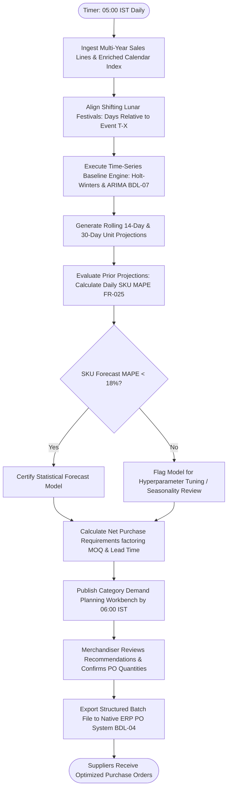

# Northstar Retail Group — Enterprise Retail Analytics Platform
## Business Process TO-BE: BP-008 — Automated Baseline Statistical Demand Forecasting & Planning

---

### 1. Process Identification & Business Purpose

* **Process ID:** `BP-008-TOBE`
* **Process Title:** Automated Baseline Statistical Demand Forecasting & Calendar-Aware Planning (Target State)
* **Operational Domain:** Central Merchandising, Supply Chain Planning & Procurement
* **Business Purpose:** Automatically ingest historical store sales lines, seasonality patterns, promotional events, and shifting regional Indian festive calendars; generate rolling 14-day and 30-day statistical baseline demand forecasts (`BDL-07`); track forecast accuracy (Mean Absolute Percentage Error / MAPE $<18\%$ per Stage 2 Technical Modeling Target `FR-023`/`FR-025`, supporting `SC-06` and `SC-07`); and publish optimized procurement advisories by **06:00 IST daily**, while preserving a read-only architecture (`BDL-04`).

---

### 2. Process Governance & Ownership

* **Accountable Process Owner:** VP Supply Chain & Logistics (Sunita Rao) & Merchandising Director
* **Operational Performers:** Automated Time-Series Forecasting Engine, Category Demand Planners
* **Participating Stakeholders:**
  * Central Category Merchandisers (review algorithmic demand projections and adjust promotional lifts)
  * Procurement Officers (execute supplier purchase orders based on forecast advisories)
  * Central DC Warehouse Planners (plan forward intake and cross-dock capacity)
  * Store Managers (view localized forward demand projections for labor scheduling)

---

### 3. Trigger & Preconditions

* **Process Trigger:** Scheduled daily execution at **05:00 IST** (following completion of POS sales ingestion, semantic aggregation, and calendar indexing).
* **Preconditions:**
  * Clean previous-day transactional sales history ingested and committed (`FR-001`).
  * Enriched Calendar Master table containing regional Indian holiday and festival dates is maintained (`FR-023`).
  * Active SKU Master contains supplier lead times, minimum order quantities (MOQ), and pack sizes.

---

### 4. Process Inputs & Outputs

```
+----------------------------------------------------------------------------------------------------+
|                                      PROCESS INPUTS & OUTPUTS                                      |
+------------------------------------+---------------------------------------------------------------+
| INPUTS                             | OUTPUTS                                                       |
+------------------------------------+---------------------------------------------------------------+
| - Multi-year store POS sales units | - Rolling 14-day & 30-day Store/SKU Baseline Demand Forecasts |
| - Current ERP on-hand & pipeline PO| - Continuous Forecast Accuracy & Historical MAPE Tracking Mart|
| - Dynamic Festive Calendar Index   | - Algorithmic Procurement Advisory & Sizing Feed (`FR-024`)   |
| - Planned promotional event catalog| - High Forecast Variance Exception Alert Digest               |
| - Supplier lead time & MOQ tables  | - Category Merchandising Planning Workbench View (`FR-023`)   |
+------------------------------------+---------------------------------------------------------------+
```

---

### 5. Detailed TO-BE Activity Workflow

The automated TO-BE process executes across four analytical and operational phases:

```
05:00 - 05:30 IST        05:30 - 05:45 IST        05:45 - 06:00 IST        08:30 - 11:00 IST
+---------------------+  +---------------------+  +---------------------+  +---------------------+
| Time-Series Feature |  | Algorithmic Forecast|  | Accuracy Evaluation |  | Merchandiser Review |
| Ingestion & Festive |->| Generation (14 & 30 |->| (MAPE Calculation)  |->| & Structured ERP PO |
| Date Alignment      |  | Day Rolling Windows)|  | & Advisory Publish  |  | Batch Release (Desk)|
+---------------------+  +---------------------+  +---------------------+  +---------------------+
```

1. **Phase 1: Feature Ingestion & Calendar Alignment (05:00–05:30 IST):**
   * The pipeline joins 24+ months of clean transactional sales with the *Enriched Calendar Master*.
   * Shifting lunar festivals (Diwali, Eid, Pongal, Ganesh Chaturthi, Durga Puja) are aligned based on days relative to festival peak ($T-14$ to $T+3$) rather than rigid Gregorian calendar months (`FR-023`).
   * Outlier sales spikes caused by stockouts or flash clearances are normalized using robust statistical filtering.
2. **Phase 2: Baseline Statistical Forecasting Execution (05:30–05:45 IST):**
   * The engine executes baseline statistical time-series forecasting models (Triple Exponential Smoothing / Holt-Winters and Auto-ARIMA) per Decision `BDL-07`.
   * Projections are generated across two mandatory rolling planning horizons:
     * *Short-Term Store Horizon (14-Day Rolling):* Used for store replenishment scheduling and labor planning.
     * *Medium-Term Procurement Horizon (30-Day Rolling):* Used for supplier purchase ordering and central DC capacity planning.
3. **Phase 3: Accuracy Evaluation & Advisory Sizing (05:45–06:00 IST):**
   * **Continuous MAPE Tracking:** The engine computes accuracy for prior projections: $\text{MAPE} = \frac{1}{n} \sum \left|\frac{\text{Actual} - \text{Forecast}}{\text{Actual}}\right| \times 100\%$.
   * Models achieving $\text{MAPE} < 18\%$ on Class-A SKUs are certified for automated procurement advisory (Stage 2 Technical Modeling Target per `FR-023` / `FR-025`).
   * **Procurement Advisory Sizing:** The platform calculates net purchase requirements: $\text{PO Advisory} = \text{Forecast Demand} + \text{Dynamic Safety Stock} - \text{Current On-Hand} - \text{Open Pipeline POs}$.
4. **Phase 4: Merchandiser Workbench Review & ERP PO Release (08:30–11:00 IST):**
   * At 06:00 IST, Category Merchandisers access their *Demand Planning Workbench* (`FR-023`).
   * Merchandisers review algorithmically generated order quantities, inspect seasonality trends, and apply promotional overrides.
   * Per Decision `BDL-04` (Read-Only Architecture), approved purchase recommendations are exported as structured purchase order batches for native ERP PO creation, ensuring strict human-in-the-loop governance.

---

### 6. Supplementary Process Diagram (Mermaid)



*(Note: Formal BPMN 2.0 XML representation is provided in [`bpmn/bp_008_to_be.bpmn`](file:///Users/adibnoushad/Northstar_Retail_Analytics/docs/03_business_process_modeling/bpmn/bp_008_to_be.bpmn)).*

---

### 7. Decision Gateways & Automated Exception Paths

* **Exclusive Gateway (XOR) — Model Accuracy Threshold:** If a SKU category's MAPE exceeds 25%, the platform automatically falls back to a 60-day moving average and alerts the demand planner to inspect promotional disruptions.
* **Exclusive Gateway (XOR) — Supplier MOQ Adjustments:** If calculated demand is 85 units but supplier MOQ is 100 units, the engine evaluates carrying cost versus lost sales to recommend rounding up or deferring the order.
* **Exclusive Gateway (XOR) — Read-Only Architecture Enforcement:** Programmatic order release directly into production ERP purchasing tables is strictly blocked; export files require merchandiser review (`BDL-04`).

---

### 8. Governing Business Rules (TO-BE)

* **Decision BDL-07 (Baseline Statistical Forecasting Scope):** Forecasting models must generate rolling 14-day store-level and 30-day DC-level demand projections updated daily.
* **Rule BRL-09 (Festival Dynamic Indexing):** Historical festival sales must be normalized against calendar shift vectors (days relative to festival day zero) to eliminate Gregorian date distortion.
* **Rule TOBE-11 (Forecast Accuracy SLA):** High-velocity Class-A SKUs must maintain a 30-day rolling MAPE under 18% (Stage 2 Technical Modeling Target per `FR-023` / `FR-025`).

---

### 9. Automation Opportunities & Process Enhancements

1. **Precision Festival Inventory Sizing:** Calendar-aware modeling eliminates mis-timed seasonal deliveries, capturing an estimated ₹3.5–5.0 Crores in incremental festival revenue.
2. **Forecast Error Compression:** Reduces forecast MAPE from $>35\%$ down to $<18\%$ across Class-A SKUs, dramatically reducing overstock and stockouts.
3. **Emergency Freight Elimination:** Algorithmic order planning prevents panic reorders, saving ₹40+ Lakhs in annual emergency expedited courier fees.
4. **Markdown Prevention:** Aligns inventory purchases with true demand velocity, preventing post-season clearance markdowns and preserving gross margins.

---

### 10. Traceability & Requirements Mapping

* **Aligned Business Problem:** `BP-07: Unreliable Sales Forecasting`, `BP-05: Inventory Overstocking and Stockouts`
* **Aligned Business Requirement:** `BR-008: Baseline Statistical Demand Forecasting`
* **Aligned Functional Requirements:** `FR-023`, `FR-024`, `FR-025`, `FR-035`
* **Aligned Non-Functional Requirements:** `NFR-001` (Daily batch SLA), `NFR-002` (Workbench latency $<3\text{s}$), `NFR-015` (Model accuracy validation)
* **Aligned Agile User Stories:** `US-012`, `US-013`
* **Target Technical Modeling SLA:** Rolling MAPE $<18.0\%$ on Class-A SKUs (`FR-023`, `FR-025`)
* **Aligned Stage 1 Success Criteria:** `SC-06` (High-Velocity Stockout Frequency Reduction $\ge 25\%$), `SC-07` (Inventory Holding Efficiency DOI 10–15% improvement)

---

### 11. Process Acceptance Criteria

1. Rolling 14-day and 30-day demand forecasts are calculated and published across 100% of active SKUs by 06:00 IST daily.
2. Historical MAPE is calculated programmatically and displayed on the Merchandising Planning Workbench.
3. Regional Indian festive date shifts are aligned automatically without manual spreadsheet date manipulation.
4. All procurement recommendations are exported as validated batch files without direct analytical writes to operational ERP tables.
