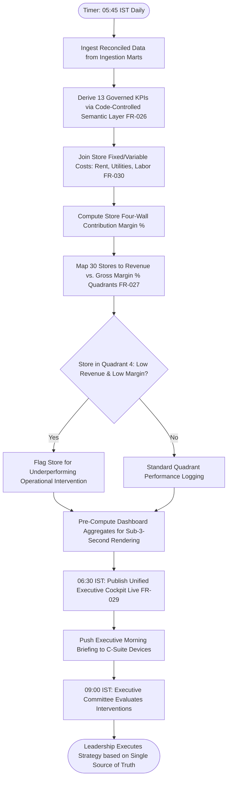

# Northstar Retail Group — Enterprise Retail Analytics Platform
## Business Process TO-BE: BP-009 — Automated Unified Executive Cockpit & Store Quadrant Performance Governance

---

### 1. Process Identification & Business Purpose

* **Process ID:** `BP-009-TOBE`
* **Process Title:** Automated Unified Executive Performance Cockpit & Store Quadrant Governance (Target State)
* **Operational Domain:** C-Suite Executive Leadership, Strategic Financial Management & Store Operations
* **Business Purpose:** Automatically compile, validate, and publish an enterprise-wide executive performance dashboard by **06:30 IST daily**; enforce a single version of truth across all 13 core KPIs via a code-governed semantic layer (`FR-026`); provide interactive Store Quadrant Scatter Analysis (Revenue vs. Gross Margin %) to pinpoint underperforming stores (`FR-027`); and deliver executive mobile briefing cards before morning retail opening.

---

### 2. Process Governance & Ownership

* **Accountable Process Owner:** Chief Executive Officer (Vikram Singhania) & Chief Financial Officer (Rajesh Khandelwal)
* **Operational Performers:** Automated Analytics Semantic Engine, Cloud Data Warehouse Orchestrator
* **Participating Stakeholders:**
  * Executive Committee (CEO, COO, CFO, CMO, VP Supply Chain, VP Operations — daily cockpit consumers)
  * Regional Retail Operations Directors (review cluster rankings and quadrant placement)
  * Corporate Strategy & FP&A Leads (conduct strategic scenario modeling and capital allocation)
  * Store Managers (benchmarked against regional quadrant performance)

---

### 3. Trigger & Preconditions

* **Process Trigger:** Scheduled execution at **05:45 IST daily** (following completion of four-way financial reconciliation and semantic metric aggregation).
* **Preconditions:**
  * Clean previous-day transactional sales, inventory, and reconciliation ledgers validated (`FR-001`, `FR-010`–`FR-013`).
  * Semantic metric models pass automated KPI verification tests (`FR-026`, `NFR-005`).
  * Cloud semantic BI service endpoints are active and healthy.

---

### 4. Process Inputs & Outputs

```
+----------------------------------------------------------------------------------------------------+
|                                      PROCESS INPUTS & OUTPUTS                                      |
+------------------------------------+---------------------------------------------------------------+
| INPUTS                             | OUTPUTS                                                       |
+------------------------------------+---------------------------------------------------------------+
| - Reconciled sales, margin & costs | - Unified Executive Command Cockpit (Live at 06:30 IST)       |
| - Store lease, rent & utility feeds| - Interactive Store Quadrant Scatter Scorecard (`FR-027`)     |
| - Category assortment sales records| - Store Four-Wall P&L Contribution Ledger (`FR-030`)          |
| - Code-governed semantic KPI models| - Executive Mobile Briefing Push (iPad & Web at 06:30 IST)    |
| - Historical baseline benchmarks   | - Automated Underperforming Store Intervention Triage Alerts  |
+------------------------------------+---------------------------------------------------------------+
```

---

### 5. Detailed TO-BE Activity Workflow

The automated TO-BE process executes across four synchronized phases every morning:

```
05:45 - 06:15 IST        06:15 - 06:30 IST        06:30 IST                09:00 - 10:30 IST
+---------------------+  +---------------------+  +---------------------+  +---------------------+
| Semantic Layer KPI  |  | Store Quadrant      |  | Executive Cockpit   |  | Focused Strategic   |
| Computation & Recon |->| Scatter & P&L Sizing|->| Live on C-Suite     |->| Executive Review    |
| Check (Single Truth)|  | (Revenue vs Margin%)|  | Devices (iPad & Web)|  | (Data Validated)    |
+---------------------+  +---------------------+  +---------------------+  +---------------------+
```

1. **Phase 1: Governed Semantic Layer KPI Aggregation (05:45–06:15 IST):**
   * The platform executes analytical transformations against clean staging tables, deriving all 13 core enterprise KPIs (Net Sales, Gross Margin %, Footfall, Average Transaction Value, Sales per Sq. Ft., Inventory Turn, DOI, Shrinkage Rate, Four-Wall Store Contribution) through a single, code-governed semantic layer (`FR-026`).
   * Formulas are version-controlled in Git, eliminating conflicting Excel spreadsheet definitions across Finance, Operations, and Marketing.
2. **Phase 2: Store Quadrant Scatter & P&L Sizing (06:15–06:30 IST):**
   * The engine positions all 30 retail stores on an interactive **Revenue vs. Gross Margin % Quadrant Scatter Graph** (`FR-027`):
     * *Quadrant 1 (High Revenue, High Margin):* "Star Stores" — Core profit drivers; Assortment benchmarks.
     * *Quadrant 2 (High Revenue, Low Margin):* "Volume Drivers" — High footfall, but heavy promotional discounting; Margin optimization target.
     * *Quadrant 3 (Low Revenue, High Margin):* "Niche Boutiques" — Premium margin yield, but footfall constrained; Marketing target.
     * *Quadrant 4 (Low Revenue, Low Margin):* "Underperforming / Distressed" — Urgent operational intervention or lease renegotiation target.
   * Daily store-level operational costs (amortized monthly rent, labor hours, utility allocations) are joined to calculate true **Store Four-Wall Contribution Margin** (`FR-030`).
3. **Phase 3: Automated Publishing & Executive Device Push (06:30 IST):**
   * Pre-computed aggregate data marts are committed, achieving sub-3-second dashboard query response times (`NFR-002`).
   * At 06:30 IST, the *Unified Executive Performance Cockpit* goes live on executive iPads and web browsers (`FR-029`).
   * A concise *Executive Morning Briefing Digest* is delivered via push notification and secure email to the CEO, COO, and CFO, summarizing yesterday’s revenue, top/bottom performing stores, and reconciliation status.
4. **Phase 4: Data-Driven Leadership Alignment (09:00–10:30 IST):**
   * During executive committee reviews, leaders review identical, verified figures. Zero meeting minutes are wasted debating spreadsheet formula integrity.
   * Discussions focus immediately on high-value strategic interventions: turning around Quadrant 4 stores, adjusting category margin mixes, and approving algorithmic procurement recommendations.

---

### 6. Supplementary Process Diagram (Mermaid)



*(Note: Formal BPMN 2.0 XML representation is provided in [`bpmn/bp_009_to_be.bpmn`](file:///Users/adibnoushad/Northstar_Retail_Analytics/docs/03_business_process_modeling/bpmn/bp_009_to_be.bpmn)).*

---

### 7. Decision Gateways & Automated Exception Paths

* **Exclusive Gateway (XOR) — Semantic KPI Parity Check:** If an ingested data point violates a semantic constraint (e.g., negative cost of goods sold or unmapped store code), the record is quarantined to the exception mart, and the metric displays an explicit audit badge rather than presenting corrupted data.
* **Exclusive Gateway (XOR) — Quadrant 4 Distressed Alert:** Any store falling into Quadrant 4 for $>14$ consecutive days automatically triggers an Executive Intervention Dossier detailing footfall drop, category margin drag, and rent-to-sales ratios.
* **Exclusive Gateway (XOR) — Executive Drill-Down Path:** Executives can drill down seamlessly from chain-wide summary metrics $\rightarrow$ regional clusters $\rightarrow$ individual store $\rightarrow$ department category $\rightarrow$ SKU level within 3 clicks.

---

### 8. Governing Business Rules (TO-BE)

* **Rule BRL-01 & BRL-02 (Semantic Standard):** All financial metrics must be computed strictly via the central semantic model; client-side formula modifications in BI tools or spreadsheets are architecturally prohibited.
* **Rule TOBE-12 (Executive Availability SLA):** The executive dashboard and morning briefing digest must be refreshed and fully accessible no later than 06:30 IST on $\ge 99.0\%$ of operating days (`SC-12`).
* **Rule TOBE-13 (Four-Wall Profitability Governance):** Store performance evaluation must be based on four-wall operating contribution margin, preventing gross top-line revenue from masking high-rent store unprofitability.

---

### 9. Automation Opportunities & Process Enhancements

1. **Elimination of Reporting Disagreements:** Enforces a single, verified version of truth across the organization, eliminating 100% of data discrepancy debates during leadership reviews.
2. **Instant Performance Visibility:** Advances executive reporting from delayed monthly decks to **daily 06:30 IST real-time visibility**.
3. **Identification of Hidden Loss-Making Stores:** Unmasks unprofitable flagship stores in expensive mall locations, enabling targeted rent renegotiations or merchandise realignment.
4. **Massive Capacity Reallocation:** Saves over 140 hours of senior analyst time monthly previously squandered on compiling PowerPoint presentations.

---

### 10. Traceability & Requirements Mapping

* **Aligned Business Problem:** `BP-08: Lack of Unified Executive Reporting`, `BP-02: Fragmented KPI Definitions`, `BP-04: Cannot Identify Underperforming Stores`
* **Aligned Business Requirement:** `BR-009: Store Performance Benchmarking and Quadrant Analysis`, `BR-010: Executive Reporting and Performance Dashboards`
* **Aligned Functional Requirements:** `FR-020`, `FR-026`, `FR-027`, `FR-029`, `FR-030`, `FR-035`
* **Aligned Non-Functional Requirements:** `NFR-001` (Daily batch SLA), `NFR-002` (Dashboard latency $<3\text{s}$), `NFR-004` (Concurrent executive users)
* **Aligned Agile User Stories:** `US-014`, `US-015`, `US-016`, `US-017`
* **Target Success Criteria:** `SC-03` (Single Version of Truth Metric Consensus), `SC-10` (Store Underperformance Remediation Cycle $<14$ days), `SC-11` (Operational Dashboard Adoption DAU/MAU $\ge 90\%$), `SC-12` (Data Pipeline Reliability SLA $\ge 99.0\%$)

---

### 11. Process Acceptance Criteria

1. Unified Executive Command Cockpit is live and accessible on web and tablet interfaces by 06:30 IST daily.
2. 100% of KPI figures displayed match the central governed semantic model definitions with $\pm 0.00$ variance.
3. Interactive Store Quadrant Scatter visualization plots all 30 retail stores correctly with interactive revenue, margin, and cost drill-downs.
4. Dashboard page load and interactive filter response times execute in $<3.0 \text{ seconds}$ per `NFR-002`.
