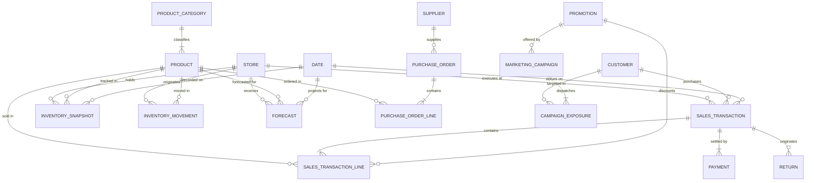

# Northstar Retail Group — Enterprise Retail Analytics Platform
## Stage 4 Deliverable: Logical Data Architecture & Entity Relationship Model

---

### 1. Document Overview & Modeling Objectives

This **Logical Data Architecture** defines the conceptual and logical data structures representing Northstar Retail Group's business operations. It formalizes the enterprise entity model, establishes clear business keys and cardinalities, and maps all operational entities directly to approved business processes (`BP-001` through `BP-009`) and functional requirements (`FR-001` through `FR-036`).

In strict alignment with enterprise consulting standards:
* **No physical database tables, SQL DDL, or mock data are created in this stage.**
* Attributes are strictly constrained to established operational parameters.
* Unresolved attribute structures are cataloged as **Open Data Discovery Questions (ODQs)**.

---

### 2. Enterprise Logical Entity-Relationship Diagram



---

### 3. Comprehensive Business Entity Catalog (17 Entities)

#### 3.1 Entity: STORE
* **Business Purpose:** Represents physical retail branches operating across 5 Indian states.
* **Key Attributes:** `store_id`, `store_name`, `store_code`, `tier` (Tier-1, Tier-2), `city`, `state`, `region`, `carpet_area_sqft`, `backroom_area_sqft`, `monthly_lease_rent`, `opening_date`, `operating_status`, `regional_manager_id`.
* **Candidate Business Key:** `store_id` (e.g., `STR-001` through `STR-030`).
* **Relationships:** One-to-Many with `SALES_TRANSACTION`, `INVENTORY_SNAPSHOT`, `INVENTORY_MOVEMENT`, and `FORECAST`.
* **Source System:** `SRC-006` (Corporate Master Data / Real Estate Master).
* **Data Sensitivity:** Medium (Four-Wall Lease Rent is Restricted Executive data).
* **Relevant Business Processes:** `BP-001` (DSR), `BP-002` (Inventory), `BP-009` (Executive Cockpit & Quadrant Analysis).
* **Relevant Functional Requirements:** `FR-001`, `FR-020` (Store Quadrants), `FR-027`, `FR-030` (Four-Wall P&L).

#### 3.2 Entity: PRODUCT (SKU)
* **Business Purpose:** Represents the master catalog of saleable merchandise items.
* **Key Attributes:** `sku_id`, `sku_code`, `sku_name`, `category_id`, `subcategory_name`, `hsn_code`, `standard_cost_price`, `mrp`, `pack_size`, `abc_velocity_class` (Class-A, B, C), `lead_time_days`, `minimum_order_qty`, `is_active`.
* **Candidate Business Key:** `sku_id` (Universal Product Barcode / EAN-13 or SKU code).
* **Relationships:** Many-to-One with `PRODUCT_CATEGORY`; One-to-Many with `SALES_TRANSACTION_LINE`, `INVENTORY_SNAPSHOT`, `INVENTORY_MOVEMENT`, `FORECAST`.
* **Source System:** `SRC-002` (Central ERP Material Master).
* **Data Sensitivity:** Medium (Standard cost price is restricted from store floor staff).
* **Relevant Business Processes:** `BP-001`, `BP-002`, `BP-005` (POS-ERP Recon), `BP-008` (Demand Forecasting).
* **Relevant Functional Requirements:** `FR-001`, `FR-007` (Dynamic DOI), `FR-008` (Stockout Alerts), `FR-009` (Aging Markdown Sizing), `FR-012` (Stock Recon).

#### 3.3 Entity: PRODUCT_CATEGORY
* **Business Purpose:** High-level departmental merchandise hierarchy.
* **Key Attributes:** `category_id`, `category_name` (Electronics, Clothing, Groceries, Home & Kitchen), `department_lead`, `target_gross_margin_pct`, `shrinkage_tolerance_pct`.
* **Candidate Business Key:** `category_id` (e.g., `CAT-ELEC`, `CAT-CLOTH`, `CAT-GROC`, `CAT-HOME`).
* **Relationships:** One-to-Many with `PRODUCT`.
* **Source System:** `SRC-002` (Central ERP).
* **Data Sensitivity:** Internal Public.
* **Relevant Business Processes:** `BP-001`, `BP-002`, `BP-008`, `BP-009`.
* **Relevant Functional Requirements:** `FR-004` (Category Margin), `FR-023` (Category Forecasting), `FR-026` (Semantic Layer).

#### 3.4 Entity: CUSTOMER
* **Business Purpose:** Individual consumers registered in the Northstar loyalty ecosystem.
* **Key Attributes:** `customer_sk` (Provisional Keyed HMAC-SHA256 digest), `registration_store_id`, `loyalty_tier` (Silver, Gold, Platinum), `account_created_date`, `rfm_segment_code`, `churn_risk_flag`. *(Plaintext phone numbers and names are isolated from the analytical warehouse per `FR-014`).*
* **Candidate Business Key:** `customer_sk` (Immutable 64-character hexadecimal cryptographic string derived from mobile number).
* **Relationships:** One-to-Many with `SALES_TRANSACTION` and `CAMPAIGN_EXPOSURE`.
* **Source System:** `SRC-003` (CRM & Loyalty Engine).
* **Data Sensitivity:** High / Restricted Personal Data (Governed under `BDL-05`, `ASM-13`, `FR-014`).
* **Relevant Business Processes:** `BP-007` (Marketing Campaign Measurement).
* **Relevant Functional Requirements:** `FR-014` (Provisional Keyed HMAC Pseudonymization), `FR-015` (RFM Segmentation).

#### 3.5 Entity: SALES_TRANSACTION (Receipt Header)
* **Business Purpose:** Header-level record of a completed sales transaction at a store checkout register.
* **Key Attributes:** `transaction_id`, `store_id`, `pos_terminal_id`, `receipt_number`, `transaction_timestamp`, `cashier_id`, `customer_sk`, `gross_total_amount`, `discount_total_amount`, `tax_total_amount`, `net_total_amount`, `tender_summary_type`.
* **Candidate Business Key:** Compound Key: `[store_id, pos_terminal_id, receipt_number, transaction_date]`.
* **Relationships:** Many-to-One with `STORE` and `CUSTOMER`; One-to-Many with `SALES_TRANSACTION_LINE`, `PAYMENT`, and `RETURN`.
* **Source System:** `SRC-001` (Store POS).
* **Data Sensitivity:** Confidential Commercial Data.
* **Relevant Business Processes:** `BP-001` (DSR), `BP-003` (Till Recon), `BP-007` (Campaign Attribution), `BP-009` (Executive Cockpit).
* **Relevant Functional Requirements:** `FR-001`, `FR-002`, `FR-010` (Till Journal Matching), `FR-017` (Closed-Loop Attribution).

#### 3.6 Entity: SALES_TRANSACTION_LINE
* **Business Purpose:** Itemized line item detailing individual products purchased within a receipt.
* **Key Attributes:** `line_item_id`, `transaction_id`, `line_number`, `sku_id`, `quantity`, `unit_selling_price`, `applied_promotion_id`, `line_discount_amount`, `tax_rate_pct`, `line_tax_amount`, `line_net_amount`, `line_cost_price` (FIFO acquisition cost).
* **Candidate Business Key:** Compound Key: `[transaction_id, line_number]`.
* **Relationships:** Many-to-One with `SALES_TRANSACTION`, `PRODUCT`, and `PROMOTION`.
* **Source System:** `SRC-001` (Store POS).
* **Data Sensitivity:** Confidential Commercial Data.
* **Relevant Business Processes:** `BP-001`, `BP-002`, `BP-005` (POS-ERP Stock Recon), `BP-007` (Promo Margin Leakage).
* **Relevant Functional Requirements:** `FR-001`, `FR-004` (Gross Margin), `FR-012` (Unit Decrements), `FR-019` (Margin Leakage).

#### 3.7 Entity: PAYMENT (Tender Line)
* **Business Purpose:** Itemized payment tenders tendered by customer to settle sales receipts.
* **Key Attributes:** `payment_id`, `transaction_id`, `tender_type` (Cash, UPI, Credit Card, Debit Card, Voucher), `tender_amount`, `edc_terminal_id`, `authorization_code`, `gateway_batch_id`, `gateway_reference_id`, `settlement_status`.
* **Candidate Business Key:** Compound Key: `[transaction_id, payment_id]`.
* **Relationships:** Many-to-One with `SALES_TRANSACTION`.
* **Source System:** `SRC-001` (Store POS) & `SRC-004` (Payment Aggregator).
* **Data Sensitivity:** High Financial Audit Data.
* **Relevant Business Processes:** `BP-003` (Till Balancing), `BP-004` (Payment Settlement Recon).
* **Relevant Functional Requirements:** `FR-010` (Till Tender Match), `FR-011` (Gateway Settlement Match).

#### 3.8 Entity: RETURN
* **Business Purpose:** Record of returned merchandise, credit note issuance, and customer refunds.
* **Key Attributes:** `return_id`, `return_receipt_number`, `store_id`, `original_transaction_id`, `return_timestamp`, `authorizing_manager_id`, `customer_sk`, `sku_id`, `returned_units`, `refund_amount`, `refund_mode` (Credit Note, Cash, Original Card), `return_reason_code`, `is_unreferenced_flag` (Invoice missing override).
* **Candidate Business Key:** Compound Key: `[store_id, return_receipt_number]`.
* **Relationships:** Many-to-One with `STORE`, `SALES_TRANSACTION`, `PRODUCT`, `CUSTOMER`.
* **Source System:** `SRC-001` (Store POS) & `SRC-002` (ERP Quarantine Staging).
* **Data Sensitivity:** High (Internal Audit & Fraud Surveillance).
* **Relevant Business Processes:** `BP-006` (Customer Returns Management).
* **Relevant Functional Requirements:** `FR-013` (Returns Reconciliation & Unreferenced Return Alerts).

#### 3.9 Entity: INVENTORY_SNAPSHOT
* **Business Purpose:** Periodic point-in-time stock balance on hand for each SKU at each retail store and central DC.
* **Key Attributes:** `snapshot_id`, `snapshot_date`, `store_id`, `sku_id`, `stock_on_hand_units`, `blocked_damaged_units`, `in_transit_units`, `unit_moving_avg_cost`, `total_valuation_amount`, `days_of_inventory_forward`.
* **Candidate Business Key:** Compound Key: `[store_id, sku_id, snapshot_date]`.
* **Relationships:** Many-to-One with `STORE`, `PRODUCT`, and `DATE`.
* **Source System:** `SRC-002` (Central ERP Inventory Balance Table).
* **Data Sensitivity:** Restricted Commercial (Stock valuations).
* **Relevant Business Processes:** `BP-002` (Inventory Health), `BP-005` (Stock Recon), `BP-008` (Procurement Sizing).
* **Relevant Functional Requirements:** `FR-007` (Dynamic DOI), `FR-008` (Stockout Warning), `FR-012` (Stock Decrements).

#### 3.10 Entity: INVENTORY_MOVEMENT
* **Business Purpose:** Detailed physical movement ledger capturing every stock change.
* **Key Attributes:** `movement_id`, `material_document_number`, `posting_date`, `movement_type` (251: Sales Decrement, 252: Return Reversal, 451: Return to Blocked Stock, 101: GRN Intake, 301: Store-to-Store Transfer), `sku_id`, `source_store_id`, `destination_store_id`, `movement_units`, `valuation_amount`.
* **Candidate Business Key:** Compound Key: `[material_document_number, posting_date, sku_id]`.
* **Relationships:** Many-to-One with `PRODUCT`, `STORE`, and `DATE`.
* **Source System:** `SRC-002` (Central ERP Material Documents).
* **Data Sensitivity:** High Financial & Inventory Audit.
* **Relevant Business Processes:** `BP-005` (POS-ERP Stock Recon), `BP-006` (Quarantine GRN Matching).
* **Relevant Functional Requirements:** `FR-012` (Movement 251 Matching), `FR-013` (Movement 451 Quarantine Matching).

#### 3.11 Entity: SUPPLIER
* **Business Purpose:** Certified commercial suppliers providing merchandise to Northstar.
* **Key Attributes:** `supplier_id`, `supplier_name`, `gstin_number`, `payment_terms_days`, `lead_time_reliability_index`, `contact_city`, `state`.
* **Candidate Business Key:** `supplier_id` (e.g., `SUP-001` through `SUP-120`).
* **Relationships:** One-to-Many with `PURCHASE_ORDER`.
* **Source System:** `SRC-002` (Central ERP Vendor Master).
* **Data Sensitivity:** Confidential Vendor Data.
* **Relevant Business Processes:** `BP-008` (Demand Forecasting & Supplier Ordering).
* **Relevant Functional Requirements:** `FR-024` (Procurement Sizing), `FR-025` (Supplier Lead-Time Index).

#### 3.12 Entity: PURCHASE_ORDER
* **Business Purpose:** Legal procurement commitments issued by Northstar to suppliers.
* **Key Attributes:** `po_id`, `po_number`, `supplier_id`, `destination_dc_id`, `po_date`, `expected_delivery_date`, `total_po_value`, `po_status` (Draft, Approved, Dispatched, Closed).
* **Candidate Business Key:** `po_number` (Unique ERP PO Number).
* **Relationships:** Many-to-One with `SUPPLIER`; One-to-Many with `PURCHASE_ORDER_LINE`.
* **Source System:** `SRC-002` (Central ERP PO Subsystem).
* **Data Sensitivity:** Confidential Procurement Data.
* **Relevant Business Processes:** `BP-008` (Procurement Advisory Release).
* **Relevant Functional Requirements:** `FR-024` (DC Sizing Logic).

#### 3.13 Entity: PURCHASE_ORDER_LINE
* **Business Purpose:** Itemized SKU order commitments within a purchase order.
* **Key Attributes:** `po_line_id`, `po_id`, `line_number`, `sku_id`, `ordered_quantity`, `unit_contract_cost`, `received_quantity`, `line_status`.
* **Candidate Business Key:** Compound Key: `[po_id, line_number]`.
* **Relationships:** Many-to-One with `PURCHASE_ORDER` and `PRODUCT`.
* **Source System:** `SRC-002` (Central ERP).
* **Data Sensitivity:** Confidential Procurement Data.
* **Relevant Business Processes:** `BP-008`.
* **Relevant Functional Requirements:** `FR-024`.

#### 3.14 Entity: MARKETING_CAMPAIGN
* **Business Purpose:** Promotional initiatives designed to drive store visits and assortment lift.
* **Key Attributes:** `campaign_id`, `campaign_name`, `marketing_channel` (SMS, WhatsApp, Email), `start_date`, `end_date`, `total_budget_cost`, `intended_promo_mechanic`, `target_category_id`.
* **Candidate Business Key:** `campaign_id` (e.g., `CMP-DIWALI-2026`).
* **Relationships:** One-to-Many with `CAMPAIGN_EXPOSURE` and `PROMOTION`.
* **Source System:** `SRC-003` (CRM Platform).
* **Data Sensitivity:** Commercial Strategy Data.
* **Relevant Business Processes:** `BP-007` (Marketing Campaign Measurement).
* **Relevant Functional Requirements:** `FR-017` (Attribution), `FR-018` (ROMI & Incrementality).

#### 3.15 Entity: CAMPAIGN_EXPOSURE
* **Business Purpose:** Record of customer assignment into 90% Test or 10% Uncontacted Holdout cohorts.
* **Key Attributes:** `exposure_id`, `campaign_id`, `customer_sk`, `cohort_type` (90% Test Treatment vs. 10% Uncontacted Holdout Control per `FR-018`), `dispatch_timestamp`, `dispatched_coupon_token`, `delivery_status`.
* **Candidate Business Key:** Compound Key: `[campaign_id, customer_sk]`.
* **Relationships:** Many-to-One with `MARKETING_CAMPAIGN` and `CUSTOMER`.
* **Source System:** `SRC-003` (CRM Platform).
* **Data Sensitivity:** Confidential Marketing Data.
* **Relevant Business Processes:** `BP-007` (Marketing Incrementality).
* **Relevant Functional Requirements:** `FR-018` (Holdout Group Governance per `BRL-06`), `FR-014` (HMAC PII).

#### 3.16 Entity: FORECAST
* **Business Purpose:** Statistical rolling demand projections generated for store replenishment and DC procurement.
* **Key Attributes:** `forecast_id`, `run_date`, `forecast_target_date`, `store_id`, `sku_id`, `projected_demand_units`, `lower_confidence_bound`, `upper_confidence_bound`, `model_algorithm` (Holt-Winters, Auto-ARIMA per `BDL-07`), `trailing_30d_mape_pct`.
* **Candidate Business Key:** Compound Key: `[run_date, forecast_target_date, store_id, sku_id]`.
* **Relationships:** Many-to-One with `STORE`, `PRODUCT`, and `DATE`.
* **Source System:** Generated internally by Platform Demand Forecasting Engine (`BP-008`).
* **Data Sensitivity:** Confidential Commercial Projections.
* **Relevant Business Processes:** `BP-008` (Demand Forecasting & Planning).
* **Relevant Functional Requirements:** `FR-023` (Baseline Forecaster), `FR-025` (MAPE Accuracy Tracking).

#### 3.17 Entity: PROMOTION
* **Business Purpose:** Discount pricing rules, coupon barcodes, and markdown clearance flags.
* **Key Attributes:** `promotion_id`, `promo_code`, `promo_name`, `discount_type` (Percentage Off, Flat Amount, BOGO), `discount_value`, `start_date`, `end_date`, `is_clearance_markdown_flag` (60/90/120-day clearance tier).
* **Candidate Business Key:** `promo_code` (e.g., `DIWALI20`, `CLR-90D-40`).
* **Relationships:** One-to-Many with `SALES_TRANSACTION_LINE`.
* **Source System:** `SRC-001` (Store POS) & `SRC-003` (CRM).
* **Data Sensitivity:** Commercial Strategy Data.
* **Relevant Business Processes:** `BP-001`, `BP-002` (Aging Markdown Sizing), `BP-007` (Promo Code Leakage).
* **Relevant Functional Requirements:** `FR-009` (Markdown Sizing), `FR-019` (Margin Leakage Monitor).

---

### 4. Open Data Discovery Questions for Logical Modeling

```
+--------+------------------------+---------------------------------------------------------------+-------------------------------------------+
| Q-ID   | Logical Entity         | Open Architectural Question / Discovery Need                  | Impact on Platform Design                 |
+--------+------------------------+---------------------------------------------------------------+-------------------------------------------+
| ODQ-06 | SALES_TRANSACTION_LINE | Does POS capture standard HSN codes at the line level, or     | Determines whether GST reconciliation is  |
|        |                        | must HSN tax classification be joined from ERP Product Master?| performed via POS line or Product master. |
+--------+------------------------+---------------------------------------------------------------+-------------------------------------------+
| ODQ-07 | INVENTORY_SNAPSHOT     | Are inventory snapshots calculated as pure EOD physical stock | Informs whether intra-day returns are     |
|        |                        | or do they reflect unposted transit and quarantine reserves?  | isolated from net sellable DOI calculations|
+--------+------------------------+---------------------------------------------------------------+-------------------------------------------+
| ODQ-08 | CAMPAIGN_EXPOSURE      | Does CRM natively log uncontacted holdout records, or must the| Informs whether the analytics pipeline    |
|        |                        | analytics engine generate and maintain the holdout manifest?  | generates the 10% holdout manifest.       |
+--------+------------------------+---------------------------------------------------------------+-------------------------------------------+
```

