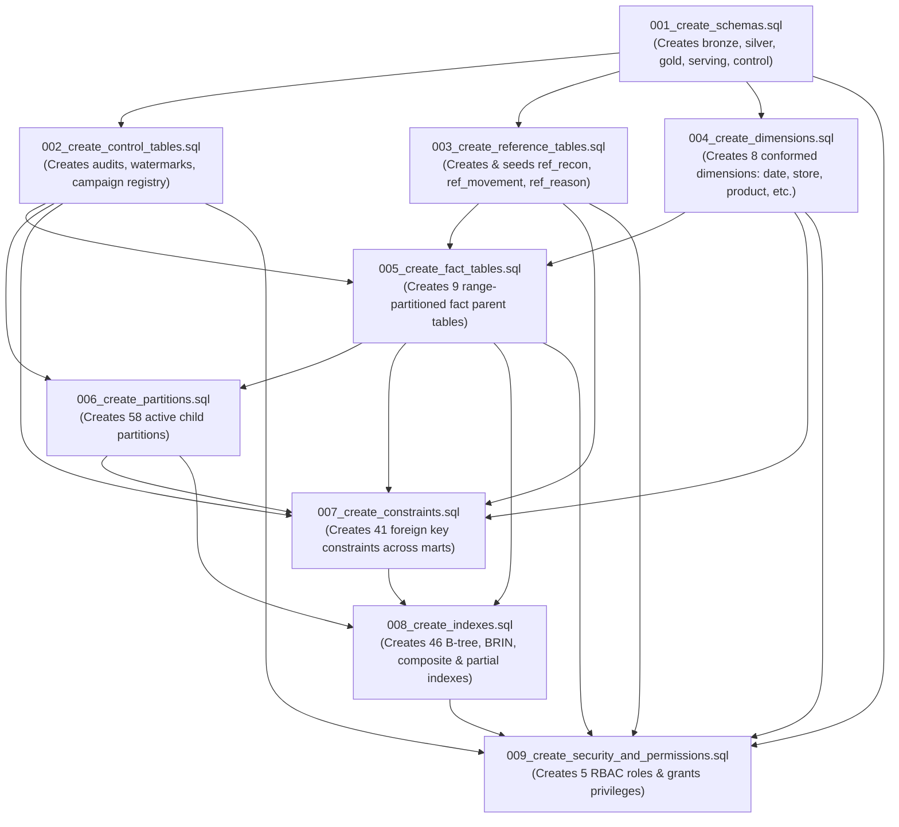

# Northstar Retail Group — Enterprise Retail Analytics Platform
## Stage 5.2B.1: DDL Migration & Execution Plan

---

### 1. Document Control & Execution Framework

* **Document Identifier:** `NRG-STAGE-5.2B-PLAN-V1.0`
* **Lead Engineer:** Senior PostgreSQL 16 Database Engineer
* **Database Platform:** PostgreSQL 16 on `localhost:5433` (Database: `northstar_analytics_dev`)
* **Phase:** Stage 5.2B.1 — DDL Migration Plan
* **Execution Status:** **STRICTLY DEFERRED — AWAITING FORMAL REVIEW & AUTHORIZATION**.

---

### 2. Dependency Graph & Sequential Migration Order

The migration files must be executed in strict topological order to respect relational foreign key dependencies, partitioned parent-child relationships, and schema existence:



---

### 3. Step-by-Step Execution Plan

```
+-----+-----------------------------------------+-----------------------------------+---------------------------------------------------+
| Step| Migration Script                        | Prerequisite Step                 | Transaction Strategy & Verification Gate          |
+-----+-----------------------------------------+-----------------------------------+---------------------------------------------------+
| 01  | 001_create_schemas.sql                  | Database connection established   | Single Transaction. Verify 5 schemas exist.       |
| 02  | 002_create_control_tables.sql           | Step 01 (control schema exists)   | Single Transaction. Verify 5 control tables + trg.|
| 03  | 003_create_reference_tables.sql         | Step 01 (gold schema exists)      | Single Transaction. Verify 3 tables + 14 seeds.   |
| 04  | 004_create_dimensions.sql               | Step 01, 03 (gold schema, ref)    | Single Transaction. Verify 8 dimensions exist.    |
| 05  | 005_create_fact_tables.sql              | Step 04 (dimensions exist)        | Single Transaction. Verify 9 parent facts exist.  |
| 06  | 006_create_partitions.sql               | Step 02, 05 (parent tables exist) | Single Transaction. Verify 58 partitions attach.  |
| 07  | 007_create_constraints.sql              | Step 06 (partitions attached)     | Single Transaction. Verify FKs applied to marts.  |
| 08  | 008_create_indexes.sql                  | Step 06, 07 (tables/FKs in place) | Single Transaction. Verify 46 indexes built.      |
| 09  | 009_create_security_and_permissions.sql | Step 01–08 complete               | Single Transaction. Verify 5 roles + grants.      |
+-----+-----------------------------------------+-----------------------------------+---------------------------------------------------+
```

---

### 4. Partitioning Strategy & Future Partition Maintenance

#### 4.1 Partition Topology
* **Monthly Facts:** `fact_sales`, `fact_inventory_snapshot`, `fact_demand_forecast` are partitioned by month on integer keys `YYYYMMDD` (e.g. `20261001` to `20261101`).
* **Annual Facts:** `fact_payments`, `fact_returns`, `fact_inventory_movements`, `fact_reconciliation`, `fact_marketing_performance`, `fact_campaign_exposure` are partitioned by year (e.g. `20260101` to `20270101`).
* **Control Batch Audit:** Partitioned annually by `TIMESTAMPTZ` on `batch_start_timestamp`.

#### 4.2 Automated Partition Maintenance Strategy
In production, a daily automated maintenance job (Airflow DAG or pg_cron procedure) will execute 30 days prior to month-end:
1. Query `information_schema.tables` for existing partition bounds.
2. Dynamically execute `CREATE TABLE IF NOT EXISTS gold.fact_sales_yYYYYmMM PARTITION OF gold.fact_sales FOR VALUES FROM (...) TO (...)`.
3. Pre-create local indexes on the newly attached partition before batch data ingestion begins.

---

### 5. Transaction & Rollback Strategy

1. **Transactional DDL in PostgreSQL 16:** PostgreSQL supports fully transactional DDL (`BEGIN ... COMMIT`). Each migration file is designed to execute inside an isolated transaction block. If any statement encounters an error, the entire migration script rolls back cleanly, leaving the database state unaltered.
2. **Deterministic Teardown / Rollback Script:** A companion rollback script (`sql/migrations/rollback/000_drop_all.sql`) will be prepared prior to live execution to allow complete tear-down and re-run during development testing without leaving orphan objects.

---

### 6. Blocker Resolution Requirement Before Execution

> [!WARNING]
> **GOVERNANCE BLOCKER TO RESOLVE PRIOR TO MIGRATION EXECUTION:**
> 
> * **Conflict Description:** `dim_customer.customer_key` is specified as `INTEGER GENERATED ALWAYS AS IDENTITY` in Data Dictionary Section 3.4 and Dimension Design Specification. However, `control.control_campaign_assignment_registry.customer_key` and `gold.fact_campaign_exposure.customer_key` are specified as `BIGINT` in Data Dictionary Section 2.8 & 4.3 and Physical Database Design Section 3.5.
> * **Impact:** PostgreSQL 16 rejects foreign key creation when referencing columns of differing types (`BIGINT` cannot reference `INTEGER`).
> * **Resolution Paths for Architecture Review:**
>   * **Option A (Recommended for Enterprise Retail Scale):** Standardize `customer_key` to `BIGINT` across all customer-referencing tables (`dim_customer`, `fact_sales`, `fact_payments`, `fact_returns`, `fact_campaign_exposure`, `control_campaign_assignment_registry`). This accommodates customer base growth beyond 2.14 billion surrogate keys over multi-year omnichannel scaling.
>   * **Option B (Strict Compliance with Dimension Spec):** Standardize `customer_key` to `INTEGER` in `control_campaign_assignment_registry` and `fact_campaign_exposure`, matching `dim_customer`.
> * **Action:** Formal sign-off on Option A or Option B must be granted before executing `007_create_constraints.sql`.
