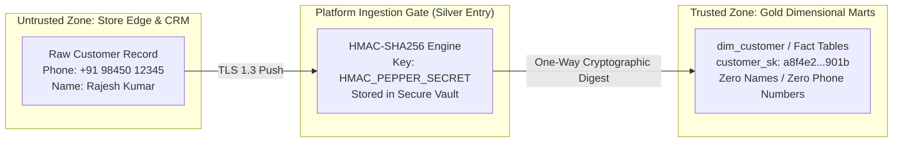

# Northstar Retail Group — Enterprise Retail Analytics Platform
## Stage 5.2A: Enterprise Auditability, Data Lineage & Privacy Architecture

---

### 1. Document Control & Regulatory Governance

* **Document Identifier:** `NRG-PDD-5.2A-008`
* **Phase:** Stage 5.2A — Physical Database Design
* **Scope:** Physical audit columns, cryptographic payload hashing, end-to-end data lineage mechanisms, and customer pseudonymization boundaries.
* **Governing Decisions & Requirements:**
  * `FR-014`: Customer Data Privacy & Pseudonymization Framework.
  * `NFR-012`–`NFR-014`: Data Privacy Safeguards & PII Vault Isolation.
  * `NFR-015`–`NFR-017`: Enterprise Auditability & Lineage Tracking.
  * Stage 2 Validation Finding: Customer pseudonymization is documented as a **provisional technical approach pending formal legal review** under the Digital Personal Data Protection Act (DPDPA), with **zero uncertified statutory compliance claims**.

---

### 2. Standard Enterprise Audit Metadata Architecture

Every physical table in the `silver`, `gold`, and `control` schemas incorporates a standardized, immutable **7-column enterprise audit block**:

```
+----------------------------+-----------------------+----------+----------------------------------------------------+
| Audit Column Name          | Physical Data Type    | Nullable | Technical Definition & Governance Function         |
+----------------------------+-----------------------+----------+----------------------------------------------------+
| `source_system`            | `VARCHAR(50)`         | NO       | Upstream source identifier (`SRC-001` POS, etc.)   |
| `source_record_id`         | `VARCHAR(100)`        | NO       | Natural business primary key in upstream system    |
| `ingestion_batch_id`       | `UUID`                | NO       | Unique pipeline execution run identifier           |
| `load_timestamp`           | `TIMESTAMPTZ`         | NO       | UTC microsecond timestamp of platform commit       |
| `source_updated_timestamp` | `TIMESTAMPTZ`         | YES      | Upstream system modification timestamp (if logged) |
| `record_hash`              | `CHAR(64)`            | NO       | Fixed SHA-256 fingerprint of business payload      |
| `data_quality_status`      | `VARCHAR(20)`         | NO       | Governance state (`VALIDATED`, `WARNING`, `QUAR`)  |
+----------------------------+-----------------------+----------+----------------------------------------------------+
```

#### 2.1 Cryptographic Payload Fingerprinting (`record_hash`)
* **Computation Standard:** `SHA-256` digest computed over the concatenated, pipe-delimited string of all core non-audit business fields in canonical alphabetical order:
  $$\text{record\_hash} = \text{SHA256}(\text{col}_1 \parallel '|' \parallel \text{col}_2 \parallel \dots \parallel \text{col}_n)$$
* **Use Case:** Enables high-speed, byte-level change detection during incremental staging merges (`SCD Type 1` and `SCD Type 2` evaluation in dbt), avoiding costly multi-column SQL `OR` equality comparisons.

#### 2.2 Data Quality Gate Status (`data_quality_status`)
* `VALIDATED`: Record passed 100% of schema, data type, referential integrity, and business range tests.
* `WARNING`: Record committed with non-fatal data quality warning (e.g. sales line linked to an inferred SKU pending ERP sync).
* `QUARANTINED`: Record failed critical validation (e.g. negative sales price, unparseable date); stored in `bronze_quarantine` for engineer inspection without stopping pipeline execution.

---

### 3. Customer Data Privacy & Pseudonymization Framework (`FR-014`)

To eliminate the risk of customer PII exposure while preserving cross-store behavioral analytics and loyalty attribution:



#### 3.1 Technical Implementation: Keyed HMAC-SHA256
1. **Raw PII Exclusion:** Customer phone numbers, email addresses, and personal names are **strictly quarantined at the ingestion boundary** and never written to `silver` or `gold` relational tables.
2. **Cryptographic Pseudonymization:** The ingestion agent applies a Keyed-Hash Message Authentication Code (HMAC) using the `SHA-256` hashing algorithm combined with a high-entropy, hardware-secured pepper secret (`HMAC_PEPPER_SECRET` from `config.base`):
   $$\text{customer\_sk} = \text{HMAC-SHA256}(\text{Normalized\_Phone\_E164}, \text{HMAC\_PEPPER\_SECRET})$$
3. **Irreversibility:** Because raw phone numbers are transformed into one-way 64-character hexadecimal digests, platform database administrators, Power BI report consumers, and analytics developers cannot reverse-engineer personal customer identities from analytical tables.
4. **Behavioral Preservability:** Identical customer phone numbers consistently produce identical `customer_sk` digests, enabling seamless RFM segmentation (`FR-015`), repeat purchase tracking, and closed-loop campaign lift attribution (`FR-018`).

#### 3.2 Regulatory Governance & DPDPA Classification
* **Provisional Technical Status:** This cryptographic pseudonymization architecture is classified as a **provisional engineering risk mitigation**.
* **Statutory Boundary:** Formal compliance with the Indian Digital Personal Data Protection Act (DPDPA 2023) requires independent enterprise legal review, appointment of a Data Protection Officer (DPO), and formal validation of consent management mechanisms.
* **Prohibition:** No claims of formal DPDPA compliance are made or implied within this physical database design.

---

### 4. End-to-End Enterprise Data Lineage Tracking

To satisfy corporate financial auditability requirements (`NFR-015`–`NFR-017`):

```
+-------------------------------------------------------------------------------------------------------------------+
|                                        DATA LINEAGE RECONSTRUCTION CHAIN                                          |
+-------------------------------------------------------------------------------------------------------------------+
|                                                                                                                   |
|   1. Source System: Store Indiranagar POS Edge Instance (`SRC-001`)                                              |
|      - File: `pos_sales_STR001_20261030_0142.json.gz`                                                            |
|      - Local Record Key: `invoice_id: 104928`, `line_id: 2`                                                       |
|                                                                                                                   |
|   2. Bronze Staging: `bronze.stg_pos_sales_raw`                                                                   |
|      - `batch_id: 7b3a4f10-90c1-4b12-a1f9-91823abce101`                                                          |
|      - `source_record_id: "STR001:104928:2"`                                                                      |
|                                                                                                                   |
|   3. Silver Cleansing: `silver.int_sales_lines`                                                                   |
|      - Deduplication applied on `[source_record_id]`                                                              |
|      - `customer_phone` converted to `customer_sk` via HMAC-SHA256; raw phone scrubbed                           |
|                                                                                                                   |
|   4. Gold Dimensional Mart: `gold.fact_sales_y2026m10`                                                            |
|      - `sales_fact_key: 109248101`                                                                                |
|      - `ingestion_batch_id: 7b3a4f10-90c1-4b12-a1f9-91823abce101`                                                |
|      - `record_hash: e3b0c44298fc1c149afbf4c8996fb92427ae41e4649b934ca495991b7852b855`                           |
|                                                                                                                   |
|   5. Serving Layer: `serving.vw_daily_sales_reporting`                                                            |
|      - Published to Power BI Executive Cockpit at 06:00 IST                                                       |
|                                                                                                                   |
+-------------------------------------------------------------------------------------------------------------------+
```

*Audit Trail Integrity:* Any number on an executive report can be traced backwards through `ingestion_batch_id` and `source_record_id` to the exact physical register lane, shift, and cashier timestamp that generated the transaction.

