# Northstar Retail Group — Enterprise Retail Analytics Platform
## Stage 5.2A: Physical Database Design Specification

---

### 1. Document Control & Executive Summary

* **Project Title:** Northstar Retail Group Enterprise Analytics Platform
* **Document Identifier:** `NRG-PDD-5.2A-001`
* **Phase:** Stage 5.2A — Physical Database Design (Architecture & Modeling Specification)
* **Lead Author:** Principal Database Architect & Senior PostgreSQL Data Engineer
* **Approved Architecture Baseline:** Stages 1–4 Approved Baseline; Stage 5.1 Environment Certified
* **Database Platform:** PostgreSQL 16 (Development Instance on `localhost:5433`, Database: `northstar_analytics_dev`)
* **Status:** **STAGE 5.2A DESIGN SPECIFICATION — STRICTLY PRE-DDL**

#### 1.1 Executive Overview
This specification delivers the authoritative physical database design for the Northstar Retail Analytics Platform. It operationalizes the approved Stage 4 Logical Architecture and Ralph Kimball Dimensional Modeling Strategy into a concrete, high-performance physical schema optimized for PostgreSQL 16.

In strict adherence to Stage 5.2A governance mandates:
1. **Design Only — Zero DDL Execution:** This deliverable provides design documentation, schema blueprints, and data dictionaries. No `CREATE`, `ALTER`, or `DROP` DDL statements have been executed against the active PostgreSQL database.
2. **Preservation of Approved Canonical Entities:** All **nine approved fact tables** and **eight approved dimension tables** from Stage 4 are rigorously modeled without deletion, merging, or semantic corruption.
3. **Decoupled 4-Way Reconciliation Hub (`BDL-02`):** Physical data structures preserve independent auditability for POS till balancing, payment settlement, inventory decrement, and customer returns.
4. **Strict Read-Only Operational Boundary (`BDL-04`):** The data model contains zero mechanisms or hooks for automated operational writeback into source POS, ERP, or banking systems.
5. **NFR-006 Sizing & Storage Integrity:** Provides a realistic physical storage architecture addressing five years of active historical transactions without silently demoting active history to cold storage.

---

### 2. Architectural Baseline & Physical Design Principles

```
+-------------------------------------------------------------------------------------------------------------------+
|                                  PHYSICAL DATA REFINERY ARCHITECTURE (LIFECYCLE)                                  |
+-------------------------------------------------------------------------------------------------------------------+
|                                                                                                                   |
|   +--------------------------+       +--------------------------+       +--------------------------+              |
|   |      BRONZE SCHEMA       |       |      SILVER SCHEMA       |       |       GOLD SCHEMA        |              |
|   |    (Transient / Raw)     |  -->  |   (Clean / Conformed)    |  -->  |    (Dimensional Marts)   |              |
|   | - Raw ingestion staging  |       | - Type validation        |       | - 8 Kimball Dimensions   |              |
|   | - JSONB/Text payloads    |       | - Pseudonymization vault |       | - 9 Partitioned Facts    |              |
|   | - Append-only batch logs |       | - 4-Way Recon engines    |       | - Star schema joins      |              |
|   +--------------------------+       +--------------------------+       +--------------------------+              |
|                                                                                      |                            |
|                                                                                      v                            |
|                                      +--------------------------+       +--------------------------+              |
|                                      |      CONTROL SCHEMA      |       |      SERVING SCHEMA      |              |
|                                      |   (Pipeline Metadata)    |       |   (Analytical Views)     |              |
|                                      | - Batch audit tracking   |       | - Business KPIs (13 KPIs)|              |
|                                      | - Watermark boundaries   |       | - Power BI DirectQuery   |              |
|                                      | - Dynamic threshold logs |       | - Row-Level Security RLS |              |
|                                      +--------------------------+       +--------------------------+              |
|                                                                                                                   |
+-------------------------------------------------------------------------------------------------------------------+
```

#### 2.1 Core Physical Modeling Principles
* **Kimball Dimensional Conformance:** Centralized, shared conformed dimensions (`DimDate`, `DimStore`, `DimProduct`, `DimCustomer`) enable cross-process drill-across analysis across sales, inventory, returns, and marketing without semantic fragmentation (`BDL-03`).
* **High-Performance Relational Typing:** Column data types strictly match business semantics using exact PostgreSQL primitives (`NUMERIC(15,2)` for currency, `TIMESTAMPTZ` for microsecond auditability, `INTEGER` surrogate keys) rather than generic string or floating-point allocations.
* **Declarative Partition Pruning:** High-volume fact tables are range-partitioned along temporal keys (`date_key`), enabling the PostgreSQL query planner to bypass non-relevant monthly or annual partitions entirely during dashboard slicing (`NFR-002`, `NFR-003`).
* **Storage Footprint Optimization:** Heavy fact tables leverage Block Range Indexes (BRIN) on monotonic sequential fields, reducing index storage footprints by over 80% compared to traditional B-trees while preserving sub-second analytical query speed.

---

### 3. Master Physical Entity Inventory

The physical database comprises **9 Fact Tables**, **8 Dimension Tables**, and **5 Supporting Control/Reference Tables**:

```
+----+----------------------------+-----------------+-----------------------+---------------------+----------------------------+
| #  | Physical Table Name        | Schema Layer    | Role / Classification | SCD Strategy        | Partitioning Strategy      |
+----+----------------------------+-----------------+-----------------------+---------------------+----------------------------+
| 01 | fact_sales                 | gold            | Core Transaction Fact | N/A (Append-Only)   | Range by Month (date_key)  |
| 02 | fact_payments              | gold            | Transaction Fact      | N/A (Append-Only)   | Range by Year (date_key)   |
| 03 | fact_returns               | gold            | Transaction Fact      | N/A (Append-Only)   | Range by Year (date_key)   |
| 04 | fact_inventory_snapshot    | gold            | Periodic Snapshot Fact| N/A (Daily Snapshot)| Range by Month (date_key)  |
| 05 | fact_inventory_movements   | gold            | Transaction Fact      | N/A (Append-Only)   | Range by Year (date_key)   |
| 06 | fact_reconciliation        | gold            | Audit / Trans Fact    | N/A (Daily Recon)   | Range by Year (date_key)   |
| 07 | fact_marketing_performance | gold            | Periodic Snapshot Fact| N/A (Daily Agg)     | Range by Year (date_key)   |
| 08 | fact_campaign_exposure     | gold            | Transaction Fact      | N/A (Append-Only)   | Range by Year (dispatch_dt)|
| 09 | fact_demand_forecast       | gold            | Periodic Snapshot Fact| N/A (Daily Model)   | Range by Month (target_dt) |
+----+----------------------------+-----------------+-----------------------+---------------------+----------------------------+
| 10 | dim_date                   | gold            | Conformed Dimension   | Static (10 Years)   | None (Lookup Table)        |
| 11 | dim_store                  | gold            | Conformed Dimension   | SCD Type 2          | None (Lookup Table)        |
| 12 | dim_product                | gold            | Conformed Dimension   | SCD Type 2          | None (Lookup Table)        |
| 13 | dim_customer               | gold            | Conformed Dimension   | SCD Type 1          | None (Lookup Table)        |
| 14 | dim_promotion              | gold            | Conformed Dimension   | SCD Type 1          | None (Lookup Table)        |
| 15 | dim_campaign               | gold            | Conformed Dimension   | SCD Type 1          | None (Lookup Table)        |
| 16 | dim_supplier               | gold            | Conformed Dimension   | SCD Type 1          | None (Lookup Table)        |
| 17 | dim_payment_method         | gold            | Conformed Dimension   | SCD Type 1          | None (Lookup Table)        |
+----+----------------------------+-----------------+-----------------------+---------------------+----------------------------+
| 18 | control_batch_audit        | control         | Operational Metadata  | N/A (Append-Only)   | Range by Year (load_ts)    |
| 19 | control_threshold_config   | control         | Operational Metadata  | SCD Type 2          | None (Single-Row Config)   |
| 20 | ref_reconciliation_domain  | gold            | Reference Domain      | Static Lookup       | None (Reference Table)     |
| 21 | ref_inventory_movement_type| gold            | Reference Domain      | Static Lookup       | None (Reference Table)     |
| 22 | ref_return_reason          | gold            | Reference Domain      | Static Lookup       | None (Reference Table)     |
+----+----------------------------+-----------------+-----------------------+---------------------+----------------------------+
```

---

### 4. Global Physical Naming & SQL Standards

1. **Identifier Casing:** Strictly `snake_case` for all database names, schemas, tables, views, columns, indexes, and constraints.
2. **Key Conventions:**
   * Primary Surrogate Keys: `<table_singular>_key` (e.g., `store_key`, `product_key`, `sales_fact_key`).
   * Natural / Business Keys: `<entity>_id` or `<entity>_code` (e.g., `store_id`, `sku_id`, `promo_code`).
   * Foreign Keys: Exactly mirror the target surrogate key name (e.g., `fact_sales.store_key` references `dim_store.store_key`).
3. **Temporal Attributes:**
   * Integer Date Keys: `date_key` (Format: `YYYYMMDD`, e.g., `20261030`).
   * Exact Timestamps: `*_timestamp` (Always `TIMESTAMPTZ` in UTC).
   * Date-only Fields: `*_date` (PostgreSQL `DATE`).
4. **Flag & Boolean Attributes:**
   * Prefixed with `is_` or suffixed with `_flag` (PostgreSQL `BOOLEAN`, values: `TRUE` / `FALSE`).
5. **Audit Metadata Standard:** Every physical table across `silver`, `gold`, and `control` incorporates the mandatory enterprise audit attributes:
   * `source_system` (`VARCHAR(50)`)
   * `source_record_id` (`VARCHAR(100)`)
   * `ingestion_batch_id` (`UUID`)
   * `load_timestamp` (`TIMESTAMPTZ`)
   * `source_updated_timestamp` (`TIMESTAMPTZ NULL`)
   * `record_hash` (`CHAR(64)` SHA-256 digest)
   * `data_quality_status` (`VARCHAR(20)`)

---

### 5. Enterprise Physical Entity-Relationship Diagram

```mermaid
erDiagram
    dim_date ||--o{ fact_sales : "dates"
    dim_store ||--o{ fact_sales : "transacts"
    dim_product ||--o{ fact_sales : "contains"
    dim_customer ||--o{ fact_sales : "purchases"
    dim_promotion ||--o{ fact_sales : "applies"

    dim_date ||--o{ fact_payments : "dates"
    dim_store ||--o{ fact_payments : "received_at"
    dim_payment_method ||--o{ fact_payments : "tendered_via"
    dim_customer ||--o{ fact_payments : "paid_by"

    dim_date ||--o{ fact_returns : "dates"
    dim_store ||--o{ fact_returns : "returned_to"
    dim_product ||--o{ fact_returns : "items"
    dim_customer ||--o{ fact_returns : "returned_by"
    ref_return_reason ||--o{ fact_returns : "classified_by"

    dim_date ||--o{ fact_inventory_snapshot : "snapshots"
    dim_store ||--o{ fact_inventory_snapshot : "located_at"
    dim_product ||--o{ fact_inventory_snapshot : "balances"

    dim_date ||--o{ fact_inventory_movements : "posted_on"
    dim_store ||--o{ fact_inventory_movements : "originates_from"
    dim_product ||--o{ fact_inventory_movements : "moves"
    ref_inventory_movement_type ||--o{ fact_inventory_movements : "categorized_as"

    dim_date ||--o{ fact_reconciliation : "audits"
    dim_store ||--o{ fact_reconciliation : "reconciles"
    ref_reconciliation_domain ||--o{ fact_reconciliation : "leg"

    dim_date ||--o{ fact_marketing_performance : "dates"
    dim_store ||--o{ fact_marketing_performance : "attributions"
    dim_campaign ||--o{ fact_marketing_performance : "evaluates"
    dim_promotion ||--o{ fact_marketing_performance : "cross_promotes"

    dim_date ||--o{ fact_campaign_exposure : "dispatched_on"
    dim_campaign ||--o{ fact_campaign_exposure : "targets"
    dim_customer ||--o{ fact_campaign_exposure : "exposed_to"

    dim_date ||--o{ fact_demand_forecast : "target_horizon"
    dim_store ||--o{ fact_demand_forecast : "forecasted_at"
    dim_product ||--o{ fact_demand_forecast : "projects"

    dim_supplier ||--o{ dim_product : "supplies"

    fact_sales {
        BIGINT sales_fact_key PK
        INTEGER date_key FK
        INTEGER store_key FK
        INTEGER product_key FK
        INTEGER customer_key FK
        INTEGER promotion_key FK
        VARCHAR pos_invoice_number
        NUMERIC quantity_sold
        NUMERIC net_sales_amount
        NUMERIC gross_margin_amount
    }

    fact_payments {
        BIGINT payment_fact_key PK
        INTEGER date_key FK
        INTEGER store_key FK
        INTEGER payment_method_key FK
        VARCHAR pos_invoice_number
        NUMERIC tender_amount
        NUMERIC gateway_deducted_fee_amount
    }

    fact_returns {
        BIGINT return_fact_key PK
        INTEGER date_key FK
        INTEGER store_key FK
        INTEGER product_key FK
        INTEGER return_reason_key FK
        VARCHAR return_receipt_id
        NUMERIC refund_amount
    }

    fact_inventory_snapshot {
        BIGINT snapshot_fact_key PK
        INTEGER date_key FK
        INTEGER store_key FK
        INTEGER product_key FK
        NUMERIC stock_on_hand_units
        NUMERIC inventory_valuation_cost_amount
    }

    fact_reconciliation {
        BIGINT recon_fact_key PK
        INTEGER date_key FK
        INTEGER store_key FK
        INTEGER recon_domain_key FK
        NUMERIC source_system_a_amount
        NUMERIC source_system_b_amount
        NUMERIC variance_amount
        BOOLEAN ticket_generated_flag
    }
```



---

### 6. Design Constraints & Boundary Verifications

1. **Read-Only Operational Boundary (`BDL-04`):**
   * The database user `northstar_dev_user` has zero write or execute privileges against source databases.
   * Gold facts and serving views strictly support downstream analytical queries and human-in-the-loop review workbenches.
2. **Configurable Threshold Integration (`BDL-06`):**
   * Discrepancy logic binds dynamically to `control.control_threshold_config.discrepancy_threshold_inr` (default ₹500.00), eliminating hardcoded SQL conditionals.
3. **Statutory Integrity:**
   * Data models strictly avoid uncertified claims of compliance with DPDPA, ISO, or PCI-DSS, classifying privacy mechanisms as provisional technical risk mitigations.
