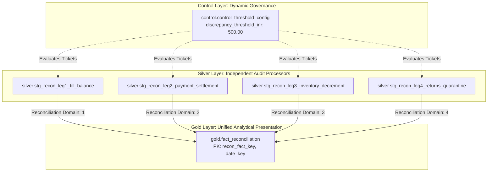

# Northstar Retail Group — Enterprise Retail Analytics Platform
## Stage 5.2A: Reconciliation Data Model Specification (Final Certified Baseline)

---

### 1. Document Control & Governance Mandates

* **Document Identifier:** `NRG-PDD-5.2A-007-REV3`
* **Phase:** Stage 5.2A — Physical Database Design (Post-Audit Revisions)
* **Scope:** Physical data structures, financial precision rules, matching keys, configurable discrepancy thresholds, and decoupled audit architectures for the **4-Way Decoupled Reconciliation Hub**.
* **Governing Architectural Decisions:**
  * `BDL-02`: Decoupled 4-Way Reconciliation Architecture (Independent audit execution).
  * `BDL-04`: Strict Read-Only Architecture (Zero automated source modifications).
  * `BDL-06`: Configurable Discrepancy Threshold (Default ₹500 via control table).
  * Stage 5.2A Audit Finding: **ERP Movement Types (e.g. `251` and `451`) are formally classified as provisional mapping assumptions** pending confirmed interface specifications from the central ERP system (`SRC-002`).

---

### 2. Financial & Quantitative Precision Framework

To guarantee strict compliance with Indian accounting standards and prevent cumulative rounding leakage:

```
+---------------------------+-----------------------+---------------------+----------------------------------------------------+
| Measurement Domain        | Physical Data Type    | Storage Precision   | Business Application & Standard                    |
+---------------------------+-----------------------+---------------------+----------------------------------------------------+
| Commercial Currency (INR) | `NUMERIC(15, 2)`      | Exact 2-Dec Paise   | Gross/Net Sales, Discounts, Taxes, Refunds, Tenders|
| Standard Acquisition Cost | `NUMERIC(14, 4)`      | 4-Dec Fractional    | FIFO Unit Cost, Standard Moving Average Valuation  |
| Statutory Tax Rates (GST) | `NUMERIC(6, 4)`       | 4-Dec Percentage    | CGST (0.0900), SGST (0.0900), IGST (0.1800)        |
| Acquirer MDR Fee Rates    | `NUMERIC(6, 4)`       | 4-Dec Percentage    | Pine Labs, Paytm MDR fraction (e.g. 0.0175)        |
| Physical Merchandise Count| `NUMERIC(12, 3)`      | 3-Dec Decimal       | Bulk weighed items (kg) & discrete item counts     |
| Currency Identifier       | `CHAR(3)`             | Fixed ISO-4217      | Fixed `'INR'` base operational currency            |
+---------------------------+-----------------------+---------------------+----------------------------------------------------+
```

---

### 3. The Four Decoupled Reconciliation Data Structures

In strict adherence to `BDL-02`, the reconciliation engine avoids a monolithic matching table. It models four dedicated Silver-layer comparison tables feeding the unified Gold audit fact `gold.fact_reconciliation`:



---

#### 3.1 Leg 1: POS Sales Line vs. Store Till Journal (`BP-003`)
* **Process Focus:** Cashier shortages/overages, un-rung sales, and unauthorized line voids (`FR-021`).
* **Comparison Grain:** **Individual POS Register per Cashier Shift per Store** (`[store_id, pos_terminal_id, shift_id, cashier_id]`).
* **Matching Join Key:** `store_id || '-' || pos_terminal_id || '-' || shift_id || '-' || cashier_employee_id`.
* **System A Measure (POS Expected):**
  $$\text{Expected Cash} = \sum (\text{Cash Tender}) - \sum (\text{Cash Refunds Issued})$$
* **System B Measure (Cashier Declared):**
  $$\text{Declared Cash} = \text{Blind Physical Currency Count Declared at Shift Close}$$
* **Mathematical Variance:**
  $$\Delta_{\text{Till}} = \text{Declared Cash} - \text{Expected Cash}$$
* **Exception Ticketing Rule:**
  $$\text{IF } |\Delta_{\text{Till}}| > \text{PARAM\_DISCREPANCY\_THRESHOLD} \text{ (₹500.00) THEN } \text{Generate Exception Ticket}$$
* **Operational Remediation Interface:** Store Manager Till Workbench (`PIR-001`). Manager reviews discrepancy on mobile tablet by 06:00 IST and submits mandatory reason code (`TILL_SHORTAGE_CASHIER_FAULT`, `SYSTEM_CORRECTION_PENDING`, `COUNTING_ERROR`).

---

#### 3.2 Leg 2: Payment Tender vs. Bank Merchant Settlement (`BP-004`)
* **Process Focus:** Dropped/unsettled digital tenders (UPI, Cards), acquirer fee drift, and MDR fee overcharges (`FR-011`).
* **Comparison Grain:** **Acquirer Settlement Batch ID & Bank UTR Number** (with drill-down to individual POS transaction ID).
* **Matching Join Key:** `bank_utr_number` OR `gateway_batch_id || '-' || settlement_date`.
* **System A Measure (POS Tender):**
  $$\text{Gross POS Digital Sales} = \sum (\text{Tender Amount for Cards/UPI})$$
  $$\text{Expected Net Deposit} = \text{Gross POS Digital Sales} - (\text{Gross Sales} \times \text{Contracted MDR \%})$$
* **System B Measure (Bank Cleared Credit):**
  $$\text{Actual Net Deposit} = \text{Bank Cleared MT940 Credit Amount}$$
  $$\text{Actual Gateway Fee} = \text{Pine Labs / Paytm Deducted Fee}$$
* **Mathematical Variances:**
  $$\Delta_{\text{Settlement}} = \text{Actual Net Deposit} - \text{Expected Net Deposit}$$
  $$\Delta_{\text{MDR Fee}} = \text{Actual Gateway Fee} - \text{Expected MDR Fee}$$
* **Exception Ticketing Rule:**
  * Dropped Tender: POS tender un-cleared after 48 hours ($T+2$) triggers Treasury Alert (`FR-011`).
  * MDR Fee Drift: $\Delta_{\text{MDR Fee}} \ge ₹100.00$ triggers Acquirer Overcharge Ticket.
* **Operational Remediation Interface:** Treasury Dispute Desk (`PIR-006`). Automatically compiles pre-formatted dispute packages with bank UTRs for acquirer clawback requests.

---

#### 3.3 Leg 3: POS Scanned Units vs. ERP Inventory Decrement (`BP-005`)
* **Process Focus:** Phantom inventory, unposted sync batches, and retail shrinkage drift (`FR-012`, `FR-016`).
* **Provisional Movement Type Classification:**
  * *Conceptual Category:* `SALES_DECREMENT` (Provisional SAP Movement Type `251`; reversal `252`).
  * *Governance Note:* Movement code `251` is treated as a **provisional design assumption**. If Northstar's ERP utilizes different codes (e.g. Navision item ledger entries or custom codes), the physical reconciliation model binds to the canonical category `SALES_DECREMENT` via `gold.ref_inventory_movement_type` without altering reconciliation logic.
* **Comparison Grain:** **Store-SKU Daily Posting Balance** (`[store_id, sku_id, posting_date]`).
* **Matching Join Key:** `store_id || '-' || sku_id || '-' || date_key`.
* **System A Measure (POS Scans):**
  $$\text{POS Net Scanned Units} = \sum (\text{Quantity Sold}) - \sum (\text{Quantity Returned})$$
* **System B Measure (ERP Decrements):**
  $$\text{ERP Decremented Units} = \sum (\text{Canonical SALES\_DECREMENT Units})$$
* **Mathematical Variance:**
  $$\Delta_{\text{Units}} = \text{POS Net Scanned Units} - \text{ERP Decremented Units}$$
  $$\Delta_{\text{Cost Value}} = \Delta_{\text{Units}} \times \text{Standard Cost Price}$$
* **Exception Ticketing Rule:**
  $$\text{IF } |\Delta_{\text{Cost Value}}| > \text{PARAM\_DISCREPANCY\_THRESHOLD} \text{ (₹500.00) THEN } \text{Flag for Cycle Count}$$
* **Operational Remediation Interface:** Store Cycle Count Workbench (`PIR-008`). Flags top 5 to 10 variance SKUs daily for a morning 15-minute shelf count, eliminating disruptive quarterly store closures (`SC-04`).

---

#### 3.4 Leg 4: Customer Returns vs. Quarantine / Refund Ledgers (`BP-006`)
* **Process Focus:** Fraudulent customer returns, stolen merchandise refund scams, and missing quarantine stock (`FR-013`).
* **Provisional Movement Type Classification:**
  * *Conceptual Category:* `RETURNS_QUARANTINE_RECEIPT` (Provisional SAP Movement Type `451`).
  * *Governance Note:* Movement code `451` is treated as a **provisional design assumption**. The reconciliation model binds to the canonical category `RETURNS_QUARANTINE_RECEIPT` in `gold.ref_inventory_movement_type`.
* **Comparison Grain:** **Return Credit Voucher Line Item** (`[return_receipt_id, return_line_number]`).
* **Matching Join Key:** `return_receipt_id || '-' || return_line_number`.
* **System A Measure (POS Refund Voucher):**
  $$\text{POS Refund Disbursed} = \text{Credit/Cash Disbursed to Customer}$$
  $$\text{POS Claimed Returned Units} = \text{Physical Units Accepted by Cashier}$$
* **System B Measure (ERP Quarantine Intake):**
  $$\text{ERP Quarantine Units} = \text{Units Checked into Blocked Quarantine Stock (Canonical Category)}$$
* **Mathematical Variance:**
  $$\Delta_{\text{Quarantine Units}} = \text{POS Claimed Returned Units} - \text{ERP Quarantine Units}$$
* **Exception Ticketing Rules:**
  1. *Unreferenced Return Fraud Alert:* Any manager-override return processed without an original sales invoice ID where refund $> ₹1,000.00$ triggers an immediate High-Risk Fraud Alert (`FR-013` AC2).
  2. *Missing Quarantine Stock:* $\Delta_{\text{Quarantine Units}} > 0$ after 24 hours triggers Store Loss Prevention Alert.
* **Operational Remediation Interface:** Regional Loss Prevention Portal. Flags cashier collusion anomalies (cashiers whose return override rates exceed $3\times$ store average).

---

### 4. Strict Read-Only Operational Boundary (`BDL-04`)

To preserve absolute compliance with corporate audit rules:
1. **Zero Automated DML against Sources:**
   * The reconciliation engine **never executes SQL `INSERT`, `UPDATE`, or `DELETE`** against operational POS databases or ERP tables.
   * It **never writes financial journal entries** or bank debit/credit adjustments.
2. **Analytical Ticketing Only:**
   * Discrepancies generate read-only analytical records in `gold.fact_reconciliation` and trigger automated email/dashboard notifications.
3. **Manual Human-in-the-Loop Remediation:**
   * Inventory adjustments must be entered manually into ERP by authorized store personnel (e.g. via SAP GUI `MI04`/`MI07`).
   * Cashier till variances must be resolved via standard POS supervisor terminal sign-offs.
   * Bank disputes must be submitted by Corporate Treasury through approved acquirer merchant portals.
