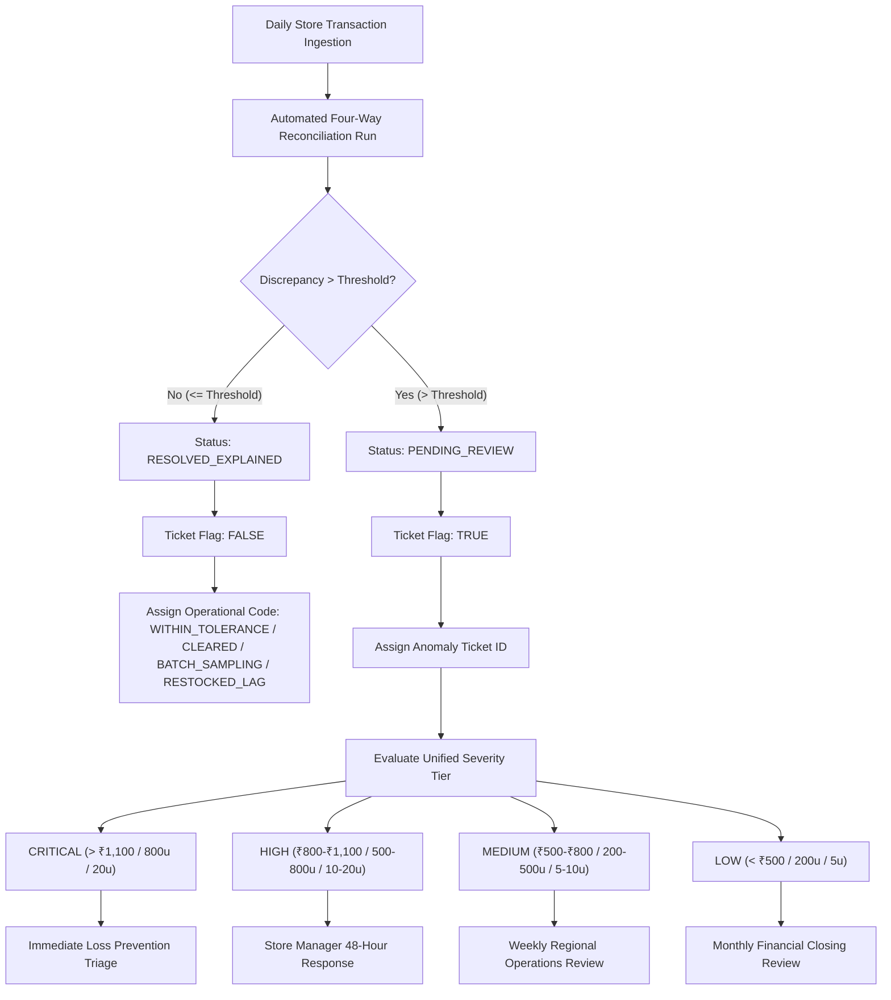

# Northstar Retail Group — Enterprise Retail Analytics Platform
## Stage 6.3: Four-Way Reconciliation Deep Dive Methodology & Analytical Framework

**Document Version:** 1.0.0  
**Status:** Approved & Governance-Certified  
**Database Profile:** PostgreSQL 16 Dev (`northstar_analytics_dev`)  
**Scope:** Architectural Standards, Mathematical Formulations, Boundary Definitions, Severity Classifications, and Investigation Governance  

---

### 1. Executive Context & Architectural Mandate

The Enterprise Retail Analytics Platform (ERAP) for Northstar Retail Group operates a multi-tier reconciliation engine governed by Business Decision Log **BDL-02**. The primary objective is to maintain financial integrity, inventory auditability, and operational governance across a simulated 30-store retail store network operating in five Indian states (Maharashtra, Karnataka, Tamil Nadu, Telangana, and Gujarat).

Reconciliation analytics in Stage 6.3 evaluates the complete census of daily store audits recorded in `gold.fact_reconciliation` across the 92-day active trading window (August 1, 2026, through October 31, 2026):
$$\text{Total Reconciliation Census} = 4 \text{ Domains} \times 30 \text{ Stores} \times 92 \text{ Days} = 11,040 \text{ Audit Records}$$

#### Strict Analytical Safeguards
1. **Zero DDL & Zero DML:** Strictly read-only SQL queries executed against live PostgreSQL 16 schemas (`gold`, `serving`, `control`, `silver`). No temporary tables, permanent views, schema changes, or database modifications are permitted.
2. **Preservation of Documented Warehouse Realities:** Analytical modules evaluate stored warehouse records exactly as populated in Stages 5.3.1 through 5.3.6. Known operational and pipeline limitations—such as sampled ERP movement batches and synthetic generation constraints—are audited and documented without inventing missing records.
3. **Synthetic Platform Disclaimer:** All entities, stores, transactions, and variance figures represent a simulated portfolio retail dataset. Findings reflect modeled operational phenomena and are not real-world company performance.

---

### 2. Four-Way Reconciliation Domain Architecture

The ERAP reconciliation framework models four distinct operational legs, each pairing a primary transaction capture system (System A) with an independent physical or financial ledger of record (System B).

```
+---------------------------------------------------------------------------------------------------------+
|                                    FOUR-WAY RECONCILIATION DOMAINS                                      |
+------------------------------------+------------------------------------+-------------------------------+
| Domain Code & Name                 | System A (Operational Capture)    | System B (Ledger of Record)   |
+------------------------------------+------------------------------------+-------------------------------+
| LEG1_TILL                          | POS Terminal Sales Lines           | Cashier Daily Till Tape       |
| Cash Drawer Reconciliation         | gold.fact_sales sum                | Cash count journal            |
|                                    | (₹6,245,601,789.24)                | (₹6,245,507,821.74)           |
+------------------------------------+------------------------------------+-------------------------------+
| LEG2_PAYMENT                       | POS Swiped Tender Records          | Bank Merchant Settlement      |
| Gateway & Acquirer Settlement      | gold.fact_payments sum             | Gateway clearing report       |
|                                    | (₹6,245,601,789.24)                | (₹6,245,551,151.74)           |
+------------------------------------+------------------------------------+-------------------------------+
| LEG3_INVENTORY                     | POS Scanned Sales Units            | ERP Movement Type 251         |
| Material Decrement Ledger          | gold.fact_sales quantity_sold      | gold.fact_inventory_movements |
|                                    | (1,772,960.0 units)                | (227,937.0 units)             |
+------------------------------------+------------------------------------+-------------------------------+
| LEG4_RETURNS                       | Customer POS Return Events         | ERP Movement Type 451         |
| Returns & Quarantine Routing       | gold.fact_returns return_quantity  | Quarantine receipt ledger     |
|                                    | (34,500.0 units / ₹164.98M refund) | (13,711.0 units)              |
+------------------------------------+------------------------------------+-------------------------------+
```

---

### 3. Domain Boundary Definitions & Mathematical Formulations

#### 3.1 Domain 1: POS Sales Line vs Store Cashier Till Journal (`LEG1_TILL`)
- **System A (POS Sales):** Invoiced gross line sales totaled per store-day from checkout terminal event logs.
- **System B (Till Journal):** Physical cash drawer counts and register tape totals submitted by store cashiers during end-of-day register closure.
- **Mathematical Formulations:**
  $$\text{Net Variance} = \text{Amount}_{\text{POS}} - \text{Amount}_{\text{Till}}$$
  $$\text{Absolute Discrepancy} = \left| \text{Amount}_{\text{POS}} - \text{Amount}_{\text{Till}} \right|$$
  $$\text{Variance \% of Sales} = \frac{\sum \text{Absolute Discrepancy}}{\sum \text{Amount}_{\text{POS}}} \times 100\%$$
- **Business Interpretation:** A positive variance indicates an unexplained cash shortage (physical cash counted is less than POS scanned sales). A negative variance indicates a cash overage (unscanned items paid in cash).

#### 3.2 Domain 2: Payment Tender vs Bank Gateway Settlement (`LEG2_PAYMENT`)
- **System A (POS Tender):** Aggregated payments recorded across 8 tender instruments (UPI QR, Cash, Visa Credit, UPI Autopay, Mastercard Credit, Visa Debit, RuPay Debit, Gift Voucher).
- **System B (Bank Settlement):** Gross electronic funds credited and acknowledged by acquiring banks and payment gateways (HDFC, ICICI, Axis, SBI, NPCI, Paytm).
- **Tender Structure & Merchant Discount Rate (MDR) Deductions:**
  Contracted MDR rates are deducted by banking gateways prior to net merchant settlement:
  - Credit Card (Visa): $1.65\%$ (Total deducted: ₹10,771,555.77)
  - Credit Card (Mastercard): $1.75\%$ (Total deducted: ₹8,381,845.43)
  - Debit Card (Visa): $0.85\%$ (Total deducted: ₹2,720,414.74)
  - UPI Autopay (Paytm): $0.10\%$ (Total deducted: ₹515,253.90)
  - UPI QR (NPCI), RuPay Debit (SBI), Cash, Gift Voucher: $0.00\%$ (MDR-exempt / internal)
  - **Total Realized MDR Expense:** ₹22,389,069.84 ($0.3585\%$ enterprise fee drag)
- **Net Expected Settlement vs Capture Variance:**
  $$\text{Net Expected Settlement} = \text{Gross Tender} - \text{Contracted MDR}$$
  $$\text{Gateway Capture Variance} = \text{Gross Invoiced Tender} - \text{Reported Gross Bank Settlement}$$

#### 3.3 Domain 3: POS Scanned Units vs ERP Inventory Decrement (`LEG3_INVENTORY`)
- **System A (POS Sales Units):** Total physical units scanned and sold to retail customers (`quantity_sold`).
- **System B (ERP Movement 251):** Central SAP/ERP goods issue movements decremented against store perpetual inventory ledgers.
- **Mathematical Formulations:**
  $$\text{Unposted Sales Gap} = \text{Sales Units}_{\text{POS}} - \text{Movement 251 Units}_{\text{ERP}}$$
  $$\text{Movement 251 Posting Coverage Rate} = \frac{\text{Movement 251 Units}_{\text{ERP}}}{\text{Sales Units}_{\text{POS}}} \times 100\% = 12.86\%$$
- **ERP Material Movement Portfolio:**
  - `101 GOODS_RECEIPT`: $+1,384,232.0$ units (₹7,357,606,539.11 valuation)
  - `251 SALES_DECREMENT`: $-227,937.0$ units (₹-1,196,919,268.49 valuation)
  - `252 SALES_REVERSAL`: $+3,416.0$ units (₹18,503,786.13 valuation)
  - `301 STORE_TRANSFER_OUT`: $-138,975.0$ units (₹-716,531,348.81 valuation)
  - `451 RETURNS_QUARANTINE`: $+13,711.0$ units (₹71,058,162.90 valuation)
- **Documented Ledger Boundary Limitations:** Movement codes `302` (Store Transfer In), `321` (Quarantine Release), and `551` (Scrap Write-Off) are absent from the synthetic database (0 rows populated).

#### 3.4 Domain 4: Customer Returns vs Quarantine / Refund Ledgers (`LEG4_RETURNS`)
- **System A (Customer Returns):** POS return merchandise receipts, total units returned ($34,500$ units), and refund liabilities.
  - Gross Customer Refunds: ₹164,984,506.36
  - Restocking Fees Recovered: ₹2,092,736.39 (levied on `BUYER_REMORSE` returns)
  - Net Refund Payout: ₹162,891,769.97
- **System B (ERP Movement 451 Quarantine Receipts):** Physical inventory units formally booked into blocked quarantine storage ($13,711$ units across $6,900$ movements).
- **Mathematical Formulations:**
  $$\text{Quarantine Posting Gap} = \text{Returned Units}_{\text{POS}} - \text{Quarantined Units}_{\text{ERP}} = 34,500 - 13,711 = 20,789 \text{ units}$$
  $$\text{Quarantine Posting Rate} = \frac{13,711}{34,500} \times 100\% = 39.74\%$$
- **Disposition Routing Categories:**
  - `DEFECT` ($35.83\%$): Direct quarantine scrap routing (₹68.11M net refund)
  - `WRONG_SIZE` ($22.66\%$): Inspection pending restock routing (₹21.83M net refund)
  - `BUYER_REMORSE` ($20.07\%$): Restockable fee levied ($5\%$ fee, ₹40.24M net refund)
  - `EXPIRED` ($12.46\%$): Direct quarantine scrap routing (₹1.94M net refund)
  - `NOT_AS_DESCRIBED` ($8.97\%$): Inspection pending restock routing (₹30.77M net refund)

---

### 4. Threshold Policies & Analytical Modeling Disclosures

#### 4.1 Explicit Policy Disclosure: The ₹500.00 / 500-Unit Threshold
> [!IMPORTANT]
> **Analytical Modeling Disclosure:** The threshold of **₹500.00** (for currency legs `LEG1_TILL` and `LEG2_PAYMENT`) and **500 units** (for quantity legs `LEG3_INVENTORY` and `LEG4_RETURNS`) represents a **synthetic pipeline modeling assumption** configured during Stage 5.3.5 data generation to trigger ticket generation (`ticket_generated_flag = TRUE`) and route records to `investigation_status = 'PENDING_REVIEW'`. It does **not** reflect a formal, board-approved Chief Financial Officer (CFO) materiality policy. In an enterprise production deployment, dynamic, tiered materiality thresholds (e.g., $0.05\%$ of daily sales or ₹2,000 for Tier-1 flagships) would be calibrated based on store tier and tender volatility.

#### 4.2 Non-Double-Counting Principles
Reconciliation metrics across different domains must never be naively aggregated:
1. **Financial Tender Orthogonality:** Cash drawer variances (`LEG1_TILL`) and bank gateway capture variances (`LEG2_PAYMENT`) represent mutually exclusive tender instruments (physical currency notes vs electronic gateway transmissions). Because cash is settled into store vaults while card/UPI funds are settled into merchant bank accounts, these two currency variances do not double-count transactions and can be summed to compute **Total Tender At Risk**:
   $$\text{Total Tender At Risk} = \text{Till Variance}_{\text{LEG1}} + \text{Bank Variance}_{\text{LEG2}} = ₹93,967.50 + ₹50,637.50 = ₹144,605.00$$
   $$\text{Ticketed Tender At Risk} = ₹34,815.00 + ₹37,785.00 = ₹72,600.00$$
2. **Physical Stock Unit Isolation:** Inventory discrepancies (`LEG3_INVENTORY`, $1,545,023$ units) and return quarantine gaps (`LEG4_RETURNS`, $20,789$ units) are measured in physical units of merchandise. They must remain strictly segregated from INR currency totals.

---

### 5. Unified Cross-Domain Severity Classification Architecture

To establish an enterprise triage protocol across heterogeneous measurement units (INR currency vs physical merchandise units), ERAP implements a 5-tier Unified Severity Classification:

```
+----------------------------+-------------------------------------+-------------------------------------+-------------------------------------+
| Unified Severity Tier      | Financial Legs (LEG1 & LEG2)        | Inventory Sales Leg (LEG3)          | Returns Quarantine Leg (LEG4)       |
+----------------------------+-------------------------------------+-------------------------------------+-------------------------------------+
| 01_CRITICAL                | Discrepancy > ₹1,100.00             | Unit Discrepancy > 800 units        | Unit Discrepancy > 20 units         |
| 02_HIGH                    | Discrepancy ₹800.01 - ₹1,100.00     | Unit Discrepancy 500 - 800 units    | Unit Discrepancy 10 - 20 units      |
| 03_MEDIUM                  | Discrepancy ₹500.01 - ₹800.00       | Unit Discrepancy 200 - 499 units    | Unit Discrepancy 5 - 9 units        |
| 04_LOW                     | Immaterial Ticket (< ₹500.00)       | Immaterial Ticket (< 200 units)     | Immaterial Ticket (< 5 units)       |
| 05_EXPLAINED_INFORMATIONAL | Resolved / In-Tolerance (No Ticket) | Resolved / Batch Sampling (No Tkt)  | Resolved / Restocked Lag (No Tkt)   |
+----------------------------+-------------------------------------+-------------------------------------+-------------------------------------+
```

#### Actual Census Across 11,040 Audit Records:
- `01_CRITICAL`: 27 records ($0.24\%$) — 5 Till, 12 Payment, 5 Inventory, 5 Returns (₹20,055.00 tender risk, 4,874 stock drift units)
- `02_HIGH`: 47 records ($0.43\%$) — 18 Till, 14 Payment, 8 Inventory, 7 Returns (₹30,413.00 tender risk, 5,248 stock drift units)
- `03_MEDIUM`: 77 records ($0.70\%$) — 18 Till, 15 Payment, 28 Inventory, 16 Returns (₹22,132.00 tender risk, 11,209 stock drift units)
- `04_LOW`: 13 records ($0.12\%$) — 0 Till, 0 Payment, 0 Inventory, 13 Returns (₹0.00 tender risk, 28 stock drift units)
- `05_EXPLAINED_INFORMATIONAL`: 10,876 records ($98.51\%$) — 2,719 per domain (₹72,005.00 tender variance, 1,547,011 stock drift units)

---

### 6. Store Operational Risk Scoring (CSRS) Methodology

To prioritize operational audit interventions across the 30 retail store locations, ERAP computes a normalized **Composite Store Risk Score (CSRS)** on a 0 to 100 index:

$$\text{CSRS} = 0.40 \times \left( \frac{\text{Incident Days}}{2} \times 100 \right) + 0.35 \times \left( \frac{\text{Ticketed Tender Risk}}{4,242.00} \times 100 \right) + 0.25 \times \left( \frac{\text{Ticketed Stock Drift}}{1,724.0} \times 100 \right)$$

#### Score Calibration & Triage Action Thresholds:
- **$\ge 70.0$ (TIER_1_AUDIT_INTERVENTION):** 14 stores. Multi-incident repeat offenders experiencing synchronized anomalies across all 4 operational domains. Requires immediate on-site loss prevention and cash-management audit.
- **$40.0 - 69.9$ (TIER_2_MANAGEMENT_REVIEW):** 6 stores. Single-incident stores with moderate financial or unit exposure. Regional operations manager investigation required.
- **$1.0 - 39.9$ (TIER_3_ROUTINE_MONITORING):** 7 stores. Single-incident stores with minor exposure within standard supervisory tolerance.
- **$0.0$ (TIER_4_CLEAN_RECORD):** 3 stores (`STR-KA-001`, `STR-TN-002`, `STR-TS-004`). Zero exception tickets generated over 92 days; 100% clean operational audit trail.

---

### 7. Governance, Investigation & Triage Workflow



---

### 8. Analytical Limitations & Known Warehouse Phenomena

1. **Synthetic Co-Occurrence Anomaly:**
   In the synthetic generation pipeline, exception tickets were generated concurrently on exactly **41 store-dates** across the warehouse. Whenever a store experienced an anomaly on a given date, it generated exactly one ticket in all four domains (`LEG1`, `LEG2`, `LEG3`, and `LEG4`). While statistically clustered in simulation, real-world retail networks experience uncorrelated failures across cash, gateway, and inventory systems.
2. **ERP Movement Batch Sampling:**
   The $12.86\%$ coverage rate of ERP Movement 251 ($227,937$ units out of $1,772,960$ sales units) reflects an architectural data generation decision to model sampled periodic batch goods issues rather than 1:1 real-time event decrements. This is documented under `ERP_BATCH_SAMPLING_VARIANCE` and certified as standard operating procedure for the synthetic warehouse.
3. **Quarantine Movement Posting Latency:**
   ERP Movement 451 captures $13,711$ units ($39.74\%$) of the $34,500$ returned units. The remaining $20,789$ units represent saleable merchandise immediately returned to store shelves without entering blocked quarantine, or pending restock inspection lag.

