# Northstar Retail Group — Enterprise Retail Analytics Platform
## Stage 6.4: Prioritized 30/60/90-Day Implementation Roadmap

**Document Version:** 1.1.0  
**Status:** Approved & Governance-Reconciled  
**Database Profile:** PostgreSQL 16 Dev (`northstar_analytics_dev`)  
**Scope:** Tactical and Strategic Action Plan for Enterprise Performance Optimization  
**Executive Disclaimer:** *This implementation roadmap is developed for a fictional retail enterprise using simulated retail data. All baseline metrics reflect verified database findings from Stages 6.1 through 6.3. Proposed targets are analytical recommendations for executive consideration and do not represent approved corporate commitments or guaranteed financial results.*

---

### 1. Roadmap Architecture & Strategic Horizons

The 30/60/90-Day Implementation Roadmap translates the quantitative findings of Stages 6.1 through 6.3 into a phased, measurable execution plan. The roadmap is structured into three consecutive operational horizons:
1. **Horizon 1 (Days 1–30) — Rapid Stabilization & Margin Defense:** Halt the immediate -₹89.64M margin drain from uncontrolled deep markdowns; dispatch loss prevention teams to the 14 high-risk stores; reallocate lower-ROMI marketing spend toward highest-performing loyalty channels.
2. **Horizon 2 (Days 31–60) — Capital Release & Customer Acceleration:** Execute inter-store inventory rebalancing to release trapped working capital (₹375.48M pool across 4,965 overstocked cells); institute automated vendor defect chargebacks; launch VIP customer win-back workflows for at-risk segments.
3. **Horizon 3 (Days 61–90) — Structural Transformation & Operational Scaling:** Transition ERP from batch sampling to real-time event-driven inventory decrementing; reallocate store retail space toward high-margin Apparel; institutionalize tiered reconciliation materiality controls.

```mermaid
flowchart LR
    subgraph H1["HORIZON 1: DAYS 1-30"]
        direction TB
        A1["Enforce POS Markdown Hard Floors"]
        A2["Dispatch Tier-1 Store Loss Prevention"]
        A3["Rebalance Marketing to High-ROMI Loyalty"]
    end
    
    subgraph H2["HORIZON 2: DAYS 31-60"]
        direction TB
        B1["Execute Inter-Store Stock Transfers"]
        B2["Automate Vendor Defect Chargebacks"]
        B3["Deploy VIP Customer Win-Back Campaigns"]
    end
    
    subgraph H3["HORIZON 3: DAYS 61-90"]
        direction TB
        C1["Deploy Real-Time ERP Decrementing"]
        C2["Reallocate High-Margin Retail Space"]
        C3["Calibrate Tiered Reconciliation Rules"]
    end

    H1 --> H2 --> H3
```



> [!IMPORTANT]
> **Operational Boundary Notice (BDL-04 Architecture Compliance):**  
> The Northstar Retail Analytics warehouse operates under a strictly read-only analytical architecture. Action items involving operational systems—such as central POS software parameter updates, real-time Kafka event streaming, ERP inventory decrement logic, and automated vendor Accounts Payable debit memos—represent **external operational initiatives**. These operational enhancements fall outside the read-only analytical platform and require separate Operational IT / Architecture Change Advisory Board (CAB) review, sandbox verification, and formal enterprise approval before implementation.

---

### 2. Horizon 1: Days 1 to 30 — Rapid Stabilization & Margin Defense

```
+----+------------------------------------+----------+-----------------------+---------------------+-------------------------------+
| ID | Action Initiative                  | Priority | Primary Business Owner| Target Completion   | Recommended Target KPI        |
+----+------------------------------------+----------+-----------------------+---------------------+-------------------------------+
| 1.1| Enforce POS Markdown Price Floors  | P1       | Pricing Director / CMO| Day 15 (2 Weeks)    | Deep markdown loss <= -₹15M   |
| 1.2| Dispatch Tier-1 Store Audit Teams  | P1       | Head of Store Ops / IA| Day 20 (3 Weeks)    | 100% of 14 stores audited     |
| 1.3| Optimize Spend: Diwali to Loyalty  | P2       | Chief Marketing Off.  | Day 10 (1.5 Weeks)  | Shift ₹500K to ROMI 1.1099    |
| 1.4| Mandate Hand-Held Return Scanning  | P2       | Head of Quality / Ops | Day 30 (4 Weeks)    | Movement 451 capture rate 100%|
+----+------------------------------------+----------+-----------------------+---------------------+-------------------------------+
```

#### Detailed Action 1.1: Enforce POS Markdown Hard Price Floors
* **Priority:** **P1 (Highest Immediate Impact)**
* **Business Owner:** Pricing Director & Chief Merchandising Officer (CMO).
* **Supporting Analytical Evidence:** Query 8.1 in Stage 6.2 proves that sales lines discounted $> 20\%$ produced an outright gross margin loss of **-₹89,642,693.30 (-34.32% margin)** across 150,858 sales lines.
* **Proposed Action:** Configure the central POS system to enforce a hard margin floor blocking any discount that results in a selling price below unit cost price $+ 5\%$. Require formal Category Director override credentials for any exception. *(Operational IT project).*
* **Target Completion Window:** Day 15.
* **Primary KPI & Recommended Target:** Reduce weekly deep-markdown margin bleed by $\ge 75\%$ (Target: monthly margin drain $< -₹15.0\text{M}$ vs baseline $-₹89.64\text{M}$).
* **Dependencies:** IT POS software parameter update; store cashier training bulletin.
* **Operational Risks & Mitigation:** *Risk of slow clearance of seasonal inventory.* Mitigation: Replace single-item price slashing with bundle promotions (e.g., pair slow-moving grocery items with high-margin apparel).

#### Detailed Action 1.2: Dispatch Rapid Operational Audit Teams to 14 Tier-1 Stores
* **Priority:** **P1**
* **Business Owner:** Head of Retail Operations & Internal Audit Lead.
* **Supporting Analytical Evidence:** Query 6.1 and 6.2 in Stage 6.3 show that 14 stores account for **₹50,976.00 ($70.21\%$)** of all ticketed tender risk and **14,586 units ($68.29\%$)** of ticketed inventory drift, driven by repeat multi-domain incidents.
* **Proposed Action:** Deploy regional internal audit and loss-prevention teams to conduct 100% physical cycle counts and cash drawer blind counts at the 14 Tier-1 intervention stores (led by Lower Parel, Pune FC Road, Powai, Jubilee Hills, and Madurai).
* **Target Completion Window:** Day 20.
* **Primary KPI & Recommended Target:** $100\%$ audit completion across all 14 stores; identification and reconciliation of all outstanding cash/inventory discrepancies.
* **Dependencies:** Regional travel logistics; store manager coordination.
* **Operational Risks & Mitigation:** *Store operational disruption during trading hours.* Mitigation: Execute inventory counts after closing hours.

#### Detailed Action 1.3: Rebalance Campaign Budget toward High-ROMI Loyalty Initiatives
* **Priority:** **P2**
* **Business Owner:** Chief Marketing Officer (CMO).
* **Supporting Analytical Evidence:** All 5 master campaigns in `gold.dim_campaign` are profitable (weighted ROMI **1.0971**, generating **₹4,914,206.60 incremental gross margin** on **₹4,479,416.40 spend**). However, performance varies: `CMP-2026-DIWALI` generates ROMI **1.0378** (spend ₹1,496,250.00; margin ₹1,552,809.38), whereas `CMP-2026-LOYALTY` generates ROMI **1.1099** (spend ₹1,038,500.00; margin ₹1,152,630.75).
* **Proposed Action:** Shift ₹500,000 in promotional budget from generic broadcast channels to high-converting personalized member re-engagement (`CMP-2026-LOYALTY`), capturing superior unit economics.
* **Target Completion Window:** Day 10.
* **Primary KPI & Recommended Target:** Increase blended marketing ROMI from 1.0971 to $\ge 1.1500$.
* **Dependencies:** Digital media agency ad spend adjustment; CRM distribution schedule.
* **Operational Risks & Mitigation:** *Slight drop in seasonal category reach.* Mitigation: Compensate with targeted digital flyers to existing loyalty shoppers.

#### Detailed Action 1.4: Mandate Hand-Held Barcode Scanning for All Merchandise Returns
* **Priority:** **P2**
* **Business Owner:** Head of Quality Assurance & Store Customer Service Lead.
* **Supporting Analytical Evidence:** Customer returns totaled 34,500 units (₹162.89M net refund). Defective items (12,363 units) and expired items (4,300 units) account for 16,663 units, but only 13,711 units entered ERP quarantine (Movement 451), leaving **2,952 unquarantined units**.
* **Proposed Action:** Mandate the use of RF hand-held scanners at all 30 store return desks, automatically triggering Movement 451 quarantine GRN generation whenever a return reason of `DEFECT` or `EXPIRED` is selected.
* **Target Completion Window:** Day 30.
* **Primary KPI & Recommended Target:** Achieve $100\%$ quarantine capture rate for defective items, closing the 2,952-unit unrecorded intake gap.
* **Dependencies:** Store hardware scanner provisioning and WiFi network coverage.
* **Operational Risks & Mitigation:** *Checkout counter delays.* Mitigation: Streamline scanner UI to 2-click barcode verification.

---

### 3. Horizon 2: Days 31 to 60 — Capital Release & Customer Acceleration

```
+----+------------------------------------+----------+-----------------------+---------------------+-------------------------------+
| ID | Action Initiative                  | Priority | Primary Business Owner| Target Completion   | Recommended Target KPI        |
+----+------------------------------------+----------+-----------------------+---------------------+-------------------------------+
| 2.1| Inter-Store Overstock Transfers    | P1       | VP Supply Chain       | Day 45 (6.5 Weeks)  | Release ₹120M working capital |
| 2.2| Automated Vendor Defect Chargebacks| P1       | Head of Procurement   | Day 50 (7 Weeks)    | Recover ₹30.0M defect refunds |
| 2.3| VIP At-Risk Customer Win-Back Cam. | P2       | Head of CRM / CMO     | Day 40 (6 Weeks)    | Reactivate 25% (300 members)  |
| 2.4| Replenishment Buffer Dynamic Reset | P2       | Lead Inventory Planner| Day 60 (8.5 Weeks)  | Reduce stockout cells by 50%  |
+----+------------------------------------+----------+-----------------------+---------------------+-------------------------------+
```

#### Detailed Action 2.1: Execute Inter-Store Inventory Transfers from Overstocked Stores
* **Priority:** **P1**
* **Business Owner:** VP Supply Chain & Logistics Operations Lead.
* **Supporting Analytical Evidence:** Closing inventory reveals **4,965 overstocked Store-SKU cells** carrying $> 30$ days forward cover ($33.10\%$ of assortment grid), trapping **470,640 units** and **₹375,476,327.62 in surplus working capital** at cost across Tier-2 and Tier-3 stores.
* **Proposed Action:** Implement scheduled inter-store transfer orders routing excess units from the 14 overstocked stores to high-density Tier-1 flagships (Lower Parel, Koramangala, Indiranagar) where daily sales velocity is $2.5\times$ higher.
* **Target Completion Window:** Day 45.
* **Primary KPI & Recommended Target:** Relocate 150,000 surplus units; unlock $\ge \text{₹120.0M}$ in working capital liquidity.
* **Dependencies:** Regional 3PL logistics trucking contracts.
* **Operational Risks & Mitigation:** *Inter-store transit damage.* Mitigation: Require sealed palletizing and insurance verification for all transfers.

#### Detailed Action 2.2: Implement Automated Vendor Quality Chargebacks
* **Priority:** **P1**
* **Business Owner:** Head of Procurement & Accounts Payable Manager.
* **Supporting Analytical Evidence:** Defective returns generated **₹68.11M in customer refunds** on 12,363 units, primarily in Electronics and Home appliances.
* **Proposed Action:** Establish automated ERP debit memo generation against vendor accounts payable ledgers for all customer returns authenticated under `DEFECT` with quarantine receipts. *(Operational ERP enhancement).*
* **Target Completion Window:** Day 50.
* **Primary KPI & Recommended Target:** Recover $\ge 45\%$ of defective return costs via vendor chargebacks (Target: $\ge \text{₹30.0M}$ cash recovery).
* **Dependencies:** Vendor contractual SLA terms and procurement legal review.
* **Operational Risks & Mitigation:** *Vendor disputes and supply holdbacks.* Mitigation: Provide vendors with detailed return inspection reports and photos.

#### Detailed Action 2.3: Deploy VIP Customer Win-Back Campaigns for At-Risk Loyalists
* **Priority:** **P2**
* **Business Owner:** Head of CRM & Loyalty / CMO.
* **Supporting Analytical Evidence:** Empirical RFM segmentation identifies **1,201 At-Risk members** (representing ₹497.42M in historical sales) and **1,625 Hibernating members** (representing ₹586.04M in historical sales), plus **1,174 Cannot Lose Them members** (representing ₹674.86M in historical sales). These represent past turnover requiring retention interventions, distinct from forward-looking forecast churn.
* **Proposed Action:** Launch personalized, automated WhatsApp and SMS re-engagement journeys offering targeted incentives (e.g., ₹500 voucher on high-margin Apparel with a ₹2,500 minimum basket) to at-risk members.
* **Target Completion Window:** Day 40.
* **Primary KPI & Recommended Target:** Reactivate $\ge 25\%$ of dormant VIP customers (Target: 300 customers; $\ge \text{₹50.0M}$ in incremental quarterly spend).
* **Dependencies:** WhatsApp Business API integration; CRM segmentation triggers.
* **Operational Risks & Mitigation:** *Customer opt-outs.* Mitigation: Cap re-activation messages at maximum 2 touches per customer per month.

#### Detailed Action 2.4: Reset SKU Replenishment Safety Buffers to Dynamic Moving Averages
* **Priority:** **P2**
* **Business Owner:** Lead Inventory Planner & Supply Chain Analyst.
* **Supporting Analytical Evidence:** The network simultaneously suffered from 4,965 overstocked cells ($> 30$ days cover) and **297 critical stockout cells** (0 days cover, $1.98\%$), plus 382 impending stockouts ($< 3$ days cover, $2.55\%$), caused by static, uncalibrated reorder points.
* **Proposed Action:** Reconfigure replenishment algorithms in ERP to replace static min/max levels with dynamic 21-day sales moving averages, factoring in store tier velocity and lead-time variability.
* **Target Completion Window:** Day 60.
* **Primary KPI & Recommended Target:** Reduce network critical stockout cells from 297 to $< 100$ cells ($< 0.7\%$); reduce overstocked cells from 4,965 to $< 3,500$.
* **Dependencies:** Supply chain ERP parameter reconfiguration.
* **Operational Risks & Mitigation:** *Replenishment order spikes during initial calibration.* Mitigation: Apply weekly purchase order volume dampening caps ($+20\%$ max adjustment).

---

### 4. Horizon 3: Days 61 to 90 — Structural Transformation & Governance Scaling

```
+----+------------------------------------+----------+-----------------------+---------------------+-------------------------------+
| ID | Action Initiative                  | Priority | Primary Business Owner| Target Completion   | Recommended Target KPI        |
+----+------------------------------------+----------+-----------------------+---------------------+-------------------------------+
| 3.1| Deploy Real-Time ERP Decrementing  | P1       | Enterprise Architect  | Day 80 (11.5 Weeks) | POS-ERP gap reduced to < 1.0% |
| 3.2| Reallocate Store Space to Apparel  | P2       | Head of Store Dev /CMO| Day 85 (12 Weeks)   | +15% Apparel floor footprint  |
| 3.3| Institutionalize Reconciliation CSR| P2       | CFO / Finance Director| Day 75 (10.5 Weeks) | Dynamic tiered thresholds live|
| 3.4| Launch "Northstar Black" VIP Tier  | P3       | Loyalty Marketing Lead| Day 90 (13 Weeks)   | 1,241 Champions enrolled      |
+----+------------------------------------+----------+-----------------------+---------------------+-------------------------------+
```

#### Detailed Action 3.1: Transition ERP from Batch Sampling to Real-Time Event-Driven Decrements
* **Priority:** **P1**
* **Business Owner:** Enterprise Solutions Architect & Lead Data Engineer.
* **Supporting Analytical Evidence:** Central ERP Movement 251 captures only **$12.86\%$ of scanned sales units** (227,937 out of 1,772,960 units), creating a 1,545,023-unit unposted structural gap.
* **Proposed Action:** Deploy Kafka-based micro-batch integration streaming POS sales events into SAP/ERP within 15-minute intervals, replacing periodic weekly goods issue batches with real-time inventory decrementing. *(External operational architecture project requiring CAB approval).*
* **Target Completion Window:** Day 80.
* **Primary KPI & Recommended Target:** Increase Movement 251 posting coverage rate from $12.86\%$ to $\ge 99.0\%$, eliminating the 1.545M-unit unposted gap.
* **Dependencies:** Core IT infrastructure and message broker scaling.
* **Operational Risks & Mitigation:** *ERP database transaction locking during peak sales hours.* Mitigation: Micro-batch asynchronous queuing with idempotency keys.

#### Detailed Action 3.2: Reallocate Physical Floor Space Toward High-Margin Apparel
* **Priority:** **P2**
* **Business Owner:** Head of Store Development & Chief Merchandising Officer (CMO).
* **Supporting Analytical Evidence:** Clothing & Apparel delivers a category-leading **$41.26\%$ gross margin**, but occupies only $18.5\%$ of average store retail footprint, whereas oversized departments dilute overall sales density.
* **Proposed Action:** Execute modular store floor redesigns across all 18 Tier-1 and Tier-2 stores, expanding high-margin Apparel selling floor area by $+15\%$ while compressing unproductive grocery and slow-moving home goods aisles.
* **Target Completion Window:** Day 85.
* **Primary KPI & Recommended Target:** Increase enterprise apparel revenue contribution from $11.95\%$ to $\ge 15.00\%$; raise network-wide gross margin by $+60$ basis points.
* **Dependencies:** Visual merchandising team; store fixturing suppliers.
* **Operational Risks & Mitigation:** *Store aesthetic disruptions during refits.* Mitigation: Implement overnight modular refits without daytime store closures.

#### Detailed Action 3.3: Institutionalize Tiered Reconciliation Materiality & Automated CSRS Triage
* **Priority:** **P2**
* **Business Owner:** Chief Financial Officer (CFO) & Internal Audit Director.
* **Supporting Analytical Evidence:** Stage 6.3 established the Composite Store Risk Score (CSRS) and demonstrated that the flat ₹500 simulation threshold creates excessive low-priority tickets in flagships while under-auditing smaller regional stores.
* **Proposed Action:** Codify the dynamic tiered materiality matrix ($0.05\%$ Tier-1, $0.08\%$ Tier-2, $0.10\%$ Tier-3) into the automated daily reconciliation pipeline, and embed the CSRS triage register into weekly executive operations reviews.
* **Target Completion Window:** Day 75.
* **Primary KPI & Recommended Target:** Reduce low-value noise tickets by $60\%$; achieve $100\%$ 48-hour resolution on all Critical/High severity tickets.
* **Dependencies:** Reconciliation pipeline rule update in PostgreSQL.
* **Operational Risks & Mitigation:** *Resistance from store managers.* Mitigation: Tie store manager performance bonuses to reconciliation compliance and clean audit records.

#### Detailed Action 3.4: Launch Exclusive "Northstar Black" Concierge Loyalty Tier
* **Priority:** **P3**
* **Business Owner:** Loyalty Program Lead & VP Customer Experience.
* **Supporting Analytical Evidence:** Top 1,241 "Champions" contribute **₹707,149,921.06 in sales ($16.18\%$ of registered loyalty revenue)** with an average historical spend of ₹569,822.66 per customer over the simulated window.
* **Proposed Action:** Formally launch the invite-only "Northstar Black" VIP membership tier, providing dedicated personal stylists, priority cashier checkout, and bespoke invitations to private previews.
* **Target Completion Window:** Day 90.
* **Primary KPI & Recommended Target:** $100\%$ enrollment of all 1,241 Champions; maintain $\ge 95\%$ retention rate in the Champions segment.
* **Dependencies:** CRM privilege configuration; store concierge staff training.
* **Operational Risks & Mitigation:** *Perceived elitism by other customer segments.* Mitigation: Establish transparent, achievable spend progression criteria for all loyalty members.

---

### 5. Roadmap Governance & Executive Accountability Matrix

```
+------------------------------------+--------------------------+--------------------------------+---------------------------------------+
| Governance Forum                   | Meeting Cadence          | Primary Participants           | Focus & Escalation Authority          |
+------------------------------------+--------------------------+--------------------------------+---------------------------------------+
| **Daily Operations Standup**       | Daily (08:30 AM IST)     | Store Mgrs, Loss Prevention    | Triage previous day's CSRS tickets    |
| **Weekly Implementation War Room** | Weekly (Mondays 10:00 AM)| Project Leads, Workstream Owners| Track 30/60/90 milestones & blockers  |
| **Monthly Executive Steering Comm.**| Monthly (1st Thursday)   | CEO, CFO, CMO, VP Supply Chain | Review financial opportunity capture  |
| **Quarterly Board Governance Audit**| Quarterly                | Board of Directors, Audit Comm.| Certify reconciliation & control health|
+------------------------------------+--------------------------+--------------------------------+---------------------------------------+
```

---

### 6. Alignment with Canonical Downstream Analytics Roadmap

The analytical recommendations in this roadmap directly inform the subsequent phases of the enterprise retail analytics platform:
* **Stage 7 — Demand Forecasting & Machine Learning:** Deploy LightGBM and ARIMA models using the clean 2-year history to automate dynamic replenishment buffers and eliminate the 297 critical stockout cells.
* **Stage 8 — Production Power BI Executive Dashboards:** Build enterprise semantic models and interactive executive cockpits implementing the KPI Scorecard and Composite Store Risk Score (CSRS) tracking.
* **Stage 9 — AI Agents & Autonomous Operational Analytics:** Implement conversational copilot agents and automated reconciliation alert bots for store operations and finance teams.
* **Stage 10 — Platform Testing, Integration QA, & User Acceptance Testing (UAT):** Conduct rigorous end-to-end integration and load testing across all analytical data marts.
* **Stage 11 — Production Deployment, CI/CD, & Handover:** Finalize containerized production deployment, orchestration, and operations runbooks.

---

### 7. Summary of Expected Cumulative Business Impact

By successfully executing this 90-day implementation plan, Northstar Retail Group will achieve the following strategic transformations:
1. **Gross Margin Enhancement:** Recovers an estimated **₹65.0M to ₹75.0M** in annualized gross profit by eliminating negative-margin deep markdowns ($> 20\%$).
2. **Working Capital Liberation:** Unlocks **₹120.0M to ₹150.0M** in liquid cash by rebalancing 470,640 overstocked units across the 4,965 overstocked Store-SKU cells.
3. **Expense Recovery:** Directs **₹30.0M to ₹35.0M** in vendor defect recoveries back to corporate accounts.
4. **Revenue Defense:** Protects high-value customer relationships by engaging the 1,201 At-Risk (₹497.42M) and 1,174 Cannot Lose Them (₹674.86M) loyalty members.
5. **Audit Integrity:** Upgrades ERP inventory decrementing to real-time event capture ($\ge 99\%$ coverage), establishing an audit-ready, enterprise-grade retail platform.
