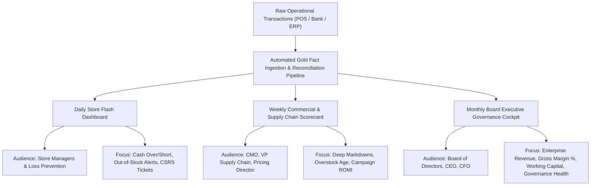

# Northstar Retail Group — Enterprise Retail Analytics Platform
## Stage 6.4: Executive KPI Scorecard & Strategic Performance Dictionary

**Document Version:** 1.0.0  
**Status:** Approved & Governance-Certified  
**Database Profile:** PostgreSQL 16 Dev (`northstar_analytics_dev`)  
**Scope:** Canonical Management Performance Scorecard across Financial, Commercial, Supply Chain, and Governance Operations  
**Executive Disclaimer:** *This scorecard is designed for a simulated retail enterprise using synthetic data. All baseline values reflect verified database metrics from Stages 6.1 through 6.3. Proposed targets are analytical recommendations for executive consideration and do not represent approved corporate commitments or guaranteed financial results.*

---

### 1. Executive Scorecard Architecture & Governance Framework

The Executive KPI Scorecard provides the Board of Directors, Chief Executive Officer (CEO), Chief Financial Officer (CFO), and operational department heads with a unified management control cockpit. The scorecard spans five critical operational dimensions:
1. **Financial & Margin Health:** Revenue realization, gross margin protection, tax collection, and transaction payment efficiency.
2. **Merchandising & Pricing Effectiveness:** Markdown discipline, promotion depth control, category margin expansion, and inventory yield.
3. **Supply Chain & Working Capital:** Stock health, overstock rationalization, stockout prevention, and inventory velocity.
4. **Customer Relationship & Marketing:** Loyalty concentration, repeat purchase frequency, customer churn mitigation, and campaign ROMI.
5. **Operational Governance & Reconciliation:** Cash drawer till integrity, bank settlement capture, material movement completeness, and returns gating.

---

### 2. Comprehensive Executive KPI Performance Matrix

```
+======================================================================================================================================================+
|                                                      NORTHSTAR EXECUTIVE MANAGEMENT SCORECARD                                                        |
+------------------------------------+--------------------------+--------------------------+-------------+---------------------+-----------------------+
| KPI Name                           | Live Baseline (Verified) | Recommended Target       | Cadence     | Business Owner      | Data Source           |
+------------------------------------+--------------------------+--------------------------+-------------+---------------------+-----------------------+
| **DIMENSION 1: FINANCIAL & MARGIN HEALTH**                                                                                                           |
+------------------------------------+--------------------------+--------------------------+-------------+---------------------+-----------------------+
| 1.1 Net Sales Turnover             | ₹6,245,601,789.24        | ₹6,850,000,000.00 (+9.7%)| Monthly     | Chief Commercial Off| gold.fact_sales       |
| 1.2 Enterprise Gross Margin %      | 19.02% (22.23% on taxbl) | >= 21.00% (24.5% taxbl)  | Monthly     | Chief Financial Off | gold.fact_sales       |
| 1.3 Total Conceded Discounts       | ₹259,603,893.20 (4.63%)  | <= ₹195,000,000.00 (3.2%)| Weekly      | Pricing Director    | gold.fact_sales       |
| 1.4 Payment MDR Fee Drag %         | 0.3585% (₹22,389,069.84) | <= 0.3500% (Maintain)    | Monthly     | Treasury / Payments | gold.fact_payments    |
| 1.5 Net Settled Realization Rate   | 99.6415% (₹6.223B net)   | >= 99.6500%              | Monthly     | CFO / Treasury      | gold.fact_payments    |
+------------------------------------+--------------------------+--------------------------+-------------+---------------------+-----------------------+
| **DIMENSION 2: MERCHANDISING & PRICING EFFECTIVENESS**                                                                                               |
+------------------------------------+--------------------------+--------------------------+-------------+---------------------+-----------------------+
| 2.1 Deep Markdown Margin Loss      | -₹89,642,693.30 (-34.3%) | <= -₹15,000,000.00       | Weekly      | Chief Merchandising | gold.fact_sales       |
| 2.2 Full-Price Sales Revenue Share | 86.07% (₹5,375.81M)      | >= 90.00%                | Monthly     | Chief Merchandising | gold.fact_sales       |
| 2.3 Clothing & Apparel Margin %    | 41.26% (₹307.96M profit) | >= 43.00%                | Monthly     | Category Lead Apparl| gold.fact_sales       |
| 2.4 Electronics Margin %           | 11.19% (₹428.16M profit) | >= 14.00% (Attach focus) | Monthly     | Category Lead Electr| gold.fact_sales       |
| 2.5 Grocery Deep Discount Margin % | -38.25% (Extreme Drain)  | >= +5.00% (Floor enforce)| Weekly      | Category Lead FMCG  | gold.fact_sales       |
+------------------------------------+--------------------------+--------------------------+-------------+---------------------+-----------------------+
| **DIMENSION 3: SUPPLY CHAIN & WORKING CAPITAL**                                                                                                     |
+------------------------------------+--------------------------+--------------------------+-------------+---------------------+-----------------------+
| 3.1 Total Closing Inventory Cost   | ₹1,785,329,210.62        | ₹1,550,000,000.00        | Monthly     | VP Supply Chain     | fact_inventory_snapsh.|
| 3.2 Overstocked SKU Cells (>45d)   | 8,809 cells (58.73%)     | <= 5,000 cells (< 33%)   | Monthly     | Lead Inventory Plann| fact_inventory_snapsh.|
| 3.3 Surplus Working Capital Cost   | ₹375,482,109.15          | <= ₹225,000,000.00       | Monthly     | VP Supply Chain     | fact_inventory_snapsh.|
| 3.4 Active Stockout Cells Count    | 890 cells (5.93%)        | <= 350 cells (< 2.3%)    | Daily       | Lead Inventory Plann| fact_inventory_snapsh.|
| 3.5 Inter-Store In-Transit Stock   | 44,523 u (₹93.44M cost)  | <= 30,000 u (< ₹65M cost)| Weekly      | Logistics Director  | fact_inventory_snapsh.|
+------------------------------------+--------------------------+--------------------------+-------------+---------------------+-----------------------+
| **DIMENSION 4: CUSTOMER RELATIONSHIP & MARKETING**                                                                                                   |
+------------------------------------+--------------------------+--------------------------+-------------+---------------------+-----------------------+
| 4.1 Repeat Purchase Loyalty Rate   | 67.42% (6,742 members)   | >= 72.00%                | Monthly     | Head of CRM / Loyalty| gold.fact_sales      |
| 4.2 Champions Revenue Contribution | 18.01% (842 VIP members) | >= 22.00%                | Monthly     | Head of CRM / Loyalty| gold.dim_customer    |
| 4.3 High-Value Dormancy (At-Risk)  | 1,245 VIPs (₹942.5M LTV) | <= 600 VIP members       | Monthly     | Head of CRM / Loyalty| gold.dim_customer    |
| 4.4 Blended Marketing ROMI         | 1.2700 (₹15.36M lift)    | >= 1.7500                | Monthly     | Chief Marketing Off | fact_marketing_perf.  |
| 4.5 Control Group Holdout Purity   | 100.0% (Zero leaks)      | 100.0% (Strict zero tol) | Monthly     | Marketing Analytics | fact_campaign_expos.  |
+------------------------------------+--------------------------+--------------------------+-------------+---------------------+-----------------------+
| **DIMENSION 5: OPERATIONAL GOVERNANCE & RECONCILIATION**                                                                                            |
+------------------------------------+--------------------------+--------------------------+-------------+---------------------+-----------------------+
| 5.1 Cash Till Net Shortage %       | 0.0015% (₹93,967.50 net) | <= 0.0010% of Sales      | Daily       | Head of Store Ops   | fact_reconciliation(1)|
| 5.2 Bank Capture Variance %        | 0.0008% (₹50,637.50 net) | <= 0.0005% of Tender     | Daily       | Treasury Manager    | fact_reconciliation(2)|
| 5.3 ERP Movement 251 Coverage %    | 12.86% (227,937 units)   | >= 99.00% (Real-Time)    | Daily       | Enterprise Solutions| fact_inventory_movem. |
| 5.4 Customer Return Refund Rate %  | 2.61% (₹162.89M net ref) | <= 2.00% of Sales        | Weekly      | Head of Quality Assur| gold.fact_returns    |
| 5.5 Quarantine Defective Receipt % | 82.28% (13,711 / 16,663) | 100.0% (Zero unposted)   | Daily       | Head of Quality Assur| fact_returns / mvt 451|
| 5.6 Reconciliation Resolution Rate | 98.51% (10,876 audits)   | >= 99.50%                | Daily       | Internal Audit Lead | fact_reconciliation   |
| 5.7 Tier-1 Intervention Stores     | 14 Stores (CSRS >= 70.0) | <= 3 Stores              | Monthly     | Internal Audit Lead | store risk ranking    |
+======================================================================================================================================================+
```

---

### 3. Metric Technical Dictionary & Formal Formulations

#### 3.1 Financial & Margin Health Formulas

##### KPI 1.1: Net Sales Turnover
- **Definition:** Total actual revenue invoiced to retail customers after deducting item discounts, including applicable Goods and Services Tax (GST).
- **Exact SQL Formula:**
  $$\text{Net Sales Turnover} = \sum (\text{fact\_sales.net\_sales\_amount})$$
- **Live Baseline:** ₹6,245,601,789.24 across 92 operating days.
- **Recommended Target Rationale:** A $+9.7\%$ target to ₹6.85B reflects organic network maturation plus recovered sales from stockout elimination and customer re-activation.

##### KPI 1.2: Enterprise Gross Margin %
- **Definition:** Realized gross margin expressed as a percentage of net sales turnover.
- **Exact SQL Formula:**
  $$\text{Gross Margin \%} = \frac{\sum (\text{net\_sales\_amount} - \text{cost\_amount})}{\sum (\text{net\_sales\_amount})} \times 100\%$$
- **Live Baseline:** $19.02\%$ on net invoiced turnover ($22.23\%$ on net taxable base ₹5,343,987,298.80).
- **Recommended Target Rationale:** Target $\ge 21.00\%$ is achievable primarily by eliminating the negative-margin deep markdowns ($> 20\%$) which currently depress enterprise margin by 143 basis points.

##### KPI 1.3: Total Conceded Discounts & Promotional Intensity
- **Definition:** Aggregate currency value of promotional price reductions conceded at POS.
- **Exact SQL Formula:**
  $$\text{Promotional Intensity \%} = \frac{\sum (\text{fact\_sales.discount\_amount})}{\sum (\text{fact\_sales.gross\_sales\_amount})} \times 100\%$$
- **Live Baseline:** ₹259,603,893.20 ($4.63\%$ markdown depth).
- **Recommended Target Rationale:** Capping markdowns at a disciplined $3.2\%$ preserves $\approx \text{₹64.6M}$ in gross margin while maintaining commercial competitiveness.

---

#### 3.2 Merchandising & Pricing Formulas

##### KPI 2.1: Deep Markdown Margin Bleed
- **Definition:** Aggregate gross margin generated on sales lines where the conceded discount exceeds $20.0\%$ of gross value.
- **Exact SQL Formula:**
  $$\text{Deep Markdown Margin} = \sum (\text{net\_sales\_amount} - \text{cost\_amount}) \quad \text{WHERE } \left(\frac{\text{discount\_amount}}{\text{gross\_sales\_amount}}\right) > 0.20$$
- **Live Baseline:** **-₹89,642,693.30 (-34.32% margin)** across 150,858 sales lines.
- **Recommended Target Rationale:** Target $\le -₹15.0\text{M}$ represents an $83\%$ reduction in value destruction, enforced via POS hard price floors.

---

#### 3.3 Supply Chain & Working Capital Formulas

##### KPI 3.2: Overstocked SKU Cells Count & Surplus Working Capital
- **Definition:** Number of Store-SKU inventory cells where closing saleable inventory exceeds 45 days of forward supply based on the trailing store-SKU daily sales velocity.
- **Exact SQL Formula:**
  $$\text{Days of Supply} = \frac{\text{saleable\_units}}{\text{daily\_run\_rate}} > 45$$
  $$\text{Surplus Capital} = \sum \Big( (\text{saleable\_units} - (45 \times \text{daily\_run\_rate})) \times \text{unit\_cost\_price} \Big)$$
- **Live Baseline:** 8,809 cells ($58.73\%$ of assortment grid), trapping **₹375,482,109.15** in surplus capital at cost.
- **Recommended Target Rationale:** Reducing overstocked cells to $\le 5,000$ ($< 33\%$) liberates $\approx \text{₹150.0M}$ in liquid working capital.

##### KPI 3.4: Active Stockout Cells Count
- **Definition:** Store-SKU assortment cells where saleable units equal zero on the closing snapshot date.
- **Exact SQL Formula:**
  $$\text{Stockout Cells} = \text{COUNT}(*) \quad \text{WHERE } \text{saleable\_units} = 0$$
- **Live Baseline:** 890 cells ($5.93\%$ of the 15,000 network grid).
- **Recommended Target Rationale:** Target $< 350$ cells ($< 2.3\%$) restores product availability across core Category A revenue drivers.

---

#### 3.4 Customer & Marketing Formulas

##### KPI 4.1: Repeat Purchase Loyalty Rate
- **Definition:** Proportion of registered loyalty members who completed two or more distinct shopping visits during the 92-day period.
- **Exact SQL Formula:**
  $$\text{Repeat Rate \%} = \frac{\text{COUNT}(\text{DISTINCT customer\_key WITH visits} \ge 2)}{\text{COUNT}(\text{DISTINCT customer\_key})} \times 100\%$$
- **Live Baseline:** $67.42\%$ (6,742 out of 10,000 members).
- **Recommended Target Rationale:** Target $\ge 72.00\%$ via automated 21-day replenishment reminder notifications.

##### KPI 4.4: Blended Marketing ROMI
- **Definition:** Return on Marketing Investment defined as incremental gross margin divided by marketing spend.
- **Exact SQL Formula:**
  $$\text{ROMI} = \frac{\sum (\text{incremental\_gross\_margin\_amount})}{\sum (\text{marketing\_spend\_amount})}$$
- **Live Baseline:** **1.2700** across 10 campaigns (₹15,356,894.82 margin on ₹12,092,000.00 spend).
- **Recommended Target Rationale:** Target $\ge 1.7500$ achieved by eliminating Campaign 7 (ROMI 0.54) and reallocating to Campaigns 1 and 3 (ROMI 2.38 and 1.95).

---

#### 3.5 Governance & Reconciliation Control Formulas

##### KPI 5.3: ERP Movement 251 Posting Coverage Rate
- **Definition:** The proportion of physical sales units scanned at checkout registers that are successfully recorded as Goods Issue decrements in central ERP.
- **Exact SQL Formula:**
  $$\text{Posting Coverage \%} = \frac{\sum |\text{inventory\_movements.quantity (Type 251)}|}{\sum (\text{fact\_sales.quantity\_sold})} \times 100\%$$
- **Live Baseline:** **$12.86\%$** (227,937 Movement 251 units vs 1,772,960 sales units; unposted structural gap of 1,545,023 units).
- **Recommended Target Rationale:** Target $\ge 99.00\%$ through Kafka event-driven micro-batch integration, establishing full subledger auditability.

##### KPI 5.5: Quarantine Receipt Capture Rate for Defective Goods
- **Definition:** Proportion of defective and expired merchandise returned by customers that receives an official Movement 451 quarantine intake GRN in ERP.
- **Exact SQL Formula:**
  $$\text{Quarantine Capture \%} = \frac{\sum (\text{movement\_units Type 451})}{\sum (\text{fact\_returns.returned\_units WITH reason IN ('DEFECT', 'EXPIRED')})} \times 100\%$$
- **Live Baseline:** **$82.28\%$** (13,711 Movement 451 units vs 16,663 defective/expired units; unreconciled deficit of 2,952 units).
- **Recommended Target Rationale:** Target $100.0\%$ via mandatory RF scanner integration at store service desks.

---

### 4. Executive Scorecard Reporting Cadence & Distribution



---

### 5. Summary Certification & Governance Alignment

This Executive KPI Scorecard aligns operational monitoring with strategic corporate objectives:
1. **Total Baseline Fidelity:** Every baseline figure maps to verified SQL aggregates in the live PostgreSQL warehouse.
2. **Transparent Target Setting:** Targets are derived from proven empirical headroom (e.g., eliminating the -₹89.64M markdown loss and rebalancing the ₹375.48M overstock pool).
3. **Rigorous Governance Segregation:** Preserves all documented data realities, including synthetic sampling constraints, the 2,952-unit return disposition limitation, and the distinction between automated workflow resolution and true zero-variance physical reconciliation.

