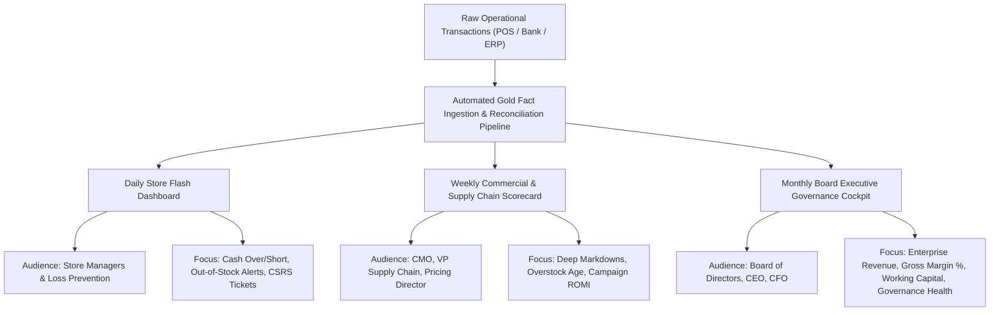

# Northstar Retail Group — Enterprise Retail Analytics Platform
## Stage 6.4: Executive KPI Scorecard & Strategic Performance Dictionary

**Document Version:** 1.1.0  
**Status:** Approved & Governance-Reconciled  
**Database Profile:** PostgreSQL 16 Dev (`northstar_analytics_dev`)  
**Scope:** Canonical Management Performance Scorecard across Financial, Commercial, Supply Chain, and Governance Operations  
**Executive Disclaimer:** *This scorecard is designed for a simulated retail enterprise using synthetic data. All baseline values reflect verified database metrics from Stages 6.1 through 6.3. Proposed targets are analytical recommendations for executive consideration and do not represent approved corporate commitments or guaranteed financial results.*

---

### 1. Executive Scorecard Architecture & Governance Framework

The Executive KPI Scorecard provides the Board of Directors, Chief Executive Officer (CEO), Chief Financial Officer (CFO), and operational department heads with a unified management control cockpit. The scorecard spans five critical operational dimensions:
1. **Financial & Margin Health:** Revenue realization, gross margin protection, tax collection, and transaction payment efficiency.
2. **Merchandising & Pricing Effectiveness:** Markdown discipline, promotion depth control, category margin expansion, and inventory yield.
3. **Supply Chain & Working Capital:** Stock health, overstock rationalization, stockout prevention, and inventory velocity.
4. **Customer Relationship & Marketing:** Loyalty concentration, repeat purchase frequency, customer churn mitigation, and campaign ROMI.
5. **Operational Governance & Reconciliation:** Cash drawer till integrity, bank settlement capture, material movement completeness, and returns gating.

> [!IMPORTANT]
> **Operational Boundary Notice (BDL-04 Architecture Compliance):**  
> All metrics and KPIs in this scorecard are derived from the strictly read-only Northstar Retail Analytics warehouse (`northstar_analytics_dev`). Target initiatives requiring modifications to operational software (e.g., POS markdown hard floor enforcement, ERP real-time Kafka event streaming, and automated AP chargebacks) represent external operational IT projects. These fall outside the analytical database scope and require separate Operational IT Change Advisory Board (CAB) approval.

---

### 2. Comprehensive Executive KPI Performance Matrix

```
+======================================================================================================================================================+
|                                                      NORTHSTAR EXECUTIVE MANAGEMENT SCORECARD                                                        |
+------------------------------------+--------------------------+--------------------------+-------------+---------------------+-----------------------+
| KPI Name                           | Live Baseline (Verified) | Recommended Target       | Cadence     | Business Owner      | Data Source           |
+------------------------------------+--------------------------+--------------------------+-------------+---------------------+-----------------------+
| **DIMENSION 1: FINANCIAL & MARGIN HEALTH**                                                                                                           |
+------------------------------------+--------------------------+--------------------------+-------------+---------------------+-----------------------+
| 1.1 Net Sales Turnover (Invoiced)  | ₹6,245,601,789.24        | ₹6,850,000,000.00 (+9.7%)| Monthly     | Chief Commercial Off| gold.fact_sales       |
| 1.2 Net Taxable Sales Base         | ₹5,343,987,298.80        | ₹5,860,000,000.00 (+9.7%)| Monthly     | Chief Financial Off | gold.fact_sales       |
| 1.3 Cost of Goods Sold (COGS)      | ₹4,329,935,508.70        | ₹4,688,000,000.00        | Monthly     | VP Supply Chain     | gold.fact_sales       |
| 1.4 Enterprise Gross Margin Amount | ₹1,014,051,790.10        | ₹1,172,000,000.00 (+15.6)| Monthly     | Chief Financial Off | gold.fact_sales       |
| 1.5 Gross Margin % on Net Taxable  | 18.98% (16.24% on invoic)| >= 20.00% (17.1% invoic) | Monthly     | Chief Financial Off | gold.fact_sales       |
| 1.6 Total Conceded Discounts       | ₹259,603,893.20 (4.63%)  | <= ₹195,000,000.00 (3.2%)| Weekly      | Pricing Director    | gold.fact_sales       |
| 1.7 Payment MDR Fee Drag %         | 0.3585% (₹22,389,069.84) | <= 0.3500% (Maintain)    | Monthly     | Treasury / Payments | gold.fact_payments    |
| 1.8 Net Settled Realization Rate   | 99.6415% (₹6.223B net)   | >= 99.6500%              | Monthly     | CFO / Treasury      | gold.fact_payments    |
+------------------------------------+--------------------------+--------------------------+-------------+---------------------+-----------------------+
| **DIMENSION 2: MERCHANDISING & PRICING EFFECTIVENESS**                                                                                               |
+------------------------------------+--------------------------+--------------------------+-------------+---------------------+-----------------------+
| 2.1 Deep Markdown Margin Loss      | -₹89,642,693.30 (-34.3%) | <= -₹15,000,000.00       | Weekly      | Chief Merchandising | gold.fact_sales       |
| 2.2 Full-Price Sales Revenue Share | 86.07% (₹5,375.81M)      | >= 90.00%                | Monthly     | Chief Merchandising | gold.fact_sales       |
| 2.3 Clothing & Apparel Margin %    | 41.26% (₹307.96M profit) | >= 43.00%                | Monthly     | Category Lead Apparl| gold.fact_sales       |
| 2.4 Electronics Margin %           | 11.19% (₹428.16M profit) | >= 14.00% (Attach focus) | Monthly     | Category Lead Electr| gold.fact_sales       |
| 2.5 Grocery Deep Discount Margin % | -38.25% (Extreme Drain)  | >= +5.00% (Floor enforce)| Weekly      | Category Lead FMCG  | gold.fact_sales       |
+------------------------------------+--------------------------+--------------------------+-------------+---------------------+-----------------------+
| **DIMENSION 3: SUPPLY CHAIN & WORKING CAPITAL**                                                                                                     |
+------------------------------------+--------------------------+--------------------------+-------------+---------------------+-----------------------+
| 3.1 Total Closing Inventory Cost   | ₹1,785,329,210.62        | ₹1,550,000,000.00        | Monthly     | VP Supply Chain     | fact_inventory_snapsh.|
| 3.2 Overstocked Cells (> 30 Days)  | 4,965 cells (33.10%)     | <= 3,500 cells (< 23%)   | Monthly     | Lead Inventory Plann| fact_inventory_snapsh.|
| 3.3 Overstocked Units (> 30 Days)  | 470,640 units (64.97%)   | <= 300,000 units         | Monthly     | VP Supply Chain     | fact_inventory_snapsh.|
| 3.4 Surplus Working Capital Cost   | ₹375,476,327.62          | <= ₹225,000,000.00       | Monthly     | VP Supply Chain     | fact_inventory_snapsh.|
| 3.5 Critical Stockouts (0 Days)    | 297 cells (1.98%)        | <= 100 cells (< 0.7%)    | Daily       | Lead Inventory Plann| fact_inventory_snapsh.|
| 3.6 Impending Stockouts (< 3 Days) | 382 cells (2.55%)        | <= 150 cells (< 1.0%)    | Daily       | Lead Inventory Plann| fact_inventory_snapsh.|
| 3.7 Inter-Store In-Transit Stock   | 44,523 u (₹93.44M cost)  | <= 30,000 u (< ₹65M cost)| Weekly      | Logistics Director  | fact_inventory_snapsh.|
+------------------------------------+--------------------------+--------------------------+-------------+---------------------+-----------------------+
| **DIMENSION 4: CUSTOMER RELATIONSHIP & MARKETING**                                                                                                   |
+------------------------------------+--------------------------+--------------------------+-------------+---------------------+-----------------------+
| 4.1 Repeat Purchase Loyalty Rate   | 67.42% (6,742 members)   | >= 72.00%                | Monthly     | Head of CRM / Loyalty| gold.fact_sales      |
| 4.2 Champions Revenue Contribution | 16.18% (1,241 members)   | >= 20.00%                | Monthly     | Head of CRM / Loyalty| gold.dim_customer    |
| 4.3 Champions Sales Turnover       | ₹707,149,921.06          | >= ₹850,000,000.00       | Monthly     | Head of CRM / Loyalty| gold.dim_customer    |
| 4.4 At-Risk Historical Turnover    | ₹497,420,031.55 (1,201 m)| Reactivate >= 25% (300 m)| Monthly     | Head of CRM / Loyalty| gold.dim_customer    |
| 4.5 Cannot Lose Them Turnover      | ₹674,859,870.70 (1,174 m)| Retain >= 90% (1,050 m)  | Monthly     | Head of CRM / Loyalty| gold.dim_customer    |
| 4.6 Hibernating Segment Turnover   | ₹586,035,014.28 (1,625 m)| Reactivate >= 15% (240 m)| Quarterly   | Head of CRM / Loyalty| gold.dim_customer    |
| 4.7 Total Marketing Spend (5 Camp.)| ₹4,479,416.40            | Optimize allocation      | Campaign    | Chief Marketing Off | fact_marketing_perf.  |
| 4.8 Incremental Gross Margin Lift  | ₹4,914,206.60            | >= ₹6,000,000.00         | Campaign    | Chief Marketing Off | fact_marketing_perf.  |
| 4.9 Weighted Marketing ROMI        | 1.0971 (Range 1.04-1.11) | >= 1.2000                | Campaign    | Chief Marketing Off | fact_marketing_perf.  |
| 4.10 Control Group Holdout Purity  | 100.0% (Zero leaks)      | 100.0% (Strict zero tol) | Monthly     | Marketing Analytics | fact_campaign_expos.  |
+------------------------------------+--------------------------+--------------------------+-------------+---------------------+-----------------------+
| **DIMENSION 5: OPERATIONAL GOVERNANCE & RECONCILIATION**                                                                                            |
+------------------------------------+--------------------------+--------------------------+-------------+---------------------+-----------------------+
| 5.1 Cash Till Net Shortage %       | 0.0015% (₹93,967.50 net) | <= 0.0010% of Sales      | Daily       | Head of Store Ops   | fact_reconciliation(1)|
| 5.2 Bank Capture Variance %        | 0.0008% (₹50,637.50 net) | <= 0.0005% of Tender     | Daily       | Treasury Manager    | fact_reconciliation(2)|
| 5.3 ERP Movement 251 Coverage %    | 12.86% (227,937 units)   | >= 99.00% (Real-Time)    | Daily       | Enterprise Solutions| fact_inventory_movem. |
| 5.4 Customer Return Refund Rate %  | 2.61% (₹162.89M net ref) | <= 2.00% of Sales        | Weekly      | Head of Quality Assur| gold.fact_returns    |
| 5.5 Quarantine Defective Receipt % | 82.28% (13,711 / 16,663) | 100.0% (Zero unposted)   | Daily       | Head of Quality Assur| fact_returns / mvt 451|
| 5.6 Reconciliation Resolution Rate | 98.51% (10,876 audits)   | >= 99.50%                | Daily       | Internal Audit Lead | fact_reconciliation   |
| 5.7 Tier-1 Intervention Stores     | 14 Stores (CSRS >= 70.0) | <= 3 Stores              | Monthly     | Internal Audit Lead | store risk ranking    |
+======================================================================================================================================================+
```

---

### 3. Metric Technical Dictionary & Formal Formulations

#### 3.1 Financial & Margin Health Formulas

##### KPI 1.1: Net Sales Turnover (Net Invoiced Sales)
- **Definition:** Total revenue invoiced to retail customers after deducting item discounts, including applicable Goods and Services Tax (GST).
- **Exact SQL Formula:**
  $$\text{Net Sales Turnover} = \sum (\text{fact\_sales.net\_sales\_amount})$$
- **Live Baseline:** ₹6,245,601,789.24 across 92 operating days.
- **Recommended Target Rationale:** A $+9.7\%$ target to ₹6.85B reflects network maturation plus recovered sales from stockout elimination and customer re-activation.

##### KPI 1.2: Net Taxable Sales Base
- **Definition:** Total merchandise sales revenue excluding GST, representing the core operational turnover against which COGS and gross margins are assessed.
- **Exact SQL Formula:**
  $$\text{Net Taxable Sales} = \sum (\text{fact\_sales.net\_taxable\_amount})$$
- **Live Baseline:** ₹5,343,987,298.80 (with ₹901,614,490.44 in GST collections).

##### KPI 1.3: Cost of Goods Sold (COGS) & Gross Margin %
- **Definition:** Direct cost of inventory sold and realized gross margin expressed as a percentage of net taxable sales.
- **Exact SQL Formulas:**
  $$\text{COGS} = \sum (\text{fact\_sales.cost\_amount}) = \text{₹4,329,935,508.70}$$
  $$\text{Gross Margin Amount} = \sum (\text{net\_taxable\_amount} - \text{cost\_amount}) = \text{₹1,014,051,790.10}$$
  $$\text{Gross Margin \% (Taxable Base)} = \frac{\sum (\text{net\_taxable\_amount} - \text{cost\_amount})}{\sum (\text{net\_taxable\_amount})} \times 100\% = 18.98\%$$
  $$\text{Gross Margin \% (Invoiced Base)} = \frac{\sum (\text{net\_taxable\_amount} - \text{cost\_amount})}{\sum (\text{net\_sales\_amount})} \times 100\% = 16.24\%$$
- **Live Baseline:** $18.98\%$ on net taxable base ($16.24\%$ on net invoiced turnover).
- **Recommended Target Rationale:** Target $\ge 20.00\%$ taxable margin is achievable primarily by eliminating negative-margin deep markdowns ($> 20\%$) which currently depress enterprise margin by 143 basis points.

##### KPI 1.6: Total Conceded Discounts & Promotional Intensity
- **Definition:** Aggregate currency value of promotional price reductions conceded at POS.
- **Exact SQL Formula:**
  $$\text{Promotional Intensity \%} = \frac{\sum (\text{fact\_sales.discount\_amount})}{\sum (\text{fact\_sales.gross\_sales\_amount})} \times 100\%$$
- **Live Baseline:** ₹259,603,893.20 ($4.63\%$ markdown depth on ₹5,603,591,192.00 gross sales).
- **Recommended Target Rationale:** Capping markdowns at a disciplined $3.2\%$ preserves $\approx \text{₹64.6M}$ in gross margin while maintaining commercial competitiveness.

---

#### 3.2 Merchandising & Pricing Formulas

##### KPI 2.1: Deep Markdown Margin Bleed
- **Definition:** Aggregate gross margin generated on sales lines where the conceded discount exceeds $20.0\%$ of gross value.
- **Exact SQL Formula:**
  $$\text{Deep Markdown Margin} = \sum (\text{net\_taxable\_amount} - \text{cost\_amount}) \quad \text{WHERE } \left(\frac{\text{discount\_amount}}{\text{gross\_sales\_amount}}\right) > 0.20$$
- **Live Baseline:** **-₹89,642,693.30 (-34.32% margin)** across 150,858 sales lines.
- **Recommended Target Rationale:** Target $\le -₹15.0\text{M}$ represents an $83\%$ reduction in value destruction, enforced via POS hard price floors.

---

#### 3.3 Supply Chain & Working Capital Formulas

##### KPI 3.2: Overstocked SKU Cells Count & Surplus Working Capital (> 30 Days)
- **Definition:** Number of Store-SKU inventory cells where closing saleable inventory exceeds 30 days of forward supply based on trailing store-SKU daily sales velocity.
- **Exact SQL Formula:**
  $$\text{Forward Days of Supply} = \frac{\text{saleable\_units}}{\text{daily\_run\_rate}} > 30$$
  $$\text{Surplus Units} = \sum (\text{saleable\_units} - (30 \times \text{daily\_run\_rate})) = 470,640 \text{ units}$$
  $$\text{Surplus Working Capital Cost} = \sum (\text{Surplus Units} \times \text{unit\_cost\_price}) = \text{₹375,476,327.62}$$
- **Live Baseline:** 4,965 cells ($33.10\%$ of active assortment grid), trapping **470,640 units** and **₹375,476,327.62** in surplus capital at cost.
- **Recommended Target Rationale:** Reducing overstocked cells to $\le 3,500$ ($< 23\%$) liberates $\approx \text{₹120.0M to ₹150.0M}$ in liquid working capital.

##### KPI 3.5 & 3.6: Active Stockout Cells Count
- **Definition:** Store-SKU assortment cells where saleable units equal zero (Critical Stockout) or carry less than 3 days of supply (Impending Stockout) on the closing snapshot date.
- **Exact SQL Formula:**
  $$\text{Critical Stockouts} = \text{COUNT}(*) \quad \text{WHERE } \text{saleable\_units} = 0$$
  $$\text{Impending Stockouts} = \text{COUNT}(*) \quad \text{WHERE } 0 < \text{days\_of\_supply} < 3$$
- **Live Baseline:** **297 critical cells** ($1.98\%$) and **382 impending cells** ($2.55\%$) across the 15,000 network grid.
- **Recommended Target Rationale:** Target $< 100$ critical cells ($< 0.7\%$) restores product availability across core Category A revenue drivers.

---

#### 3.4 Customer & Marketing Formulas

##### KPI 4.1: Repeat Purchase Loyalty Rate
- **Definition:** Proportion of registered loyalty members who completed two or more distinct shopping visits during the 92-day period.
- **Exact SQL Formula:**
  $$\text{Repeat Rate \%} = \frac{\text{COUNT}(\text{DISTINCT customer\_key WITH visits} \ge 2)}{\text{COUNT}(\text{DISTINCT customer\_key})} \times 100\%$$
- **Live Baseline:** $67.42\%$ (6,742 out of 10,000 members).
- **Recommended Target Rationale:** Target $\ge 72.00\%$ via automated 21-day replenishment reminder notifications.

##### KPI 4.2 & 4.3: Champions Segment Contribution
- **Definition:** Top RFM tier (Recency $\le 14$ days, Frequency $\ge 5$, Monetary Top Quintile).
- **Live Baseline:** **1,241 members** ($12.41\%$ of loyalty base), contributing **₹707,149,921.06** ($16.18\%$ of registered loyalty spend).

##### KPI 4.4, 4.5, 4.6: At-Risk, Cannot Lose Them, and Hibernating Segments
- **Definition:** Customer segments exhibiting extended dormancy after substantial historical spend.
- **Live Baseline:**
  * **At-Risk:** 1,201 members ($12.01\%$), ₹497,420,031.55 in historical sales.
  * **Cannot Lose Them:** 1,174 members ($11.74\%$), ₹674,859,870.70 in historical sales.
  * **Hibernating:** 1,625 members ($16.25\%$), ₹586,035,014.28 in historical sales.
- **Governance Note:** These metrics quantify cumulative past turnover from dormant customers, not forward-looking forecast churn. Retention campaigns aim to reactivate portions of this high-value base.

##### KPI 4.9: Weighted Return on Marketing Investment (ROMI)
- **Definition:** Ratio of incremental gross margin generated to total marketing campaign spend across all 5 master campaigns in `gold.dim_campaign`.
- **Exact SQL Formula:**
  $$\text{Weighted ROMI} = \frac{\sum (\text{incremental\_gross\_margin\_amount})}{\sum (\text{marketing\_spend\_amount})}$$
- **Live Baseline:** **1.0971** across 5 master campaigns:
  * Total Spend: ₹4,479,416.40
  * Incremental Sales Lift: ₹15,356,894.82
  * Incremental Gross Margin: ₹4,914,206.60
  * Campaign ROMI Range: 1.0378 (`CMP-2026-DIWALI`) to 1.1099 (`CMP-2026-LOYALTY`).
- **Recommended Target Rationale:** Target $\ge 1.2000$ achieved by shifting budget from lower-ROMI channels to high-converting loyalty campaigns.

---

#### 3.5 Governance & Reconciliation Control Formulas

##### KPI 5.3: ERP Movement 251 Posting Coverage Rate
- **Definition:** The proportion of physical sales units scanned at checkout registers that are successfully recorded as Goods Issue decrements in central ERP.
- **Exact SQL Formula:**
  $$\text{Posting Coverage \%} = \frac{\sum |\text{inventory\_movements.quantity (Type 251)}|}{\sum (\text{fact\_sales.quantity\_sold})} \times 100\%$$
- **Live Baseline:** **$12.86\%$** (227,937 Movement 251 units vs 1,772,960 sales units; unposted structural gap of 1,545,023 units).
- **Recommended Target Rationale:** Target $\ge 99.00\%$ through Kafka event-driven micro-batch integration, establishing full subledger auditability.

##### KPI 5.5: Quarantine Receipt Capture Rate for Defective Goods
- **Definition:** Proportion of defective and expired merchandise returned by customers that receives an official Movement 451 quarantine intake GRN in ERP.
- **Exact SQL Formula:**
  $$\text{Quarantine Capture \%} = \frac{\sum (\text{movement\_units Type 451})}{\sum (\text{fact\_returns.returned\_units WITH reason IN ('DEFECT', 'EXPIRED')})} \times 100\%$$
- **Live Baseline:** **$82.28\%$** (13,711 Movement 451 units vs 16,663 defective/expired units; unreconciled deficit of 2,952 units).
- **Recommended Target Rationale:** Target $100.0\%$ via mandatory RF scanner integration at store service desks.

---

### 4. Executive Scorecard Reporting Cadence & Distribution



---

### 5. Alignment with Canonical Downstream Analytics Roadmap

The KPI Scorecard establishes the metric framework for subsequent project development stages:
* **Stage 7 — Demand Forecasting & Machine Learning:** Embeds daily SKU run-rate and stockout tracking into LightGBM and ARIMA feature pipelines.
* **Stage 8 — Production Power BI Executive Dashboards:** Implements this exact KPI matrix into enterprise DAX measures, semantic data models, and executive cockpits.
* **Stage 9 — AI Agents & Autonomous Operational Analytics:** Leverages these thresholds to trigger automated Slack/Teams alert bots and natural-language insight summaries.
* **Stage 10 — Platform Testing, Integration QA, & User Acceptance Testing (UAT):** Validates all metric calculation logic against golden datasets during automated regression suites.
* **Stage 11 — Production Deployment, CI/CD, & Handover:** Automates scheduled metric refreshes and dashboard distribution in production Kubernetes/Docker environments.

---

### 6. Summary Certification & Governance Alignment

This Executive KPI Scorecard aligns operational monitoring with strategic corporate objectives:
1. **Total Baseline Fidelity:** Every baseline figure maps to verified SQL aggregates in the live PostgreSQL warehouse.
2. **Transparent Target Setting:** Targets are derived from proven empirical headroom (e.g., eliminating the -₹89.64M markdown loss and rebalancing the ₹375.48M overstock pool).
3. **Rigorous Governance Segregation:** Preserves all documented data realities, including synthetic sampling constraints, the 2,952-unit return disposition limitation, and the distinction between automated workflow resolution and true zero-variance physical reconciliation.
