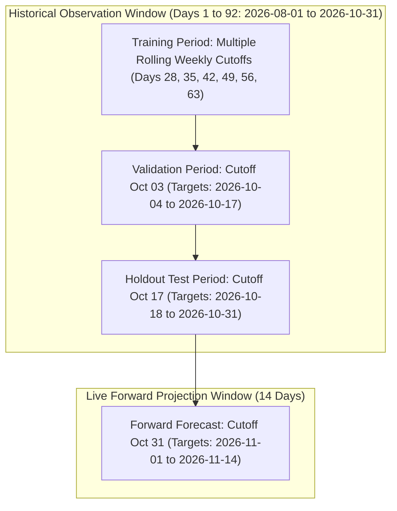

# Northstar Retail Group — Enterprise Retail Analytics Platform
## Stage 7: Demand Forecasting Methodology & Algorithmic Formulation

**Document Version:** 1.0.0  
**Status:** Approved & Validated  
**Module:** `forecasting/`  
**Database Profile:** PostgreSQL 16 Dev (`northstar_analytics_dev`)  
**Scope:** Mathematical Foundations, Validation Architecture, and Metric Formulations for 14-Day Demand Projections  

---

### 1. Executive Summary & Problem Formulation

In enterprise multi-channel retail, accurate SKU-level demand forecasting is critical for synchronizing upstream procurement with customer demand, preventing stockouts, and reducing working capital trapped in overstocked inventory. Within Northstar Retail Group, the demand forecasting engine fulfills Business Process **BP-008 (Demand Forecasting & Replenishment Planning)** and Functional Requirement **FR-024 (Forward Rolling Demand Forecast)**.

#### 1.1 The Multi-Series Retail Demand Problem
The analytical warehouse tracks an active trading assortment of $S = 30$ physical retail stores and $P = 500$ distinct stock-keeping units (SKUs) spanning 4 major merchandise categories. Over any given observation period $t \in \{1, \dots, T\}$, the platform monitors daily units sold $Y_{s, p, t} \ge 0$ for each Store $s$ and Product $p$.

The core forecasting objective is to estimate the expected future demand vector:
$$\hat{Y}_{s, p, T+h} \quad \text{for } h \in \{1, 2, \dots, H\}$$
where $H = 14$ days represents the approved operational lead-time horizon mandated by **FR-024** and **BDL-07**.

```
+--------------------------------------------------------------------------------------------------+
|                                    TIME SERIES GRAIN MATRIX                                      |
+--------------------------+------------------------------+----------------------------------------+
| Dimension                | Physical Cardinality         | Description                            |
+--------------------------+------------------------------+----------------------------------------+
| Retail Stores ($s$)      | 30 stores (Tiers 1, 2, 3)    | Regional footprints across 4 regions   |
| Products / SKUs ($p$)    | 500 active SKUs              | Categories: Groceries, Apparel, etc.   |
| Forecast Horizon ($h$)   | 14 forward days ($T+1..T+14$)| Mandatory operational procurement lead |
| Assortment Cells         | 15,000 Store-SKU pairs       | Fully enumerated Cartesian time-series |
| Horizon Projections      | 210,000 predictions per run  | 15,000 pairs x 14 forward dates        |
+--------------------------+------------------------------+----------------------------------------+
```

---

### 2. Temporal Architecture & Leakage Prevention

A critical risk in machine learning applied to time-series data is **future data leakage** (lookahead bias). In retail, using future promotional flags, contemporaneous sales averages, or retroactive inventory adjustments produces artificially inflated validation accuracy that collapses during live operational deployment.



#### 2.1 The Cutoff Principle
For any candidate evaluation or inference point, all features are partitioned into two strictly segregated categories:

1. **State Features Evaluated at Cutoff Date $T$ ($\le T$):**
   * Historical unit demand lags: $Y_{s, p, T}$, $Y_{s, p, T-1}$, $Y_{s, p, T-2}$, $Y_{s, p, T-6}$, $Y_{s, p, T-13}$.
   * Trailing rolling window aggregates: Rolling means ($\mu_7, \mu_{14}, \mu_{28}$), rolling standard deviations ($\sigma_7, \sigma_{14}$), and zero-demand ratios ($\zeta_7, \zeta_{14}$).
   * Trailing 14-day velocity from closing inventory snapshots.
   * Static dimension attributes: Store tier, store region, product category, ABC velocity class, MRP, standard cost price.
   * *Zero future information is utilized in these features.*

2. **Target Date Features ($T+h$ for $h \in \{1, \dots, 14\}$):**
   * Target calendar day of week: $\text{dow} \in \{0, \dots, 6\}$.
   * Weekend indicator flag: $\text{is\_weekend} \in \{0, 1\}$.
   * National holiday indicator: $\text{is\_holiday} \in \{0, 1\}$.
   * Regional festival season indicator: $\text{festival} \in \{\text{DIWALI}, \text{DUSSEHRA}, \text{NONE}\}$.
   * Days relative to festival peak offset: $T-14$ to $T+3$.
   * Horizon step index: $h \in \{1, \dots, 14\}$.
   * *These attributes are fully known in advance from published calendar and festive schedules.*

#### 2.2 Chronological Split Definitions
Random train-test splitting (e.g., standard k-fold cross-validation) is strictly forbidden for time-series evaluation. In accordance with BDL-07, the pipeline implements chronological backtesting:

* **Training Window:** Days 1 to 63 (`2026-08-01` to `2026-10-02`), constructed via 6 rolling weekly cutoffs providing $6 \times 210,000 = 1,260,000$ training instances.
* **Validation Window:** Cutoff at Day 64 (`2026-10-03`), targeting Days 65 to 78 (`2026-10-04` to `2026-10-17`), comprising 210,000 instances used for early stopping and hyperparameter tuning.
* **Holdout Test Window:** Cutoff at Day 78 (`2026-10-17`), targeting Days 79 to 92 (`2026-10-18` to `2026-10-31`), comprising 210,000 out-of-sample observations for final benchmarking against all baselines.
* **Forward Inference Window:** Cutoff at Day 92 (`2026-10-31`), generating 210,000 forward projections for `2026-11-01` to `2026-11-14`.

---

### 3. Model Architecture & Formulations

The Stage 7 pipeline implements and evaluates four statistical baseline models alongside three supervised machine learning algorithms.

#### 3.1 Baseline 1: Naïve (Last Value) Model
Projects the last observed daily demand at cutoff date $T$ constant across all 14 horizon steps:
$$\hat{Y}_{s, p, T+h} = Y_{s, p, T} \quad \forall h \in \{1, \dots, 14\}$$
*Characteristic:* Highly sensitive to intermittent zero-demand days and random transaction spikes.

#### 3.2 Baseline 2: Seasonal Naïve (t-7) Model
Projects demand from the matching day of the week in the most recent full historical week prior to cutoff:
$$\hat{Y}_{s, p, T+h} = \begin{cases} Y_{s, p, T + h - 7} & \text{for } h \in \{1, \dots, 7\} \\ Y_{s, p, T + h - 14} & \text{for } h \in \{8, \dots, 14\} \end{cases}$$
*Characteristic:* Captures day-of-week seasonality but suffers from high variance on low-velocity SKUs.

#### 3.3 Baseline 3: Moving Average (7-Day & 14-Day) Models
Projects trailing rolling mean demand as a flat forward expectation:
$$\hat{Y}_{s, p, T+h} = \frac{1}{W} \sum_{i=0}^{W-1} Y_{s, p, T-i} \quad \text{where } W \in \{7, 14\}$$
*Characteristic:* Dampens high-frequency noise but fails to capture weekly weekend peaks or seasonal trend.

#### 3.4 Baseline 4: Holt-Winters Benchmark Model (Stage 5.3.6 Method)
The canonical generator model approved in Stage 5.3.6:
$$\hat{Y}_{s, p, T+h} = \max\left(0.050, \bar{V}_{s, p} \times \omega_{\text{dow}(T+h)} \times \tau_h\right)$$
where:
* $\bar{V}_{s, p} = \frac{1}{14} \sum_{i=0}^{13} Y_{s, p, T-i}$ (trailing 14-day daily velocity).
* $\omega_{\text{dow}}$ is the empirical Day of Week multiplier ($\text{Mon}=0.90, \text{Tue}=0.88, \text{Wed}=0.92, \text{Thu}=0.95, \text{Fri}=1.10, \text{Sat}=1.30, \text{Sun}=1.25$).
* $\tau_h = 1.0 + (0.002 \times h)$ is the forward horizon linear trend dampener.

#### 3.5 Supervised Machine Learning Models

##### 3.5.1 LightGBM Regressor (Champion Candidate)
Gradient-boosted decision tree ensemble utilizing Gradient-based One-Side Sampling (GOSS) and Exclusive Feature Bundling (EFB).
$$\hat{Y}_{s, p, T+h} = \sum_{m=1}^M f_m(\mathbf{x}_{s, p, T, h})$$
* **Hyperparameters:** `n_estimators=200`, `learning_rate=0.05`, `num_leaves=31`, `min_child_samples=50`, `random_state=42`.
* **Objective:** L2 Mean Squared Error with early stopping on validation loss.
* **Advantage:** Native handling of categorical variables (`store_tier`, `category_name`, `abc_velocity_class`, `festival`) without one-hot expansion, sub-second training on millions of rows, and non-linear feature interaction capture.

##### 3.5.2 HistGradientBoosting Regressor
Scikit-learn's optimized histogram-based gradient boosting algorithm (inspired by LightGBM):
* **Hyperparameters:** `max_iter=120`, `learning_rate=0.05`, `max_leaf_nodes=31`, `categorical_features` enabled.

##### 3.5.3 Random Forest Regressor
Bagged decision tree ensemble providing non-linear variance reduction:
* **Hyperparameters:** `n_estimators=50`, `max_depth=12`, `max_samples=0.25`, `random_state=42`, `n_jobs=-1`.

---

### 4. Mathematical Evaluation Framework

Retail demand forecasting requires specialized metrics due to the presence of **intermittent demand** and **zero-sales days** ($42.33\%$ zero cells across the network).

#### 4.1 Mean Absolute Error (MAE)
$$\text{MAE} = \frac{1}{N} \sum_{i=1}^N |y_i - \hat{y}_i|$$
Measures average absolute unit error per Store-SKU-Day cell. Robust to outliers but scale-dependent.

#### 4.2 Root Mean Squared Error (RMSE)
$$\text{RMSE} = \sqrt{\frac{1}{N} \sum_{i=1}^N (y_i - \hat{y}_i)^2}$$
Penalizes large errors heavily; critical for identifying catastrophic under-forecasting in flagship stores.

#### 4.3 Weighted Absolute Percentage Error (WAPE)
$$\text{WAPE} = \frac{\sum_{i=1}^N |y_i - \hat{y}_i|}{\sum_{i=1}^N y_i} \times 100\%$$
**The primary enterprise metric for intermittent retail demand.**  
*Key Property:* WAPE weights errors by volume and is mathematically immune to division-by-zero errors caused by $y_i = 0$.

#### 4.4 Masked Mean Absolute Percentage Error ($\text{MAPE}_{\text{nonzero}}$)
$$\text{MAPE}_{\text{nonzero}} = \frac{1}{N_{y>0}} \sum_{i: y_i > 0} \frac{|y_i - \hat{y}_i|}{y_i} \times 100\%$$
Standard MAPE evaluated strictly on observations where actual demand $y_i > 0$.

#### 4.5 Forecast Bias (Net Error Ratio)
$$\text{Bias} = \frac{\sum_{i=1}^N (\hat{y}_i - y_i)}{\sum_{i=1}^N y_i} \times 100\%$$
Measures systematic directional distortion:
* $\text{Bias} > 0$: Systematic over-forecasting (working capital inflation, markdown risk).
* $\text{Bias} < 0$: Systematic under-forecasting (stockout risk, lost sales).

---

### 5. Architectural Boundary & Data Governance (BDL-04)

All models and pipelines operate under strict compliance with **BDL-04**:
1. **Zero Database Modifications:** The production PostgreSQL warehouse remains strictly read-only. No records in `gold.fact_sales`, `gold.fact_inventory_snapshot`, or `gold.fact_demand_forecast` are overwritten or altered.
2. **Reproducibility Guarantee:** All feature extraction, model seeds, and evaluation logic are fully deterministic (`random_state=42`).
3. **Artifact Isolation:** Forward forecast datasets and replenishment advice are serialized to local analytical storage (`analytics/stage_7/` and `data/gold/stage_7_forecast/fact_demand_forecast_stage_7.parquet`).

