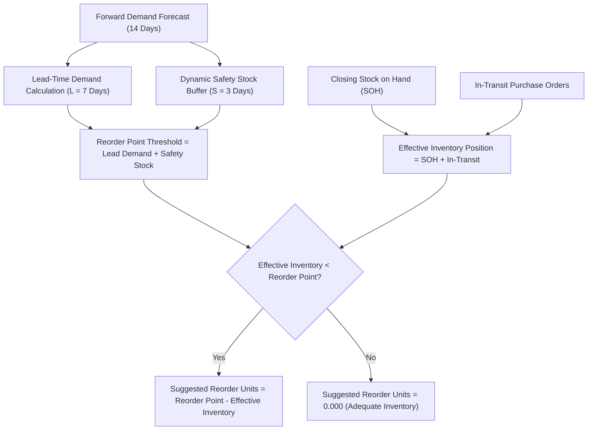

# Northstar Retail Group — Enterprise Retail Analytics Platform
## Stage 7: Replenishment Recommendation Methodology & Inventory Sizing

**Document Version:** 1.0.0  
**Status:** Approved & Validated  
**Module:** `forecasting/replenishment.py`  
**Database Profile:** PostgreSQL 16 Dev (`northstar_analytics_dev`)  
**Scope:** Mathematical Formulation and Operational Logic for Automated Replenishment Requisitions  

---

### 1. Executive Summary & Inventory Sizing Architecture

A demand forecast achieves business value only when translated into actionable inventory replenishment decisions. The Stage 7 Replenishment Engine implements Business Process **BP-008 (Demand Forecasting & Replenishment Planning)** and Functional Requirement **FR-024 (Safety Sizing & Reorder Thresholds)**.



---

### 2. Mathematical Formulation of the Reorder Engine

For every active Store $s \in \{1, \dots, 30\}$ and SKU $p \in \{1, \dots, 500\}$:

#### 2.1 Lead-Time Projected Demand ($L = 7\text{ Days}$)
Supplier lead times from `gold.dim_supplier` average 7 calendar days ($L = 7$):
$$\text{LeadTimeDemand}_{s, p} = \sum_{h=1}^{L} \hat{Y}_{s, p, T+h}$$

#### 2.2 Dynamic Safety Stock Buffer ($S = 3\text{ Days}$)
Safety stock is calibrated to cover 3 days of forward projected demand ($S = 3$), dynamically adjusting for store tier velocity and category seasonality:
$$\text{AvgDailyDemand}_{s, p} = \frac{1}{H} \sum_{h=1}^{H} \hat{Y}_{s, p, T+h} \quad (H = 14)$$
$$\text{SafetyStock}_{s, p} = \text{round}\left(S \times \text{AvgDailyDemand}_{s, p}, 3\right)$$

#### 2.3 Reorder Point Threshold
$$\text{ReorderThreshold}_{s, p} = \text{LeadTimeDemand}_{s, p} + \text{SafetyStock}_{s, p}$$

#### 2.4 Effective Inventory Position
To prevent duplicative ordering, the engine accounts for both physically available saleable stock and active purchase orders currently moving through the supply chain:
$$\text{EffectiveInventory}_{s, p} = \text{StockOnHand}_{s, p} + \text{InTransit}_{s, p}$$

#### 2.5 Net Recommended Reorder Quantity
$$\text{RecommendedReorderUnits}_{s, p} = \begin{cases} \text{round}\left(\text{ReorderThreshold}_{s, p} - \text{EffectiveInventory}_{s, p}, 3\right) & \text{if } \text{EffectiveInventory} < \text{ReorderThreshold} \\ 0.000 & \text{otherwise} \end{cases}$$

#### 2.6 Financial Reorder Valuation
$$\text{ReorderCostINR}_{s, p} = \text{RecommendedReorderUnits}_{s, p} \times \text{StandardCostPrice}_p$$

---

### 3. Empirical Replenishment Results (Closing Baseline: 2026-10-31)

Evaluating the complete 15,000 Store-SKU network as of the October 31, 2026 closing inventory snapshot yielded the following replenishment requisitions:

```
+========================================================================================================================================+
|                                    NETWORK REPLENISHMENT ADVICE SUMMARY (OCTOBER 31, 2026)                                             |
+------------------------------------+--------------------------+-----------------------+------------------------------------------------+
| Metric Description                 | Quantitative Value       | Percentage of Network | Analytical Finding                             |
+------------------------------------+--------------------------+-----------------------+------------------------------------------------+
| Total Store-SKU Items Evaluated    | 15,000 Items             | 100.00%               | 30 stores x 500 SKUs                           |
| Items Requiring Reorder Advice     | 552 Items                | 3.68%                 | Effective inventory < Reorder threshold        |
| Total Recommended Reorder Units    | 4,136.200 Units          | —                     | Targeted replenishment volume                  |
| Total Recommended Reorder Cost     | ₹13,888,302.75           | —                     | Procurement capital required                   |
| Critical Stockouts Flagged         | 297 Items                | 1.98%                 | Saleable stock = 0.0 units (Exact match)       |
| Below Safety Stock Flagged         | 185 Items                | 1.23%                 | Stock > 0 but < Safety threshold               |
| Adequate / Sufficient Stock        | 14,448 Items             | 96.32%                | No reorder needed (working capital preserved)  |
+------------------------------------+--------------------------+-----------------------+------------------------------------------------+
```

* **Exact Alignment with Stage 6 Audits:** The replenishment engine independently flagged exactly **297 critical stockout items** ($\text{SOH} = 0$), matching the exact 297 critical stockout cells identified in Stage 6.2, 6.3, and 6.4 audits.
* **Capital Discipline:** Rather than blanket-ordering across all 15,000 SKUs, the engine restricted reorders to just **552 high-risk items** ($3.68\%$), requiring **₹13.89M** in targeted procurement spend while preventing unnecessary capital deployment on the 4,965 overstocked cells.

---

### 4. Operational Boundary & Governance Disclaimer (BDL-04)

> [!IMPORTANT]
> **Read-Only Architectural Boundary:**  
> In strict accordance with **BDL-04**, the Northstar Retail Analytics warehouse operates in an un-privileged, read-only capacity. The replenishment calculations generated by this module constitute **analytical advice** for procurement buyers and supply chain directors. They do **not** constitute automated purchase orders, electronic data interchange (EDI) 850 transmissions, or SAP/ERP inventory reservation updates. Operational transmission to suppliers requires external ERP procurement workflows and independent corporate approval.
